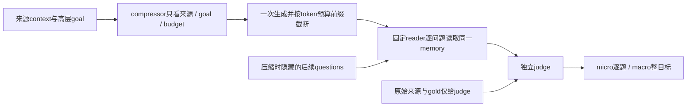
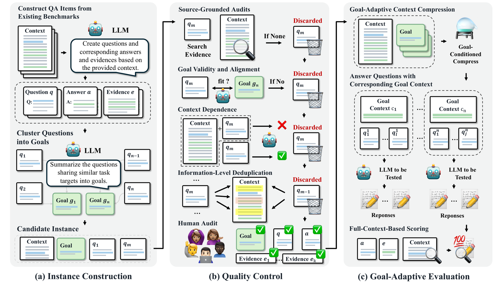

# GACC-Bench：目标压缩的未来问题隔离评测

> `evaluation_protocol_interface` / L1 CPU 合同诊断。接口可接真实 compressor、reader、judge 和 tokenizer；本轮仅固定 token-ID/规则 fixture，没有运行官方数据或 LLM，不声称实现了新的压缩模型。

## 论文信息

| 字段 | 内容 |
| --- | --- |
| 论文链接 | [GACC-Bench](https://arxiv.org/abs/2610.21893) |
| 公司/机构 | 一作 Weiting Liu，Fudan University；合作者包括 JD.com、HUST、HIT、HKUST(GZ)等 |
| 首次公开日期 | 2026-10-15，arXiv v1 13:51:56 UTC；10-16 公告补审 |
| 原文开源代码 | [官方代码/数据入口](https://github.com/weiting24/GACC-Bench)；本轮未确认完整复用许可证，须保留来源数据许可；[HF数据入口](https://huggingface.co/datasets/Regimes/GACC-Bench)本轮读取不可用 |
| 本地 Adapter | 无（`adapter: null`）；协议 key：`gacc-bench` |
| 本地复现代码 | `src/auto_research/agent_research/gacc_bench.py`；`scripts/run_oct17_supplement_agent.py` |

## 原始论文总结

### 背景与主要改动

长期上下文压缩常在具体后续问题尚未知时执行，但用户可能已给出高层目标。GACC-Bench 按 context–goal 组织多道后续问题，压缩器只能看到来源、目标和预算；固定 reader 用同一压缩记忆逐题回答，再由固定 judge 对照原文和参考答案评分，检验是否保全整组目标证据。



<!-- paper-figure:start -->
### 原论文关键图

[](https://arxiv.org/html/2610.21893v1/GACC-Bench.png)

> **原论文 Figure 3（关键图）**：展示原论文方法的总体设计和关键组成。图片来自[原论文](https://arxiv.org/abs/2610.21893)，版权归原作者所有；点击图片可查看来源。
<!-- paper-figure:end -->

### 核心公式

[原文 §3.3–4.1](https://arxiv.org/html/2610.21893v1)以 `cl100k_base` 为共同参考 tokenizer。给定来源 token 数 $N$ 和保留比例 $r$：

$$
L=\lfloor rN\rfloor,\qquad
M=decode(encode(compressor(C,g,L))[:L]).
$$

本地接口支持 $r=0$ 和短来源向下取整为零的边界：预算严格为 0，保留空 memory，不强制补一个 token。生成不足预算不 padding，超预算只保留前缀，不重生成。这是实际 reader 输入行为，不是把未使用预算计为填充成本；每行保留 proposed/retained/unused budget、re-encoded memory token 与零 padding 账本。每个 context–goal–budget 只生成一次记忆，所有关联问题复用。Micro 是所有问题的正确比例；Macro 不是逐目标正确率平均，而是 **每个目标的所有问题都正确** 的目标比例：

$$
Micro=\frac{\sum_g\sum_q c_{gq}}{\sum_g |Q_g|},\qquad
Macro=\frac{1}{|G|}\sum_g\prod_{q\in Q_g}c_{gq}.
$$

### 论文离线与线上效果

原文由七来源构建 281 contexts、500 goals、2,571 questions，比较十个 compressor；固定 DeepSeek-V4-Pro reader/judge 的 full-context 基线 Micro=99.38%、Macro=96.80%。压缩后仍有较大差距，Own-goal 通常优于 No-goal 和 Cross-goal。原文主结果是 API 模型协议结果，不是本地压缩成绩；未报告生产线上 A/B。

## 本地复现

```bash
PYTHONPATH=src python scripts/run_oct17_supplement_agent.py \
  --methods gacc-bench --device cpu --seeds 42,43,44 \
  --output runs/oct17-supplement-agent/gacc-bench.json
```

### 数据协议与 CPU 结果

每 seed 初始化两段小字符串来源、四个目标、12 个问题。规则 compressor 只挑目标所在行，规则 reader 只解析已保留字段，fixture judge 做精确比较；这三者不是 LLM。使用明确命名的 Unicode codepoint token-ID codec，**不是 `cl100k_base`，正式 tokenizer 实测次数为 0**。正式使用必须传入真实、固定版本 `cl100k_base` encode/decode callbacks，本轮不新增依赖或下载 tokenizer。接口只记录调用方声明的 tokenizer 身份，`identity_verified=false`；仅把名字写成 `cl100k_base` 不会被当成验证通过。

三 seed 均调用 compressor 四次，再读同 cache 时新调用数为 0；Micro=2/3、Macro=0，保留了每组最后字段被截断的失败。独立计数误差为 0，预算违例为 0，问题/gold 暴露给 compressor 为 0。见 [CPU 产物](metrics/component-cpu-seeds42-44.json)；这些值不能与原文表格比较。

### 代码映射、成本与边界

`CompressorInput` 仅有 context/goal/token_budget；`ReaderInput` 仅有 memory/question；参考答案只进入 `JudgeInput`。`evaluate` 检查来源 ID 一致、目标/问题身份，并在缓存键绑定来源/目标内容 hash、tokenizer revision 和 compressor revision，避免不同模型误用同一记忆。callbacks 是可信进程内协议，不是恶意代码沙箱。

没有下载官方全量数据，没有运行十模型、多 budget、固定 reader/judge 的长上下文 API 评测。其长来源、多问题和多模型调用总成本高，**成本过高，不复现（审查 DONE）**；数据入口不可访问和许可证未核验另保留为范围限制，不冒称官方 benchmark 已验证。接口不参与 Evolve 晋级，`diagnostic_only=true`。
