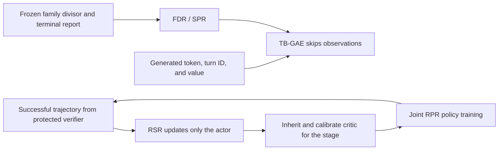
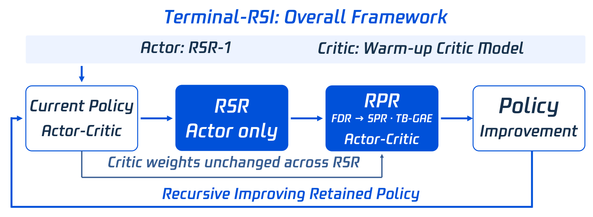

# Terminal-RSI: Credit Assignment on an Interaction Clock and Completion-First Rewards

<!-- source-sha256: 58c517c2805cbeadbe7f1b5cae04634c172ffb1ade964b5b0dbbd709c8831056 -->

[简体中文](README.md) · English

> `component_only` / L1 CPU numerical diagnostic. Runs only TB-GAE, exact chunk continuation, and FDR/SPR; no shell, terminal agent, or PPO training. Actual TB-GAE use in the paper's checkpoints has explicit unverified limits.

## Paper information

| Field | Details |
| --- | --- |
| Paper | [Terminal-RSI](https://arxiv.org/abs/2610.22192) |
| Affiliations | First author Junyao Yang, Tencent Hy Frontier / National University of Singapore; co-first authors Zongxia Li and Yucheng Shi. |
| First public release | 2026-10-15, arXiv v1 16:43:56 UTC; reviewed as a follow-up to the 10-16 announcement. |
| Authors' open-source code | The [project page](https://jyyang26.github.io/terminal-rsi/) still said Code soon / Model soon. No verifiable method code or license was released. |
| Local adapter | None (`adapter: null`); component key `terminal-rsi` |
| Local implementation | `src/auto_research/agent_research/terminal_rsi.py`; `scripts/run_oct17_supplement_agent.py` |

## Original paper summary

### Background and main changes

A terminal agent needs to learn reproducible behavior from successfully verified trajectories and assign sparse completion feedback to much earlier actions. Terminal-RSI alternates RSR trajectory rewriting with RPR that retains critic weights, calibrating the critic at the start of each stage. It proposes TB-GAE, which discounts on an interaction-turn clock rather than by observation text length, and uses family-calibrated FDR before switching to strictly completion-first SPR.



<!-- paper-figure:start -->
### Key figure from the paper

[](https://arxiv.org/html/2610.22192v1/terminal_rsi_overall_from_ppt.png)

> **Figure 2 from the paper:** Overall method design and key components. The figure comes from the [original paper](https://arxiv.org/abs/2610.22192), © the original authors. Select the image to see the source.
<!-- paper-figure:end -->

### Core equations

[Paper §§2.2–2.3](https://arxiv.org/html/2610.22192v1) recurse over generated tokens only. Within the same turn, $(\Gamma_j,\Lambda_j)=(1,1)$. Across turns, use $(\gamma_{turn},\lambda_{turn})$:

$$
\delta_j=\tilde r_j+\Gamma_j(1-d_j)v_{j+1}-v_j,\qquad
A_j=\delta_j+\Gamma_j\Lambda_j(1-d_j)A_{j+1}.
$$

Observations affect conditional values but are not recursion nodes. A computational chunk boundary is not environment termination. Exact continuation requires both $v_{j+1}$ and $A_{j+1}$; a value bootstrap alone loses the tail trace. Apply the reward once at the end of the rollout, not again in later chunks.

For a valid report, the paper freezes the family divisors and computes:

$$
R_{FDR}=P/D_f,\qquad R_{SPR}=S+\frac{P}{P+D'_f},\quad D_f,D'_f>0.
$$

Invalid reports fall back to the strict success flag $S$. FDR is unbounded. SPR scores failures below 1 and strict successes at least 1. This does not prove potential-based reward invariance or lower policy-gradient variance. The implementation prevents extreme floating-point rounding from pushing a failure score across 1.

### Reported offline and online results

The paper reports Terminal-Bench 2.1/3.0/4.0/Hard, LHTB, and SWR100 from Base to the end of five stages. The final TB4.0 and TB2.1 scores were 19.84% and 86.52%, respectively. These are the authors' model scores; no production online A/B test was reported. **§2.4 states that the first stage actually used standard GAE with γ=λ=1. Unit-clock equivalence does not prove deployment of TB-GAE or isolate its online benefit.** Recomputing a fixed trajectory cannot separate training effects of the reward, critic, and optimizer either.

## Local reproduction

```bash
PYTHONPATH=src python scripts/run_oct17_supplement_agent.py \
  --methods terminal-rsi --device cpu --seeds 42,43,44 \
  --output runs/oct17-supplement-agent/terminal-rsi.json
```

### Data protocol and CPU results

Each seed initializes 20 generated-token values over five turns with one terminal reward. Inserting 40 observations leaves the result unchanged. An independent double-sum expansion checks the recursion. The run splits at generated position 11 and passes complete continuation state. An intentionally incorrect implementation that zeros the tail advantage is a negative control. Family divisors are fitted only on independent synthetic calibration counts, not test targets.

Across three seeds, errors against the independent expansion were at floating-point rounding scale, about $10^{-16}$. Exact continuation and observation insertion errors were both 0. The mean maximum discrepancy of the incorrect zeroed-trace control was 0.654704. Mean failed-rollout FDR / SPR was 2.163216 / 0.683794, and strict-success SPR was 1.683794. These illustrate reward bounds, not task success rates. See the [CPU artifact](metrics/component-cpu-seeds42-44.json).

### Code mapping, cost, and limits

`tb_gae` corresponds to Eq. 8–12. `Continuation` explicitly carries value, advantage, and next turn. `FamilyDivisors` is immutable and defaults to 82 for an unknown family. `calibrate_family_divisors` uses a quantile with explicit linear interpolation. `reward` corresponds to Eq. 6/7. There is no actor/critic, real terminal rollout, RSR, distributed PPO, or official dataset.

The paper's Qwen3.8-27B, 256K context, multi-stage distributed training, 3,000 tasks, and long terminal environments are too expensive for one A100, A30, or Mac. **The full experiments were not reproduced (review complete)**. No CUDA receipt is fabricated for a numerical operator. There is no Evolve integration, and main-table gains are not attributed to local TB-GAE.
