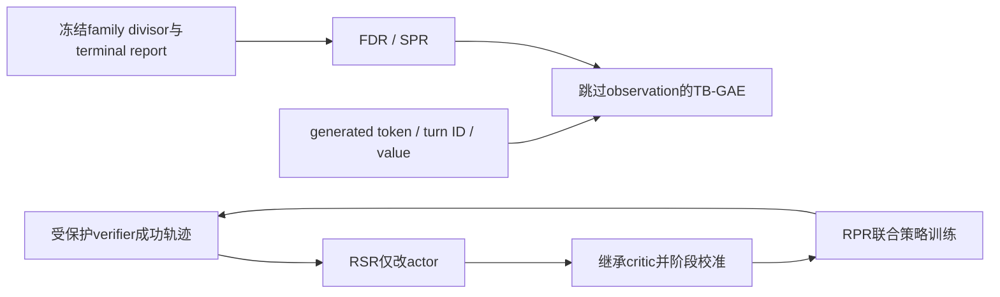
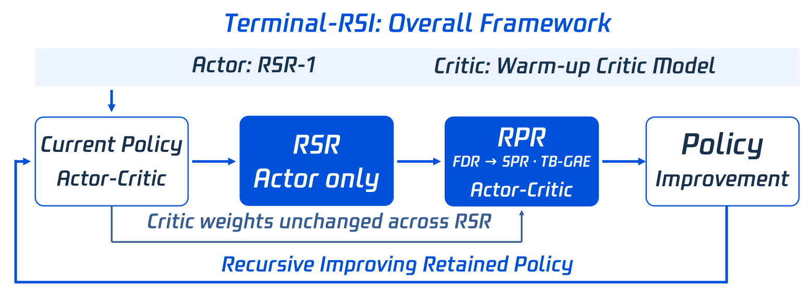

# Terminal-RSI：按交互时钟归因与完成优先奖励

> `component_only` / L1 CPU 数值诊断。只执行 TB-GAE、精确 chunk 续接和 FDR/SPR，不执行 shell、终端 Agent 或 PPO 训练。原文 TB-GAE 的 checkpoint 实际使用情况有明确未核实边界。

## 论文信息

| 字段 | 内容 |
| --- | --- |
| 论文链接 | [Terminal-RSI](https://arxiv.org/abs/2610.22192) |
| 公司/机构 | 一作 Junyao Yang，Tencent Hy Frontier / National University of Singapore；共同一作 Zongxia Li、Yucheng Shi |
| 首次公开日期 | 2026-10-15，arXiv v1 16:43:56 UTC；10-16 公告补审 |
| 原文开源代码 | [作者项目页](https://jyyang26.github.io/terminal-rsi/)仍标 Code soon / Model soon；未发布可核验方法代码/许可证 |
| 本地 Adapter | 无（`adapter: null`）；组件 key：`terminal-rsi` |
| 本地复现代码 | `src/auto_research/agent_research/terminal_rsi.py`；`scripts/run_oct17_supplement_agent.py` |

## 原始论文总结

### 背景与主要改动

终端 Agent 既要从验证成功的轨迹里学会可重现行为，也要把稀疏完成反馈传给很早的动作。Terminal-RSI 交替 RSR 轨迹改写和保留 critic 权重的 RPR，阶段开始时先校准 critic；提出 TB-GAE 用交互 turn 时钟而非 observation 文本长度衰减，并用 family 校准的 FDR 过渡到严格完成优先的 SPR。



<!-- paper-figure:start -->
### 原论文关键图

[](https://arxiv.org/html/2610.22192v1/terminal_rsi_overall_from_ppt.png)

> **原论文 Figure 2（关键图）**：展示原论文方法的总体设计和关键组成。图片来自[原论文](https://arxiv.org/abs/2610.22192)，版权归原作者所有；点击图片可查看来源。
<!-- paper-figure:end -->

### 核心公式

[原文 §2.2–2.3](https://arxiv.org/html/2610.22192v1)仅对 generated token 递推。相同 turn 中 $(\Gamma_j,\Lambda_j)=(1,1)$，跨 turn 为 $(\gamma_{turn},\lambda_{turn})$：

$$
\delta_j=\tilde r_j+\Gamma_j(1-d_j)v_{j+1}-v_j,\qquad
A_j=\delta_j+\Gamma_j\Lambda_j(1-d_j)A_{j+1}.
$$

Observation 只影响条件值，不是递推节点。计算分块不是环境终止；精确续接必须同时传 $v_{j+1}$ 和 $A_{j+1}$，只保留 value bootstrap 会丢失尾部 trace。奖励按 rollout 末端计入一次，不得跨 chunk 重复发放。

对有效报告，原文冻结 family divisor 后：

$$
R_{FDR}=P/D_f,\qquad R_{SPR}=S+\frac{P}{P+D'_f},\quad D_f,D'_f>0.
$$

报告无效时回退严格成功标志 $S$。FDR 没有上界；SPR 的失败分数小于 1、严格成功至少 1，不等于势函数不变奖励或降低策略梯度方差的证明。实现对极端浮点舍入保护失败分数不跨过 1。

### 论文离线与线上效果

原文报告从 Base 到五阶段终态的 Terminal-Bench 2.1/3.0/4.0/Hard、LHTB 和 SWR100；终态 TB4.0 为 19.84%、TB2.1 为 86.52%。这些是作者模型成绩，未报告生产线上 A/B。**§2.4 明确首阶段实际为标准 GAE、γ=λ=1；unit-clock 等价不证明 TB-GAE 已部署，也不隔离其在线收益。**固定轨迹重算同样不能分离奖励、critic 与优化器的训练效应。

## 本地复现

```bash
PYTHONPATH=src python scripts/run_oct17_supplement_agent.py \
  --methods terminal-rsi --device cpu --seeds 42,43,44 \
  --output runs/oct17-supplement-agent/terminal-rsi.json
```

### 数据协议与本轮 CPU 结果

每 seed 初始化 20 个 generated-token value，五个 turn、一个终端奖励；再插入 40 个 observation，核对结果不变。以独立二重求和展开核对递推，按生成位置 11 切块并传完整 continuation；另用清零尾部 advantage 的错误实现作负对照。Family divisor 只从独立合成 calibration count 拟合，不使用测试目标。

三 seed 的独立展开误差为浮点舍入量级（约 $10^{-16}$），完整续接和 observation 插入误差均为 0；错误清零 trace 的最大差异均值为 0.654704。失败 rollout 的 FDR / SPR 均值为 2.163216 / 0.683794，严格成功 SPR 为 1.683794，展示奖励边界而非任务成功率。见 [CPU 产物](metrics/component-cpu-seeds42-44.json)。

### 代码映射、成本与边界

`tb_gae` 对应 Eq.8–12；`Continuation` 显式携带 value、advantage 和 next turn；`FamilyDivisors` 不可变，未知 family 默认 82，`calibrate_family_divisors` 使用明确线性插值 quantile；`reward` 对应 Eq.6/7。没有 actor/critic、真实 terminal rollout、RSR、分布式 PPO 或官方数据。

原文 Qwen3.8-27B、256K、多阶段分布式训练、3,000 任务及长终端环境，对单 A100/A30/Mac 成本过高，**成本过高，不复现（审查 DONE）**。不为数值算子伪造 CUDA 收据，不进入 Evolve，不把主表提升归因于本地 TB-GAE。
