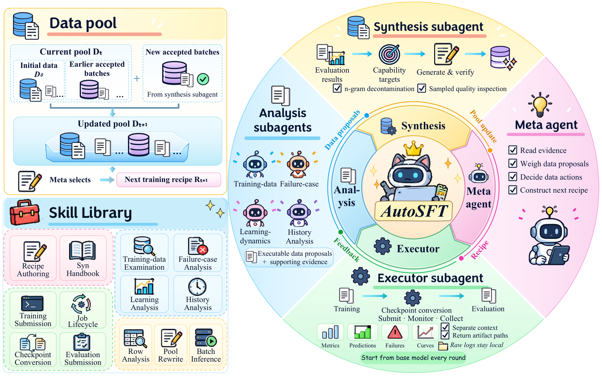

# AutoSFT: Automated data research under a fixed training contract

<!-- source-sha256: 13690aa171c879d50295fc095b55ff00d794c599e52bb02d84c01ccf628cce61 -->

[简体中文](README.md)

> Cost-deferred research reference. **The full experiment was reviewed and not reproduced because of cost.** No local model, controller fixture, fake adapter, or Evolve integration.

## Paper information

| Field | Details |
| --- | --- |
| Paper | [AutoSFT: An Agentic System for Automated Data Research in Supervised Fine-Tuning](https://arxiv.org/abs/2610.22194) |
| Company / institution | First author Bingxiang He, Tsinghua University; coauthors from BUPT, ModelBest, UIUC, CUHK, and others |
| First public release | 2026-10-15 16:44:34 UTC, arXiv v1. The cover is dated October 16; metadata uses v1. This entry is an announcement backfill. |
| Author code | [Thinking-Space/AutoSFT](https://github.com/Thinking-Space/AutoSFT) has only a README stating “Source code coming soon”; algorithm source has not been released. |
| Local adapter | None (`adapter: null`); reference key `auto-sft` |
| Local implementation | None. This page and `src/auto_research/paper_specs/catalog/agent-research/auto-sft.json` only, with no implementation claim. |

## Paper summary

### Background and main changes

One agent reading logs, analyzing failures, modifying data, and launching jobs can accumulate execution noise and end up changing only mixture proportions. AutoSFT separates a meta-agent, execution subagents, four analytical perspectives, and synthesis. Execution returns traceable artifacts only. Analysis proposes different interventions from data, failures, training signals, and research history. The meta-agent selects the next intervention. See [Sections 2–4](https://arxiv.org/html/2610.22194v1).

Interventions can rebalance categories, delete or repair data, replace answers, synthesize targeted samples, or change ordering. These six types are a retrospective classification, not a fixed action menu. Each round retrains from **the same base** under fixed model, trainer, and budget. Data pool, recipe, and research history carry over, not weights.

~~~mermaid
flowchart LR
    M[Meta-agent and research history] --> A[Data / failure / training / history analysis]
    A --> M
    M --> D[Revise recipe and preregister hypothesis]
    D --> E[Executor restarts SFT from fixed base]
    E --> V[Fixed evaluation contract and recorded artifacts]
    V --> M
    M --> S[Gap-targeted synthesis, separate validation, decontamination]
    S --> D
~~~

<!-- paper-figure:start -->
### Original paper figure

> **Paper Figure 1:** Meta, executor, analysis, and synthesis roles, shared data pool, and skills. Each round trains from the fixed base. The multi-agent training experiment was not reproduced locally. From the [original paper](https://arxiv.org/abs/2610.22194); copyright remains with the authors. Click the image to open its source.
<!-- paper-figure:end -->

### Fixed training contract

Let $M_0$ be the fixed base, $D_t$ be round $t$'s data and ordering, and $H_{<t}$ be preregistered hypotheses, proposals, and prior conclusions:

$$
a_t=\pi_{\mathrm{meta}}(D_{t-1},H_{<t}),\qquad
D_t=\mathrm{Apply}(D_{t-1},a_t),\qquad
M_t=\mathrm{SFT}(M_0,D_t;\text{fixed trainer and budget}).
$$

This is not continual training $M_t=\mathrm{SFT}(M_{t-1},D_t)$. Before training, register the intervention, comparison round, expected direction, and fine-grained evidence. Score changes and the appearance of mechanism evidence are evaluated separately; predictions are not rewritten afterward.

### Paper results, evaluation reuse, and limits

The authors report a best IFEval gain of +6.5 from analysis, then +3.4 IFEval / +2.9 IFBench from synthesis. Analysis raises MBPP+ by +3.7 over a single agent on coding. These are fixed-contract research runs, not local reproduction. The research analyzes evaluation failures and selects across rounds. Capability descriptions and n-gram checks avoid copying evaluation wording during synthesis, but decontamination does not eliminate all benchmark adaptation. External generalization needs a separate frozen holdout. No online production A/B is reported. See the [experiments and synthesis constraints](https://arxiv.org/html/2610.22194v1).

## Cost decision and local status

The paper uses Qwen3-1.7B-Base, Megatron-LM, and **8×H800**. A 20-round run takes about **130 GPU-hours**. Agents and synthesis cost about **USD 95 per round and USD 1,900 per run**. Execution subagents, independent semantic review, and retraining from the base are defining mechanisms, not replaceable by a few rules. See [Appendix D](https://arxiv.org/html/2610.22194v1).

No training/API campaign or weight or data download under the single A100/A30 or Mac budget. `implementation_status=deferred_high_cost`, `full_experiment_status=not_reproduced_high_cost`, `review_done=true`. Deferred is a reference status, not a TODO blocking the watermark. `diagnostic_only=true`, `promotion_eligible=false`, `evolve_integrated=false`.
