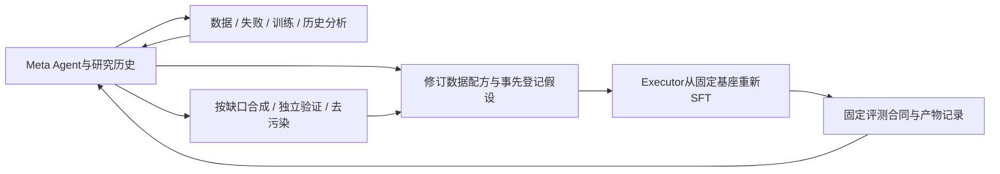
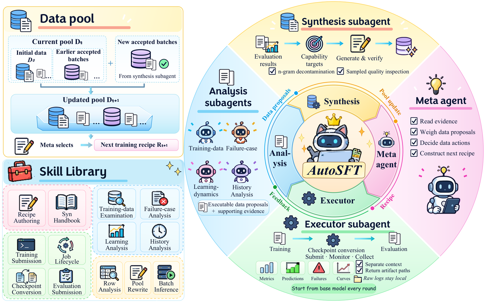

# AutoSFT：固定训练合同下的自动数据研究

> 高成本资料收录。**完整实验成本过高，不复现（审查 DONE）**；没有本地模型实现、控制器fixture、假 Adapter 或 evolve 接入。

## 论文信息

| 字段 | 内容 |
| --- | --- |
| 论文链接 | [AutoSFT: An Agentic System for Automated Data Research in Supervised Fine-Tuning](https://arxiv.org/abs/2610.22194) |
| 公司/机构 | 一作 Bingxiang He；Tsinghua University；共同作者来自BUPT、ModelBest、UIUC、CUHK等 |
| 首次公开日期 | 2026-10-15 16:44:34 UTC，arXiv v1；论文封面标10-16，元数据按v1记录；本次为公告补漏 |
| 原文开源代码 | [Thinking-Space/AutoSFT](https://github.com/Thinking-Space/AutoSFT)；目前仅README，写明 Source code coming soon，尚未公开算法源码 |
| 本地 Adapter | 无（`adapter: null`）；资料 key：`auto-sft` |
| 本地复现代码 | 无。本地只维护本页与 `src/auto_research/paper_specs/catalog/agent-research/auto-sft.json`，不宣称方法已实现 |

## 原始论文总结

### 背景与主要改动

自动后训练研究若让一个 Agent 同时读训练日志、分析失败、改数据、提交任务，可能在上下文中积累大量执行输出，最终只反复调整混合比例。AutoSFT 将 Meta Agent、执行子代理、四种分析视角与数据合成分开：执行侧只返回可追溯产物，分析侧从数据、失败、训练信号、研究历史提出不同方案，Meta Agent 决定下一轮的数据干预。[原文 §2–4](https://arxiv.org/html/2610.22194v1)

干预不局限于筛行或生成：可以调类别比例、删除、修复、替换回答、定向合成和调整顺序。这六类是作者对实际动作的事后归类，不是给分析Agent预设的固定菜单。论文每轮从**同一个基座**重新训练，固定模型、训练器与预算；跨轮延续的是数据池、配方和研究历史，不是上一轮权重。

<!-- paper-figure:start -->
### 原论文关键图

> **原论文 Figure 1（关键图）**：AutoSFT 的 meta、executor、analysis 与 synthesis 角色，及共享数据池和技能库；每轮从固定基座重新训练，完整多 Agent 训练实验未在本地复现。图片来自[原论文](https://arxiv.org/abs/2610.22194)，版权归原作者所有；点击图片可查看来源。
<!-- paper-figure:end -->

### 核心公式：固定训练合同的形式化

令 $M_0$ 为固定基座，$D_t$ 为第 $t$ 轮的数据和顺序，$H_{<t}$ 为事先假设、提案及历史结论：

$$
a_t=\pi_{\mathrm{meta}}(D_{t-1},H_{<t}),\qquad
D_t=\mathrm{Apply}(D_{t-1},a_t),\qquad
M_t=\mathrm{SFT}(M_0,D_t;\text{固定训练器与预算}).
$$

这不是 $M_t=\mathrm{SFT}(M_{t-1},D_t)$ 的连续训练。作者要求训练前登记要改什么、对照哪一轮、预期方向及细粒度证据；分数变化和机制证据是否出现分开判定，不能事后改写预测。

### 原文效果、评测复用与局限

作者报告增加分析带来最佳IFEval +6.5，合成再增IFEval +3.4 / IFBench +2.9，代码任务上分析比单代理增MBPP+ +3.7；这些来自固定合同下的逐轮研究运行，不能当成本地复现实测。研究使用评测失败分析和多轮最优选择，合成通过能力表述和n-gram检查避免直接照搬评测措辞，但去污染不等于完全消除对该评测的适配；独立外部泛化仍需另设冻结holdout。未报告生产线上 A/B。[论文实验及合成约束](https://arxiv.org/html/2610.22194v1)

## 成本决策与本地状态

原文配置 Qwen3-1.7B-Base、Megatron-LM、**8×H800**。一次20轮运行约 **130 GPU小时**；Agent与数据合成约 **95美元/轮、1900美元/次**。执行子代理、独立语义审查和每轮从基座训练都是定义机制的重要部分，不能删成几条规则后称为AutoSFT复现。[原文 Appendix D](https://arxiv.org/html/2610.22194v1)

对当前单A100/A30和Mac预算，本轮不尝试这套训练/API campaign，也不下载权重或数据。`implementation_status=deferred_high_cost`、`full_experiment_status=not_reproduced_high_cost`、`review_done=true`；这里的deferred字段是“资料状态”，不是仍阻塞审查水位的待办。`diagnostic_only=true`、`promotion_eligible=false`、`evolve_integrated=false`。
