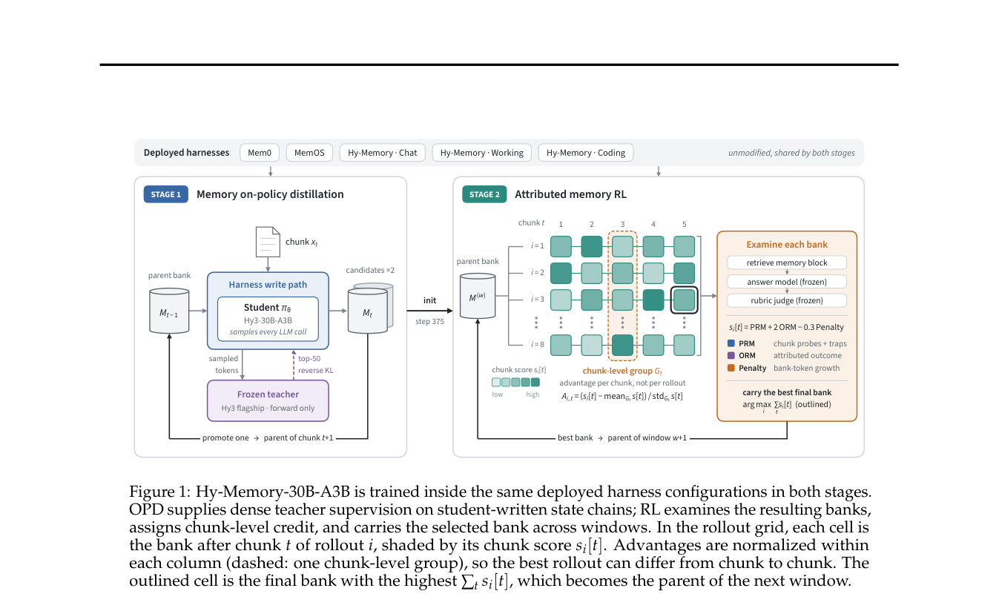

# Hy-Memory: Attribution-based reinforcement learning for long-term memory writing

<!-- source-sha256: b8f26c2364c70d55003d44aa450d19e84bda007c205fbbbed9011ecb0f5c4cf2 -->

[简体中文](README.md)

> **Research reference only; reviewed and not reproduced because of cost.** Published model and framework entry points do not mean the repository completed 30B memory training.

## Paper information

| Field | Details |
| --- | --- |
| Paper links | [arXiv 2610.22196](https://arxiv.org/abs/2610.22196); [pinned v1 full text](https://arxiv.org/html/2610.22196v1) |
| Company / institution | Tencent Hunyuan; first author Tianxiang Fei |
| First public release | 2026-10-15 16:46:47 UTC (arXiv v1; announced October 16) |
| Author code | [Hy-Memory framework](https://github.com/Tencent-Hunyuan/Hy-Memory), Apache-2.0; [checkpoint entry](https://huggingface.co/tencent/Hy-Memory-30B-A3B). Full training materials have not been confirmed public; model terms require separate review. |
| Local adapter / stable key | `hy-memory`, reference only, no executable adapter |
| Local implementation | None. This page and [catalog metadata](https://github.com/daiwk/auto-research/blob/main/src/auto_research/paper_specs/catalog/agent-research/hy-memory.json) only. |
| Review status | Full experiment not reproduced; review complete; no local GPU receipt |

## Paper summary

### Background and main changes

First use OPD on memory states written by the student to learn write protocols for different frameworks. Then freeze the reader and judge and optimize only the writer. Chunk-level probes supplement sparse rewards; cross-chunk factual attribution locates contributions; a growth penalty discourages storing everything.

### Architecture and data flow

~~~mermaid
flowchart TD
  B[Parent memory store] --> W[Writer rollout in isolated copy]
  W --> M[Candidate memory stores]
  M --> R[Frozen reader answers]
  R --> J[Frozen judge and fact attribution]
  J --> C[Per-chunk GRPO]
  J --> S[Choose final candidate memory store]
  S --> B
~~~

<!-- paper-figure:start -->
### Original paper figure

> **Paper Figure 1:** Overall method and main components. From the [original paper](https://arxiv.org/abs/2610.22196); copyright remains with the authors. Click the image to open its source.
<!-- paper-figure:end -->

### Core equation

Section 6 uses a current-chunk probe, attributed outcome, and growth penalty:

$$
s_i[t]=\mathrm{prm}_i[t]+2\mathrm{orm}_i[t]-0.3\mathrm{pen}_i[t],\qquad
A_{i,t}=\frac{s_i[t]-\mu_t}{\sigma_t+\epsilon}.
$$

Each rollout contributes once per chunk, not once per model call. Gold belongs only to the judge and is not passed to writer, reader, or retrieval queries.

### Offline and online results reported in the paper

The paper compares memory frameworks, including out-of-training EverMemOS, on a **fixed 20% benchmark subset**, not the full benchmarks. Differences after replacing writer, reader, and judge together cannot be attributed to writer training alone.

No online production A/B is reported. Releasing a model and framework does not establish user-traffic gains.

## Local reproduction

Reference only. Section 7 uses 30B-A3B, 128 H20s, and batches of 64 windows × eight rollouts. No model download, multi-framework RL, or service evaluation sweep. **Reviewed and not reproduced because of cost.**

## Reproduction limits

No executable adapter, training score, or Evolve promotion. Other memory operators are not a reproduction of this paper. See the [batch acceptance contract](../../research-audits/oct17-supplement/README.md).
