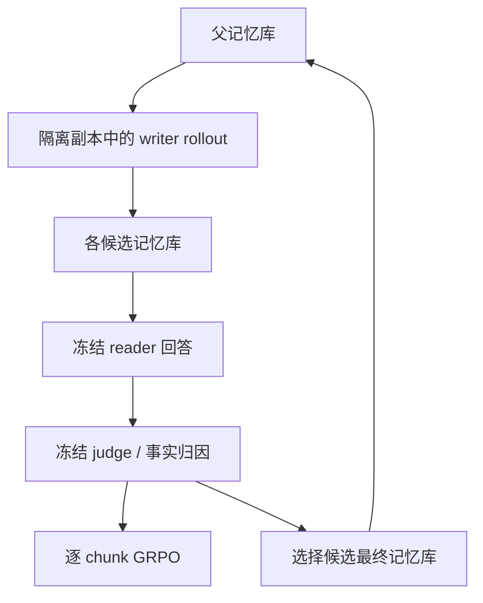
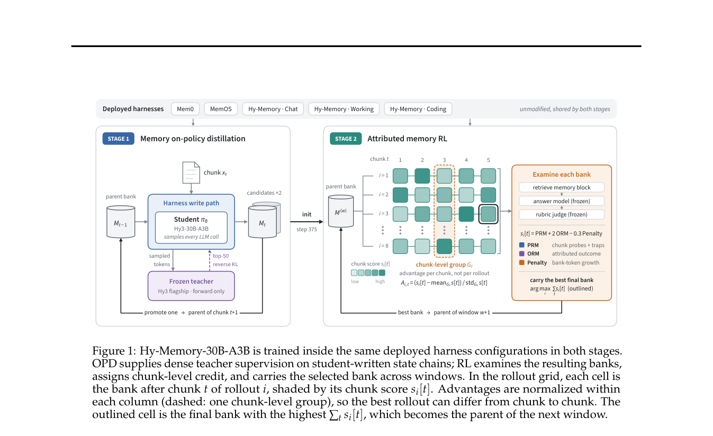

# Hy-Memory：面向长期记忆写入的归因强化学习

> **仅研究资料；成本过高，不复现（审查 DONE）。** 模型和框架入口不代表本库完成了30B记忆训练。

## 论文信息

| 字段 | 内容 |
| --- | --- |
| 论文链接 | [arXiv 2610.22196](https://arxiv.org/abs/2610.22196)；[固定 v1 全文](https://arxiv.org/html/2610.22196v1) |
| 公司 / 机构 | Tencent Hunyuan；一作 Tianxiang Fei |
| 首次公开日期 | 2026-10-15 16:46:47 UTC（arXiv v1；10-16 公告） |
| 原作者代码 | [Hy-Memory 框架](https://github.com/Tencent-Hunyuan/Hy-Memory)，Apache-2.0；[checkpoint 入口](https://huggingface.co/tencent/Hy-Memory-30B-A3B)。未确认完整训练材料均已公开；模型条款独立核验 |
| 本地 adapter / 稳定键 | `hy-memory`（资料键，无可执行 adapter） |
| 本地复现代码 | 无算法实现；仅本文及 [catalog 元数据](https://github.com/daiwk/auto-research/blob/main/src/auto_research/paper_specs/catalog/agent-research/hy-memory.json) |
| 验收状态 | 完整实验不复现 / 审查 DONE；无本地 GPU 通过回执 |

## 原始论文总结

### 背景与主要改动

先在学生自己写出的记忆状态上做 OPD，学习不同框架的写入协议；再冻结 reader 和 judge，单独优化 writer。逐块探针补足稀疏奖励，跨块事实归因定位贡献，存储增长惩罚防止“全部记住”。

### 架构与数据流

<!-- paper-figure:start -->
### 原论文关键图

> **原论文 Figure 1（关键图）**：展示原论文方法的总体设计和关键组成。图片来自[原论文](https://arxiv.org/abs/2610.22196)，版权归原作者所有；点击图片可查看来源。
<!-- paper-figure:end -->

### 核心公式

原文§6使用当前块探针、归因 outcome 与增长惩罚：

$$
s_i[t]=\mathrm{prm}_i[t]+2\mathrm{orm}_i[t]-0.3\mathrm{pen}_i[t],\qquad
A_{i,t}=\frac{s_i[t]-\mu_t}{\sigma_t+\epsilon}.
$$

每个 rollout 对同一 chunk 只投一票；不能按多次模型调用重复计权。Gold只供 judge，不进入 writer、reader 或检索查询。

### 论文离线与线上效果

原文比较多个记忆框架，包括训练外 EverMemOS，但结果来自**固定20% benchmark子集**，不是全量评测。不能把 writer、reader 和 judge 同时替换后的变化归因于写入训练。

生产线上 A/B：未报告；开源模型和框架发布不是用户流量收益证据。

## 本地复现

只做资料收录。§7配置为30B-A3B、128 H20，每批64 windows×8 rollouts；不下载模型、不启动多框架 RL 或服务扫评。**成本过高，不复现（审查 DONE）**。

## 复现边界

无可执行 adapter、训练分数或 Evolve 晋级；不把其他记忆算子当成本论文复现。范围见[本批验收合同](../../research-audits/oct17-supplement/README.md)。
