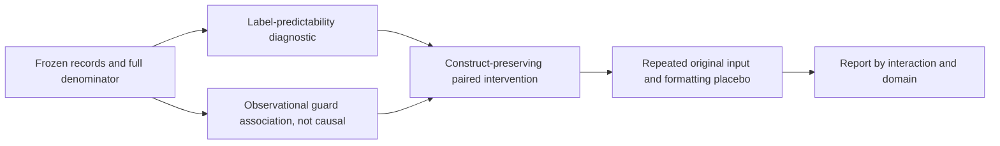
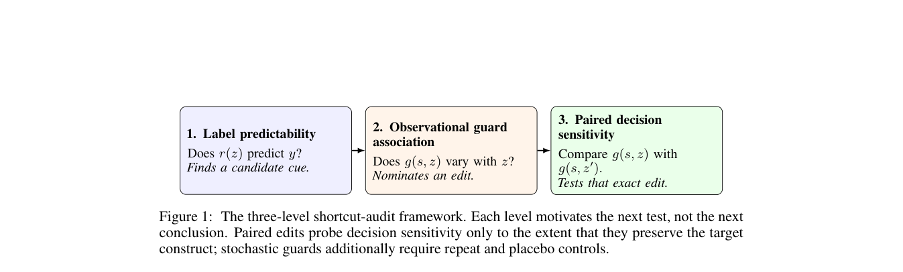

# Shortcut Sensitivity: Auditing Shortcuts and Statistical Units in Agent-Safety Evaluation

<!-- source-sha256: 295cfb06128226eddc4e91115c370eea48ea4e36dba1f2d4feb3316996f41f0e -->

[简体中文](README.md) · English

> The local status is `component_only`, a CPU mechanism diagnostic rather than a safety guard. Tool-name lookup reads labels **only to test benchmark-label predictability**. It is not evidence of agent capability, safety detection, or eligibility for Evolve promotion.

## Paper information

| Field | Details |
| --- | --- |
| Paper | [Shortcut Sensitivity in Agent-Safety Evaluations](https://arxiv.org/abs/2610.22243) |
| Affiliation | First author Hasan Demirkiran and collaborator Jens Ernstberger, both Kontext. |
| First public release | 2026-10-15, arXiv v1 17:18:05 UTC (10-16 01:18:05 Beijing time) |
| Authors' open-source code | [Public research code](https://github.com/hasandemirkiran/shortcut-sensitivity-agent-safety-evaluations/tree/07b4fbe9de731f76c19bda781888db5f4c6123e7), but `LICENSES.md` explicitly states there is no separate reuse license. That is not a standard open-source license. Local code is independent and does not copy code or original records. |
| Local adapter | None (`adapter: null`); component key `shortcut-sensitivity` |
| Local implementation | `src/auto_research/agent_research/shortcut_sensitivity.py`; `scripts/run_oct17_agent_components.py` |

## Original paper summary

### Background and main changes

Agent-safety evaluations can expose trajectory length, tool names, provenance markers, and repeated interactions. A high score may reflect construction artifacts rather than actual risk judgment. The paper uses a three-level inference ladder: first, whether cues predict labels; second, whether cues correlate with guard decisions; and third, whether a paired intervention that changes only the cue changes those decisions. Each level only motivates the next test; it does not establish that the model used a shortcut.



Original diagram: [Figure 1, three-level shortcut audit](https://arxiv.org/html/2610.22243v1#S2.F1).

<!-- paper-figure:start -->
### Key figure from the paper

[](https://arxiv.org/pdf/2610.22243#page=3)

> **Figure 1 from the paper:** Main architecture, modules, and connections. The figure comes from the [original paper](https://arxiv.org/abs/2610.22243), © the original authors. Select the image to see the source.
<!-- paper-figure:end -->

### Core equations

The tool-name lookup diagnostic uses the majority label in the **training fold**, breaks ties as unsafe, and uses the overall training-fold majority for an unseen tool. When holding out an entire domain, it predicts that domain without fitting the lookup to its labels.

Equal-interaction weights are $w_i=1/n_{g(i)}$, where $n_g$ counts steps in interaction $g$. Add $w_i$ to TP/TN/FP/FN before computing F1; do not compute F1 separately for each interaction and average it. Every interaction has the same total weight.

The paired effect of a stochastic guard is $\Delta_T=\frac1n\sum_i[\Pr(g(Tx_i)=1)-\Pr(g(x_i)=1)]$. Placebo correction is $\Delta_T-\Delta_{placebo}$. Unsigned flip rate is not signed effect, and disagreement on repeated original inputs cannot simply be subtracted from the effect.

### Reported offline and online results

AgentDojo tool-name lookup had mixed-domain F1 0.901 and domain-held-out F1 0.495. For the frozen TS-Guard on AgentHarm, row F1 was 0.902 and equal-interaction F1 was 0.719. Haiku's marker rewrite and tool alias changed blocking by -8.33 / +11.46 percentage points, respectively. Luna did not reproduce effects of comparable magnitude, so the result is configuration-dependent. No production online A/B test was reported.

## Local reproduction

### Data protocol and command

The run reads only four AgentDojo files, two AgentHarm files, and the frozen TS-Guard reference from ToolSafe revision `46358fa424a927a895c6c8322f99032c4eb5155e`, about 13.1 MB in total. Each file has a pinned byte count and SHA256 before download; both are rechecked before reading and symlinks are forbidden. JSON and ReAct text are inert data, never executed. Original text, parameters, and identifiers are not committed. Data license information is incomplete; caching does not grant redistribution rights.

```bash
PYTHONPATH=src python scripts/run_oct17_agent_components.py \
  --methods shortcut-sensitivity --device cpu --seeds 42,43,44 \
  --shortcut-cache .cache/oct17-agent-public/toolsafe --fetch-shortcut \
  --output runs/oct17-agent/shortcut-public.json
```

The paper's strict mapping treats `score==0` as safe and `score==0.5` or `score==1` as unsafe. Ambiguous rows are not excluded. The AgentHarm reference is aligned in the authors' stated `harmful_steps → benign_steps` order and checked against all 0/0.5/1 ordinal labels, not just prevalence. All 731 rows are retained. Missing predictions, infinite or unknown scores, and incorrect order are rejected. Parsing failures raise errors rather than dropping rows.

The fixed leave-one-domain-out (LODO) audit runs once. Seeds 42/43/44 only randomize mixed-domain cross-validation folds grouped by interaction; they are not three trained models or independent corpora. Changing the seed does not change the official fixed LODO result and cannot justify fabricating a confidence interval for it.

### Local CPU results

| Audit | Full denominator | Local recomputation |
| --- | ---: | ---: |
| AgentDojo domain-held-out lookup F1 | 1,220 rows / 4 domains | 0.495479 |
| Fraction of held-out tool names seen in other training domains | 1,220 rows | 0.172951 |
| AgentHarm frozen guard, row F1 | 731 rows | 0.901683 |
| Same frozen guard, equal-interaction F1 | 731 rows / 197 interactions | 0.719328 |
| Row / equal-interaction balanced accuracy | Same 731 rows | 0.754179 / 0.775686 |

The implementation and independent row-by-row reference disagreed on 0 LODO predictions. Dropped rows and model calls were both 0. This recomputes published predictions rather than scoring a new guard. All three CV splits produced 0.900875, not three independent capability experiments. See [CPU metrics](metrics/component-cpu-seeds42-44.json) for the full artifact.

### Code mapping and limits

- `leave_one_domain_out` / `grouped_lookup_cv` are diagnostics that explicitly depend on training-fold labels; the prediction function receives only held-out tool names.
- `evaluation_units` computes row-level and equal-interaction confusion matrices over the same rows. A missing class has recall `null` rather than fabricated balanced accuracy.
- `paired_sensitivity` only aggregates repeated decisions provided by the caller. It does not automatically claim construct preservation or call a paid guard.
- Internal model judgments, the full LinuxArena workflow, paired guard calls, and bootstrap were not independently rerun.

The full configuration includes 960 Haiku calls, the same repeated protocol for Luna, a seven-model screen, and model-guard comparisons. A single A100, A30, or Mac does not provide the corresponding API/multi-model budget, and total cost remains high. **The full experiments were not reproduced (review complete)**. This disposition does not block review. The completed low-cost work is a statistical audit component, not a reproduction of the paper's capabilities.
