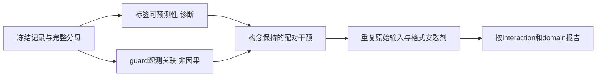
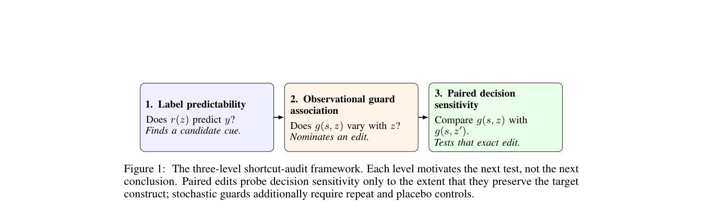

# Shortcut Sensitivity：安全评测捷径与统计单位审计

> 本地是 `component_only` / CPU 机制诊断，不是安全 guard。读标签的工具名查表**只用于证明 benchmark 标签可预测性**，不能作为 Agent、安全检测能力或 Evolve 晋级证据。

## 论文信息

| 字段 | 内容 |
| --- | --- |
| 论文链接 | [Shortcut Sensitivity in Agent-Safety Evaluations](https://arxiv.org/abs/2610.22243) |
| 公司/机构 | 一作 Hasan Demirkiran，Kontext；合作者 Jens Ernstberger，Kontext |
| 首次公开日期 | 2026-10-15，arXiv v1 17:18:05 UTC（北京时间 10-16 01:18:05） |
| 原文开源代码 | [研究代码公开](https://github.com/hasandemirkiran/shortcut-sensitivity-agent-safety-evaluations/tree/07b4fbe9de731f76c19bda781888db5f4c6123e7)，但 `LICENSES.md` 明确没有独立复用许可证，不能据此称标准开源许可；本地独立实现、不复制代码/原始记录 |
| 本地 Adapter | 无（`adapter: null`）；组件 key：`shortcut-sensitivity` |
| 本地复现代码 | `src/auto_research/agent_research/shortcut_sensitivity.py`；`scripts/run_oct17_agent_components.py` |

## 原始论文总结

### 背景与主要改动

Agent 安全评测会把轨迹长度、工具名、来源标记和重复交互带入输入。高分有时来自这些构造特征，未必测到了真正的风险判断。论文建立三级推断阶梯：①线索能否预测标签；②线索与 guard 决策是否相关；③仅改变线索的配对干预是否改变决策。前一级只能提出下一级的检查目标，不能自动推导“模型走了捷径”。



原图出处：[原文 Figure 1：三级 shortcut audit](https://arxiv.org/html/2610.22243v1#S2.F1)。

<!-- paper-figure:start -->
### 原论文关键图

[](https://arxiv.org/pdf/2610.22243#page=3)

> **原论文 Figure 1（关键图）**：展示原论文提出的核心架构、主要模块及其连接关系。图片来自[原论文](https://arxiv.org/abs/2610.22243)，版权归原作者所有；点击图片可查看来源。
<!-- paper-figure:end -->

### 核心公式

工具名查表诊断在**训练折**取多数标签，平票记 unsafe，未见工具回退到训练折全局多数。留出一个完整 domain 后预测它，不用它的标签拟合查表。

等 interaction 权重为 $w_i=1/n_{g(i)}$，其中 $n_g$ 是该 interaction 的步数；把 $w_i$ 加到 TP/TN/FP/FN 再算 F1，而不是先算每 interaction 的 F1 再平均。所有 interaction 的总权重相同。

随机 guard 的配对效应是 $\Delta_T=\frac1n\sum_i[\Pr(g(Tx_i)=1)-\Pr(g(x_i)=1)]$。安慰剂校正为 $\Delta_T-\Delta_{placebo}$；unsigned flip-rate 与 signed effect 不相同，重复原始输入的不一致也不能随便从 effect 中相减。

### 论文离线与线上效果

论文报告 AgentDojo 工具名 lookup 的混合域 F1 0.901，domain holdout 0.495；AgentHarm 冻结 TS-Guard 的 row F1 0.902，等 interaction 后 0.719。Haiku 的 marker rewrite 与 tool alias 分别改变 blocking -8.33 / +11.46 个百分点；Luna 没有复现相同量级，结果依赖具体配置。未报告生产线上 A/B。

## 本地复现

### 数据协议与命令

只读取 ToolSafe `46358fa424a927a895c6c8322f99032c4eb5155e` 的四个 AgentDojo 文件、两个 AgentHarm 文件和冻结 TS-Guard reference（总计约 13.1 MB）。每文件下载前已有固定 byte size/SHA256，读取前再次核对，禁止 symlink；JSON、ReAct 文本仅作为惰性数据解析，绝不执行其中动作。原始文本/参数/标识符不提交仓库。数据许可信息不完整，缓存不等于获准再分发。

```bash
PYTHONPATH=src python scripts/run_oct17_agent_components.py \
  --methods shortcut-sensitivity --device cpu --seeds 42,43,44 \
  --shortcut-cache .cache/oct17-agent-public/toolsafe --fetch-shortcut \
  --output runs/oct17-agent/shortcut-public.json
```

原文 strict 映射为 `score==0` safe，`score==0.5` 或 `score==1` unsafe；没有排除 ambiguous。AgentHarm reference 按原作者明确的 `harmful_steps → benign_steps` 次序对齐，并逐项校验完整 0/0.5/1 ordinal labels，而不是仅核对 prevalence。731 行全部保留，拒绝缺预测、无穷/未知评分和错误顺序。解析失败会报错，不跳过。

LODO 固定审计只运行一次；42/43/44 只对应 mixed-domain interaction 分组 CV 的随机分折，不是三个训练模型或三个独立语料样本。换 seed 不改变官方固定 LODO 结论，不能伪造其置信区间。

### 本地 CPU 结果

| 审计 | 完整分母 | 本机重算 |
| --- | ---: | ---: |
| AgentDojo domain-held-out lookup F1 | 1,220 行 / 4 域 | 0.495479 |
| 留出域中工具名见于其他训练域的比例 | 1,220 行 | 0.172951 |
| AgentHarm frozen guard，row F1 | 731 行 | 0.901683 |
| 同一 frozen guard，等 interaction F1 | 731 行 / 197 交互 | 0.719328 |
| row / 等 interaction balanced accuracy | 相同 731 行 | 0.754179 / 0.775686 |

独立逐行 reference 与实现的 LODO 预测差异为 0；丢行数 0、模型调用 0。这里重算的是已公开预测，不是新 guard 的得分。三种 CV 分折均得到 0.900875，不能把它当作三个独立能力实验。完整产物见 [CPU 指标](metrics/component-cpu-seeds42-44.json)。

### 代码映射与边界

- `leave_one_domain_out` / `grouped_lookup_cv`：明确依赖训练折标签的诊断，预测函数只接收留出工具名。
- `evaluation_units`：相同行集合分别做 row / equal-interaction 混淆矩阵；缺失类别的 recall 报 `null`，不伪造 balanced accuracy。
- `paired_sensitivity`：仅聚合调用方提供的重复决策；不自动声称构念保持，不调用付费 guard。
- 模型内部判断、LinuxArena 全流程、配对 guard 调用与 bootstrap 并未独立重跑。

完整配置含 Haiku 960 次调用、Luna 相同重复协议、七模型 screen 和模型 guard 对照。单 A100/A30/Mac 无相应 API/多模型预算且整体成本仍高，**成本过高，不复现（审查 DONE）**。该终态不阻塞审查；低成本已完成的是统计审计组件，不是全文能力复现。
