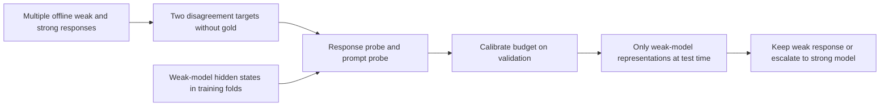
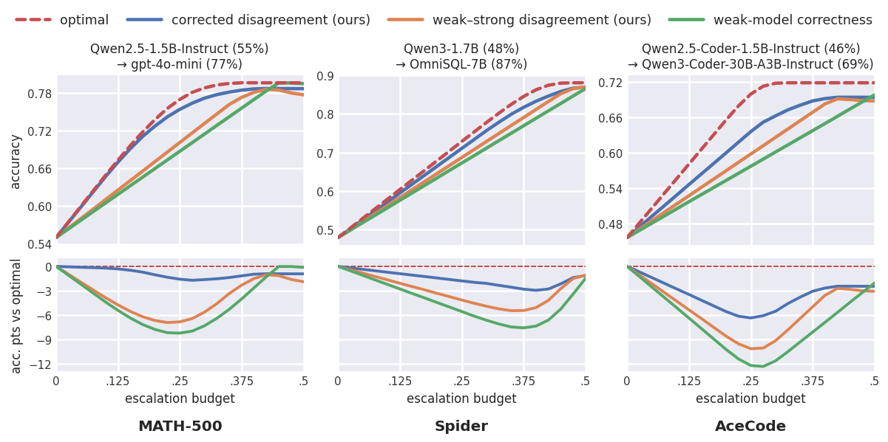

# Disagreement-Guided Routing: Weak-to-Strong Escalation without Correct-Answer Labels

<!-- source-sha256: 04239496a21cb8584b5ecdb822e45cfffc99a36fda7ae662e5afc2e0deac0056 -->

[简体中文](README.md) · English

> `component_only` / CPU diagnostic: implements target estimation, two genuinely fitted probes, and a validation-threshold contract. Synthetic representations are not LLM hidden states. Mechanism checks do not establish BFCL or WebShop capability gains; not included in Evolve.

## Paper information

| Field | Details |
| --- | --- |
| Paper | [Disagreement-Guided Weak-to-Strong Routing](https://arxiv.org/abs/2610.22245) |
| Affiliation | First author Sima Noorani and co-first author Shayan Kiyani; University of Pennsylvania. |
| First public release | 2026-10-15, arXiv v1 17:19:57 UTC (10-16 01:19:57 Beijing time) |
| Authors' open-source code | No runnable code released. The [official repository](https://github.com/nooranisima/disagreement-weak-to-strong-routing) had only a README marked Code coming soon. Appendix A.5 says configurations will be released after acceptance. |
| Local adapter | None (`adapter: null`); component key `disagreement-routing` |
| Local implementation | `src/auto_research/agent_research/disagreement_routing.py`; `scripts/run_oct17_agent_components.py` |

## Original paper summary

### Background and main changes

A weak model's likely error does not imply that a strong model can fix it. The paper subtracts the strong model's own disagreement from weak–strong disagreement to estimate the benefit of escalation. Offline it only needs equivalence comparisons between answers or actions, not judgments about which answer is correct. At test time it uses weak-model representations and two lightweight probes. The strong model is called only when the router escalates.



Original diagram: [Figure 1 from the paper](https://arxiv.org/html/2610.22245v1#S4.F1).

<!-- paper-figure:start -->
### Key figure from the paper

[](https://arxiv.org/html/2610.22245v1/population-plots-main-all3Datasets.png)

> **Figure 1 from the paper:** Accuracy–routing-budget curves for three benchmarks and their gaps to optimal routing. These are paper results, not local synthetic-probe capabilities. The figure comes from the [original paper](https://arxiv.org/abs/2610.22245), © the original authors. Select the image to see the source.
<!-- paper-figure:end -->

### Core equations

For each weak response, $\widehat d_i=K_s^{-1}\sum_k A(y_{w,i},y_{s,k})$. The strong model's self-disagreement uses ordered pairs with **distinct sample indices**:

$$
\widehat g=\frac{1}{K_s(K_s-1)}\sum_{k\ne k'} A(y_{s,k},y_{s,k'}).
$$

Diagonal self-pairs are not independent samples; the denominator is not $K_s^2$. Local `empirical_targets` accepts no correct answer. It defaults to exact response inequality and can use a caller-provided safe equivalence function for parsed actions.

The two soft BCE training targets are $f_d(h(p,y_w))\to\widehat d_i$ and $f_g(h(p))\to\widehat g$. The corrected score is

$$
\widehat S_{CD}=\min_i f_d(p,y_{w,i})-f_g(p).
$$

Scores can be negative and must not be clipped to [0,1]. Escalate when $\widehat S_{CD}>\tau$, with $\tau\ge0$ calibrated only on validation. At a tied boundary, route conservatively below the budget rather than randomly crossing the boundary to meet a quota. Test-distribution changes may alter actual routing rates; the target is not a hard test quota.

### Reported offline and online results

The paper covers BFCL Multi-Turn, WebShop, MATH-500, Spider, and AceCode. In Appendix A.4's WebShop table for **200 evaluation tasks**, at about 40% routing budget, corrected disagreement has success rate 0.460 and raw disagreement 0.260. This table does not share a denominator with the different full task set in the main paper. No production online A/B test was reported. These are paper results, not local new-model measurements.

## Local reproduction

### Data protocol and execution

Each seed generates 128 independent synthetic prompt vectors: 80 train, 24 validation, and 24 test. Each prompt has two weak responses and 12 strong-response samples. Response representations use synthetic context and candidate encodings, while prompt representations use synthetic context only. These are not checkpoint hidden states and do not establish language ability. Only training data constructs targets and fits the probes. Standardization means and variances do not use validation or test data.

```bash
PYTHONPATH=src python scripts/run_oct17_agent_components.py \
  --methods disagreement-routing --device cpu --seeds 42,43,44 \
  --output runs/oct17-agent/disagreement-cpu.json
```

`fit_probability_probe` runs 200 actual Adam updates with soft-target BCE in NumPy rather than returning targets from a lookup table. For each seed a negative control trains on shuffled targets. An independent Counter implementation verifies every d/g target. No gold answers enter target construction, probes, inference, or threshold calibration. There is no model answer API to bypass.

### CPU mechanism results (42/43/44)

| Metric | Mean |
| --- | ---: |
| Response-probe training BCE, initial → final | 0.693459 → 0.634277 |
| Prompt-probe training BCE, initial → final | 0.693484 → 0.685691 |
| Maximum error against independent target reference | 1.11e-16 |
| Validation routing rate | 0.250000 |
| Actual test routing rate | 0.305556 |
| Held-out predicted-score MAE | 0.276911 |
| Prompt-probe test MAE, normal / shuffled targets | 0.153005 / 0.165937 |

Test-distribution drift and substantial score MAE are retained. Falling training loss does not establish improved routing capability. Benchmark task success was not computed. The [CPU metrics](metrics/component-cpu-seeds42-44.json) contain full statistics, seeds, and source hashes.

### Code mapping and limits

`empirical_targets` corresponds to Eq. 9/10, `corrected_score` to Eq. 11, and `ProbabilityProbe` to the soft-BCE interface. `calibrate_budget` explicitly rejects `split="test"`. Inference through `DisagreementRouter.scores` accepts only prompt and response representations, not strong-model samples or answer labels.

There is no real weak-model hidden-state extraction, online generation, multi-turn DAgger-style agent data aggregation, real SQL/code environment, or full official benchmark suite. The complete experiments with an 8B weak model, several strong models, K=10 per step, thousands of WebShop tasks, and long rollouts over multiple budgets exceed one A100, A30, or Mac. **They were not reproduced (review complete)**. These omissions are closed rather than queued for automatic retry, and low-cost fixtures do not stand in for the full method.
