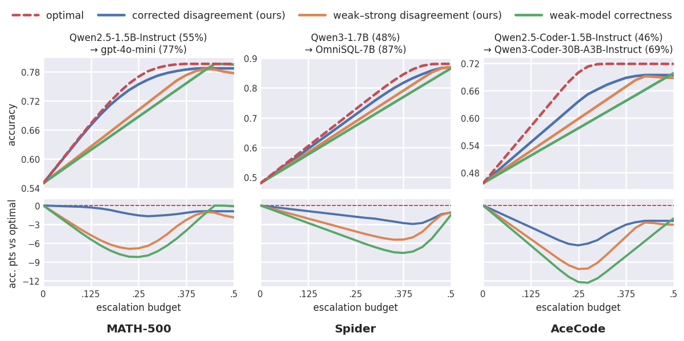

# Disagreement-Guided Routing：无正确答案标签的弱到强路由

> `component_only` / CPU 诊断：实现论文目标估计、两个真实拟合的 probe 和 validation 阈值合同。合成表示不是 LLM hidden state，不把机制检查写成 BFCL/WebShop 能力提升；不进入 Evolve。

## 论文信息

| 字段 | 内容 |
| --- | --- |
| 论文链接 | [Disagreement-Guided Weak-to-Strong Routing](https://arxiv.org/abs/2610.22245) |
| 公司/机构 | 一作 Sima Noorani、共同一作 Shayan Kiyani；University of Pennsylvania |
| 首次公开日期 | 2026-10-15，arXiv v1 17:19:57 UTC（北京时间 10-16 01:19:57） |
| 原文开源代码 | 尚未发布可运行代码；[官方仓库](https://github.com/nooranisima/disagreement-weak-to-strong-routing)当前只有 README，标注 Code coming soon；原文 A.5 说待接收后发布配置 |
| 本地 Adapter | 无（`adapter: null`）；组件 key：`disagreement-routing` |
| 本地复现代码 | `src/auto_research/agent_research/disagreement_routing.py`；`scripts/run_oct17_agent_components.py` |

## 原始论文总结

### 背景与主要改动

“弱模型可能答错”不等于“强模型能补救”。原文用弱强分歧减去强模型自身分歧，估计升级调用的增益。离线只需对模型回答/动作做等价性比较，不需要判断哪个回答正确；测试时仅运行弱模型的表示和两个轻量 probe，路由决定升级时才查询强模型。


原图出处：[原论文 Figure 1](https://arxiv.org/html/2610.22245v1#S4.F1)。

<!-- paper-figure:start -->
### 原论文关键图

[](https://arxiv.org/html/2610.22245v1/population-plots-main-all3Datasets.png)

> **原论文 Figure 1（关键图）**：三个 benchmark 的准确率—路由预算曲线及其与最优路由的差距；这是原论文结果，不是本地合成探针能力。图片来自[原论文](https://arxiv.org/abs/2610.22245)，版权归原作者所有；点击图片可查看来源。
<!-- paper-figure:end -->

### 核心公式

对每个弱响应，$\widehat d_i=K_s^{-1}\sum_k A(y_{w,i},y_{s,k})$。强模型自身分歧用 **不同采样索引**的有序配对：

$$
\widehat g=\frac{1}{K_s(K_s-1)}\sum_{k\ne k'} A(y_{s,k},y_{s,k'}).
$$

不能把对角 self-pairs 当独立强模型样本，分母也不是 $K_s^2$。本地 `empirical_targets` 不接收正确答案，默认按响应精确不相等，也允许调用方提供安全的已解析动作等价函数。

两个软 BCE 训练目标为 $f_d(h(p,y_w))\to\widehat d_i$、$f_g(h(p))\to\widehat g$。论文校正分数为

$$
\widehat S_{CD}=\min_i f_d(p,y_{w,i})-f_g(p).
$$

分数可以为负，不能裁成 [0,1]。路由取 $\widehat S_{CD}>\tau$，$\tau\ge0$ 仅从 validation 校准；有相同分数的边界时保守少路由，避免为了凑配额随机越界。测试分布变化会使实际路由率变化，不承诺测试硬配额。

### 论文离线与线上效果

原文覆盖 BFCL Multi-Turn、WebShop、MATH-500、Spider 和 AceCode。附录 A.4 的 **200 evaluation task** WebShop 表：约 40% 路由预算下 corrected disagreement 成功率 0.460，raw disagreement 0.260；此表不能与正文另一个完整任务集合混成同一分母。未报告生产线上 A/B。这些均为原文结果，不是本地新模型测量。

## 本地复现

### 数据协议与操作

每 seed 生成 128 个独立合成 prompt-vector，80 train / 24 validation / 24 test；每 prompt 两个弱响应、12 个强响应采样。response 表示为合成 context 与候选编码，prompt 表示仅合成 context。它们不是 checkpoint hidden states，也没有声称语言能力。只有 train 数据构造目标并优化；标准化均值/方差不读 validation 或 test。

```bash
PYTHONPATH=src python scripts/run_oct17_agent_components.py \
  --methods disagreement-routing --device cpu --seeds 42,43,44 \
  --output runs/oct17-agent/disagreement-cpu.json
```

`fit_probability_probe` 用 NumPy 执行 200 次真实 Adam / soft-target BCE 更新，不是直接返回目标的查表。相同 seed 另训打乱 train 目标的负对照；独立 Counter 实现核对全部 d/g 目标。无 gold 答案进入目标构造、probe、推理或阈值校准；不存在需要绕过的模型回答 API。

### CPU 机制结果（42/43/44）

| 指标 | 均值 |
| --- | ---: |
| Response-probe train BCE，初始 → 最终 | 0.693459 → 0.634277 |
| Prompt-probe train BCE，初始 → 最终 | 0.693484 → 0.685691 |
| 与独立目标 reference 的最大误差 | 1.11e-16 |
| Validation 路由率 | 0.250000 |
| Test 实际路由率 | 0.305556 |
| Held-out 预测 score MAE | 0.276911 |
| Prompt-probe test MAE，正常 / 打乱目标 | 0.153005 / 0.165937 |

保留 test 分布漂移和较大 score MAE，不能根据 train loss 下降宣称路由能力提高。这里没有计算基准任务成功率。完整统计、seed 和 source hashes 见 [CPU 指标](metrics/component-cpu-seeds42-44.json)。

### 代码映射与边界

`empirical_targets` 对应原文 Eq.9/10，`corrected_score` 对应 Eq.11，`ProbabilityProbe` 对应 soft BCE 接口；`calibrate_budget` 明确拒绝 `split="test"`。推理 `DisagreementRouter.scores` 只接受 prompt/response 表示，不接受强模型样本或答案标签。

没有实现真实弱模型 hidden-state 抽取、在线生成、Agent 多轮 DAgger 式数据聚合、真实 SQL/代码环境或官方全部基准。完整 8B 弱模型、多个强模型、每步 K=10、WebShop 数千任务和多预算长 rollout 在单 A100/A30/Mac 下成本过高，**成本过高，不复现（审查 DONE）**。这些缺失明确关闭，不留自动重试队列，不以低成本 fixture 冒充全文方法。
