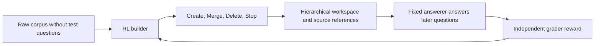
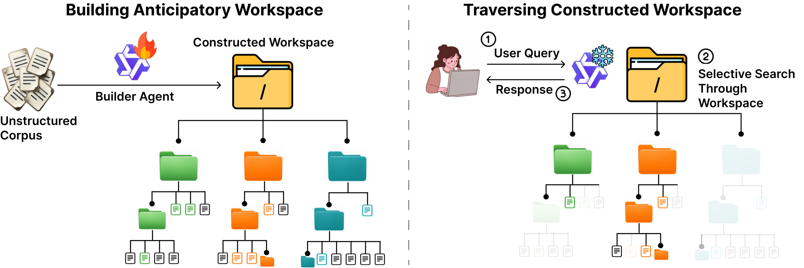

# Librarian Agents: Workspaces That Anticipate Future Queries and Recomputed Public Results

<!-- source-sha256: ad32dec9a3d6778b96dabc8a861d6c0a267bfb8604c83a597f5c5041349cd9e3 -->

[简体中文](README.md) · English

> The local status is `evaluation_protocol_interface`: a real filesystem/provenance contract and CPU recomputation from official compact score records. No RL builder was trained, and static summaries do not stand in for the paper's core model. `adapter: null`, diagnostic only, not eligible for Evolve promotion.

## Paper information

| Field | Details |
| --- | --- |
| Paper | [Librarian Agents: Training LLMs to Curate Long-Context Workspaces that Anticipate Future Queries](https://arxiv.org/abs/2610.22273) |
| Affiliations | First author Anikait Singh and co-first authors Teresa Zhang and Yoonho Lee, all Stanford University; collaboration with CMU. |
| First public release | 2026-10-15, arXiv v1 17:35:17 UTC (10-16 01:35:17 Beijing time) |
| Authors' open-source code | [Official code](https://github.com/teresaz05/librarian-agents/tree/455ac88c81c639c10a8404464dabf71a7fbb563e), MIT. Appendix A.11 states CC-BY-4.0 for results and synthetic artifacts. |
| Local adapter | None (`adapter: null`); local key `librarian-agents` |
| Local implementation | `src/auto_research/agent_research/librarian_agents.py`; `scripts/run_librarian_agents.py` |

## Original paper summary

### Background and main changes

Conventional RAG retrieves after each query, repeatedly exploring cross-document relationships. Before seeing evaluation questions, Librarian's trainable builder organizes the raw corpus into a reusable hierarchical filesystem. A fixed answerer later navigates it and can follow provenance back to the raw documents. CreateFile, MergeFiles, Delete, and Stop form a finite-horizon MDP. Delete can never remove raw documents.



<!-- paper-figure:start -->
### Key figure from the paper

[](https://arxiv.org/html/2610.22273v1#S1.F1)

> Figure 1 shows constructing a workspace ahead of time and reusing it. The figure comes from the [original paper](https://arxiv.org/html/2610.22273v1), © the original authors. The asset is `teaser_v2_workspace.png` from the official v1.
<!-- paper-figure:end -->

### Core equations

$S(\mathcal F)=\mathbb E_{q,\tilde y}[\mathrm{Acc}(\tilde y,y^*(q))]$ and general utility $U(\mathcal F)=S(\mathcal F)-\lambda_{tok}C_{tok}-\lambda_{read}C_{read}$. Navigation penalties are weighted by correctness; an incorrect answer has zero utility. The sparse objective is $r=U(\mathcal F_H)-\alpha\sum_t\mathrm{Cost}_{build}(\mathcal A_t)$. The main training runs actually set $\alpha=\lambda_{tok}=\lambda_{read}=0,\gamma=1$, probe the answerability delta every 8 builder turns, and add terminal correctness reward. The general cost formula does not mean the main runs used cost shaping.

Reuse cost is $T_m(q)=B_m/q+A_m$ and its quality-normalized form is $T_m(q)/p_m$. Report raw tokens and full-denominator accuracy together; fewer tokens alone do not establish improvement.

### Reported offline and online results

The paper reports gains over the strongest baseline of 33 percentage points on main BrowseComp-Plus and 31 points on average across BRIGHT domains. These are paper results, not new local model scores. In the appendix's 443-question reuse protocol, Base scores 107/443 and RL 282/443. Do not conflate this with the main figure's 50 questions or the separate 178,926 construction-token protocol. No production online A/B test was reported.

## Local reproduction

### Data protocol and pinned sources

Official revision `455ac88c81c639c10a8404464dabf71a7fbb563e`. The [compact corpus records](validation/upstream/browsecomp_per_corpus.jsonl) preserve `results/browsecomp_per_corpus.jsonl` unchanged, SHA256 `3417da0c54a4b16e182ef148e79b70e2622689a9cc0c690c928e4ce0b3837cb4`. Code uses the MIT [LICENSE](validation/upstream/LICENSE); results are attributed under CC-BY-4.0 per Appendix A.11. The authors' scripts were not executed locally.

Both arms contain exactly the same 50 corpora and 443 expected questions. `max_token_capped_failure` retains the corpus's whole question denominator with zero correct. Answerer/judge/infrastructure errors, duplicate corpora, missing arms, and non-finite metrics are rejected. Per-corpus question counts must match between arms. The paired corpus bootstrap uses 10,000 resamples: resample 50 corpora and sum questions within the sample to compute micro accuracy rather than treating questions as independent bootstrap units.

```bash
PYTHONPATH=src python scripts/run_librarian_agents.py \
  --records docs/agent-research/2610.22273-librarian-agents/validation/upstream/browsecomp_per_corpus.jsonl \
  --resamples 10000 --seed 19105 --output runs/librarian-agents/official-reuse-cpu.json
```

### CPU recomputation results

| Metric | Base | Librarian RL |
| --- | ---: | ---: |
| Correct / full question denominator | 107/443 | 282/443 |
| Accuracy | 24.1535% | 63.6569% |
| Corpus-bootstrap SE | 3.5545 percentage points | 2.9456 percentage points |
| Capped-failure corpora | 14/50 | 0/50 |
| Builder tokens/corpus | 126,012.2 | 147,633.7 |

The paired accuracy difference is 39.5034 percentage points, 95% CI [31.4732, 47.7480]. The ratio of correct answers per builder token is 2.2495, CI [1.7530, 3.0101]. At ten queries, the tokens-per-expected-correct ratio is 0.661957, CI [0.504052, 0.836325]. The crossover is 31 queries/corpus, CI [18, 54]. These are recomputed from frozen official records, not new training or a new answerer. Statistical seed 19105 is not an independent training seed. See [CPU metrics](metrics/official-reuse-cpu.json) for the full cost curve and actual command.

### Filesystem contract and code mapping

`Workspace` creates `raw_docs/`, `synthetic_fs/`, and `history/` on disk. Create takes explicit source IDs and invokes the caller's content executor. Merge nests real child directories beneath a synthetic parent. Delete archives only synthetic nodes, promotes children, and preserves historical provenance and raw fallback. Nodes track direct sources and transitive raw-source sets. Checks cover raw-document hashes, path safety, and symlink escape. Stop saves JSON data. A cold load verifies hashes, hierarchy, and on-disk contents, never using `eval` or executing serialized code.

The interface has no future-query or gold-answer parameter. The unit-test executor only concatenates raw documents; it is a **filesystem-contract fixture**, not a learned builder or a reproduction of paper capabilities. `recompute_records` only recomputes frozen scores and token counts. There is no new-model navigation experiment on complete author workspace snapshots, full BRIGHT baseline rerun, checkpoint selection, training, or Evolve integration.

Cost decision: the Qwen3.5-4B builder and Qwen3.5-35B-A3B executor use 680 tasks, 10 epochs, batch 8/group 4, up to 60k tokens per trajectory, and Tinker/Modal/Gemini services. That is above the budget of one A100, A30, or Mac with no API/training budget. **The full experiments were not reproduced (review complete)**. `full_experiment_status: not_reproduced_high_cost` closes the full RL and model pipeline, not the completed bounded audit of public results.
