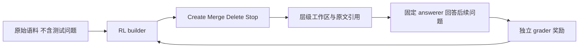
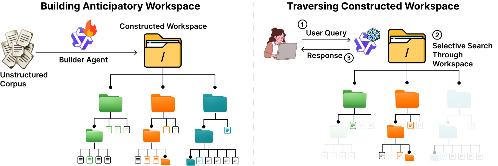

# Librarian Agents：预见未来查询的工作区与公开结果复算

> 本地为 `evaluation_protocol_interface`：真实文件系统/provenance 合同与官方 compact score records 的 CPU 复算。没有训练 RL builder，没有以静态摘要替代论文核心模型；`adapter: null`，仅诊断，不允许 Evolve 晋级。

## 论文信息

| 字段 | 内容 |
| --- | --- |
| 论文链接 | [Librarian Agents: Training LLMs to Curate Long-Context Workspaces that Anticipate Future Queries](https://arxiv.org/abs/2610.22273) |
| 公司/机构 | 一作 Anikait Singh；共同一作 Teresa Zhang、Yoonho Lee，均 Stanford University；CMU 合作 |
| 首次公开日期 | 2026-10-15，arXiv v1 17:35:17 UTC（北京时间 10-16 01:35:17） |
| 原文开源代码 | [已发布官方代码](https://github.com/teresaz05/librarian-agents/tree/455ac88c81c639c10a8404464dabf71a7fbb563e)，MIT；论文 A.11 对结果/合成产物声明 CC-BY-4.0 |
| 本地 Adapter | 无（`adapter: null`）；本地 key：`librarian-agents` |
| 本地复现代码 | `src/auto_research/agent_research/librarian_agents.py`；`scripts/run_librarian_agents.py` |

## 原始论文总结

### 背景与主要改动

常规 RAG 每次查询后才检索，重复探索跨文档关系。Librarian 在还未看到评测问题时，由可学习 builder 把原始语料组织成可复用层级文件系统；固定 answerer 后续导航，必要时沿 provenance 回退到 raw docs。CreateFile、MergeFiles、Delete、Stop 形成有限 horizon MDP，Delete 永远不能删原文。



<!-- paper-figure:start -->
### 原论文关键图

[](https://arxiv.org/html/2610.22273v1#S1.F1)

> Figure 1，提前构建工作区后重复利用。图片来自[原论文](https://arxiv.org/html/2610.22273v1)，版权归原作者所有；图像为官方 v1 的 `teaser_v2_workspace.png`。
<!-- paper-figure:end -->

### 核心公式

$S(\mathcal F)=\mathbb E_{q,\tilde y}[\mathrm{Acc}(\tilde y,y^*(q))]$，一般效用为 $U(\mathcal F)=S(\mathcal F)-\lambda_{tok}C_{tok}-\lambda_{read}C_{read}$；导航惩罚按正确性加权，错误回答效用为零。稀疏目标为 $r=U(\mathcal F_H)-\alpha\sum_t\mathrm{Cost}_{build}(\mathcal A_t)$。论文主训练实际设 $\alpha=\lambda_{tok}=\lambda_{read}=0,\gamma=1$，每 8 个 builder turns 探测 answerability delta 并加终止正确性奖励，不能把一般成本公式误写成主训练实际用了成本 shaping。

复用成本 $T_m(q)=B_m/q+A_m$，按质量归一后为 $T_m(q)/p_m$。必须同时报告 raw tokens 和 full-denominator accuracy，不能仅凭较少 token 判定更好。

### 论文离线与线上效果

原文主 BrowseComp-Plus 比最强 baseline 高 33 个百分点，BRIGHT 跨域平均高 31 点；这些是论文报告，不是本地新模型得分。附录 443 题复用协议：base 107/443、RL 282/443；不能与主图 50 题或另一个 178,926 construction-token 协议混同。未报告生产线上 A/B。

## 本地复现

### 数据协议与固定来源

官方 revision `455ac88c81c639c10a8404464dabf71a7fbb563e`；[compact corpus records](validation/upstream/browsecomp_per_corpus.jsonl) 原样来自 `results/browsecomp_per_corpus.jsonl`，SHA256 为 `3417da0c54a4b16e182ef148e79b70e2622689a9cc0c690c928e4ce0b3837cb4`。代码 MIT [LICENSE](validation/upstream/LICENSE)，结果按原文 A.11 CC-BY-4.0 attribution 使用；本地未执行作者脚本。

每 arm 恰好相同 50 corpora、443 expected questions。`max_token_capped_failure` 保留整个 corpus 的题目分母并计零正确；answerer/judge/infrastructure error、重复 corpus、缺失 arm、非有限指标均拒绝。两臂每 corpus 的题量须一致。10,000 次 paired corpus bootstrap：重采样 50 个 corpus 后，把样本内题目加总计算 micro accuracy，而不是把每题视为独立 bootstrap 单元。

```bash
PYTHONPATH=src python scripts/run_librarian_agents.py \
  --records docs/agent-research/2610.22273-librarian-agents/validation/upstream/browsecomp_per_corpus.jsonl \
  --resamples 10000 --seed 19105 --output runs/librarian-agents/official-reuse-cpu.json
```

### 本轮 CPU 复算结果

| 指标 | Base | Librarian RL |
| --- | ---: | ---: |
| 正确/完整题目分母 | 107/443 | 282/443 |
| Accuracy | 24.1535% | 63.6569% |
| Corpus-bootstrap SE | 3.5545 个百分点 | 2.9456 个百分点 |
| Capped-failure corpora | 14/50 | 0/50 |
| Builder tokens/corpus | 126,012.2 | 147,633.7 |

配对准确率差 39.5034 个百分点，95% CI [31.4732, 47.7480]；每 builder token 正确数比为 2.2495，CI [1.7530, 3.0101]。十查询时 tokens/expected-correct 比为 0.661957，CI [0.504052, 0.836325]；交点 31 查询/corpus，CI [18, 54]。这些数由官方冻结记录复算，与新训练/新 answerer 无关；统计 seed 19105 不是独立训练 seed。逐项成本曲线和真实命令见 [CPU 指标](metrics/official-reuse-cpu.json)。

### 文件系统合同与代码映射

`Workspace` 真正在磁盘创建 `raw_docs/`、`synthetic_fs/` 和 `history/`。Create 接收明确 source IDs 并调用调用方 content executor；Merge 把真实子目录嵌套到合成父节点；Delete 只归档合成节点，子节点提升，历史 provenance 和 raw fallback 不消失。每个节点记录直接来源和 transitive raw-source 集；原文 hash、路径安全和 symlink 逃逸受检查。Stop 保存数据 JSON；cold load 验证 hash、层级和磁盘内容，绝不 `eval`/执行序列化代码。

该接口没有 future query/gold 参数；单测 executor 只拼接原文，是**文件系统合同 fixture**，不是 learned builder 或论文能力实现。`recompute_records` 仅复算冻结得分和 token。没有公开作者完整 filesystem snapshots 的新模型导航实验，没有 BRIGHT 全部 baseline 重跑，没有 checkpoint 选择或训练，不进入 Evolve。

成本决策：Qwen3.5-4B builder、Qwen3.5-35B-A3B executor、680 tasks、10 epochs、batch 8/group 4、每轨迹最多 60k tokens，且依赖 Tinker/Modal/Gemini 服务；单 A100/A30 或本地 Mac、零 API/训练预算下，**成本过高，不复现（审查 DONE）**。`full_experiment_status: not_reproduced_high_cost` 关闭的是完整 RL 与模型链路，不影响已完成的有界公共结果审计。
