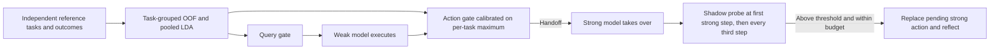
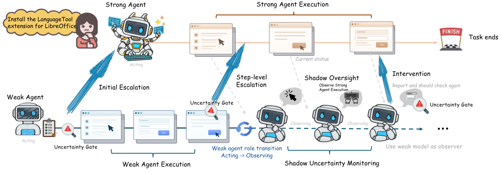

# LEASH: Reference-Representation Routing and Oversight After Handoff

<!-- source-sha256: d66cab37789b46329c987cbb04a465e30f9a366ee1fe6de2023272da7fc2fb4c -->

[简体中文](README.md) · English

> `component_only` / L1 CPU mechanism diagnostic. Inputs are explicitly generated synthetic vectors, not model hidden states. Statistical calibration and a Shadow callback do not constitute an OSWorld or real GUI-agent reproduction.

## Paper information

| Field | Details |
| --- | --- |
| Paper | [LEASH](https://arxiv.org/abs/2610.22280) |
| Affiliations | First author Qingni Wang, Simular; collaborators include University of Wisconsin–Madison. |
| First public release | 2026-10-15, arXiv v1 17:40:12 UTC; follow-up review of the 10-16 announcement |
| Authors' open-source code | No released author method repository was found. License unconfirmed; no third-party implementation was copied. |
| Local adapter | None (`adapter: null`); component key `leash` |
| Local implementation | `src/auto_research/agent_research/leash.py`; `scripts/run_oct17_supplement_agent.py` |

## Original paper summary

### Background and main changes

Starting with a weaker model and handing off to a stronger one when necessary can save cost. Deciding when to hand off and detecting whether the stronger model goes off course afterward are separate problems. LEASH measures distances from weak-model representations to historical pass/fail references without training a separate monitor network. Initial and runtime gates decide handoff. Afterward, it periodically uses representations of unexecuted weak-model Shadow actions to monitor the stronger model and asks it to reconsider when needed.



<!-- paper-figure:start -->
### Key figure from the paper

[](https://arxiv.org/html/2610.22280v1/overview.png)

> **Figure 2 from the paper:** Overall method design and key components. The figure comes from the [original paper](https://arxiv.org/abs/2610.22280), © the original authors. Select the image to see the source.
<!-- paper-figure:end -->

### Core equations

[§§3.2–3.4 and Appendix A](https://arxiv.org/html/2610.22280v1) fit standardized means and pooled covariance for two reference classes. A high score means closer to the failure class, not a calibrated failure probability:

$$
u_c(h)=d^2_{c,Pass}(h)-d^2_{c,Fail}(h),\quad
d^2(h)=(z-\mu)^T(\Sigma+\lambda I)^{-1}(z-\mu).
$$

The initial target rate $p_q$ and overall target rate $p_{esc}$ give the remaining conditional rate:

$$
p_a=\frac{p_{esc}-p_q}{1-p_q},\quad U_i=\max_t u_a(h_{i,t}).
$$

The runtime gate is calibrated on reference **per-task maxima**, not step-level quantiles. All observations for a task stay in the same OOF fold. The final refit and test-distribution drift can change the realized routing rate; the target rate is not a hard test quota. The Shadow threshold is the 90th percentile of reference action scores. Appendix A.4 probes at the first strong step after handoff and every three steps thereafter: 1/4/7/10 under one-based counting, not 3/6/9. At most 6 interventions are allowed, and the process stops after 2 changes to strong-model actions. Probe actions are never executed.

### Reported offline and online results

The paper compares several weak backbones with an Opus 5 strong executor/Manager on 262 OSWorld tasks with 50 actions each. It reports success rates and estimated inference cost from logged tokens priced at reference rates, not local hardware throughput. It retains initial/runtime-gate and Shadow ablations, so all gains should not be attributed to the initial gate. No production online A/B test was reported.

## Local reproduction

```bash
PYTHONPATH=src python scripts/run_oct17_supplement_agent.py \
  --methods leash --device cpu --seeds 42,43,44 \
  --output runs/oct17-supplement-agent/leash.json
```

### Data protocol and CPU results

Each seed uses 30 synthetic reference tasks, 90 action vectors, and 12 isolated evaluation tasks. Task-grouped 10-fold OOF selects ridge regularization (0.01/0.1/1) within the reference data. Standardization is fitted on training folds only. No evaluation task or outcome is used in fitting or threshold selection.

Across three seeds, maximum error against an independent quadratic-form reference was at floating-point rounding scale (about $10^{-15}$). Initial/overall reference routing rates were 0.233333 / 0.466667, retaining the lower rates imposed by integer task budgets. Mean synthetic outcome AUROC was 0.974815 OOF and 0.990741 held out. A shuffled-reference-label negative control still reached 0.796296, showing that separability on this small fixture cannot support a claim of agent capability. The high-score Shadow callback stopped after two strong-action changes without executing probe actions. The complete [CPU artifact](metrics/component-cpu-seeds42-44.json) retains per-seed results and hashes.

### Code mapping, cost, and limits

`fit_lda` fits means and pooled covariance and computes the ridge inverse with SVD. `crossfit_reference` records task folds and each fold's training tasks. `calibrate_escalation` calibrates conditional budgets; `calibrate_shadow` and `ShadowOversight.monitor` schedule oversight. Inference through `PooledLDA.score` accepts no gold/outcome labels.

There was no real hidden-state extraction, OSWorld desktop run, paid strong-model call, or run of the multiple 8B–35B backbones on long tasks. The complete multi-model, multi-configuration experiment is costly and requires GUI/remote interfaces. **It was not reproduced (review complete)**. The local operator runs on CPU without CUDA and is not presented as GPU or official-task validation. Not included in Evolve.
