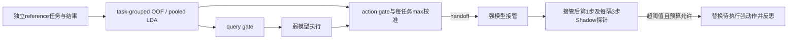
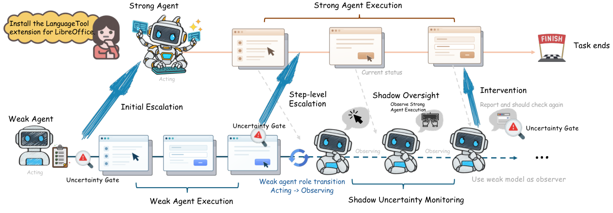

# LEASH：参考表示路由与接管后监督

> `component_only` / L1 CPU 机制诊断。输入是明确生成的合成向量，不是模型 hidden states；统计校准和 Shadow callback 不等于完成 OSWorld 或真实 GUI Agent。

## 论文信息

| 字段 | 内容 |
| --- | --- |
| 论文链接 | [LEASH](https://arxiv.org/abs/2610.22280) |
| 公司/机构 | 一作 Qingni Wang，Simular；合作者包括 University of Wisconsin–Madison |
| 首次公开日期 | 2026-10-15，arXiv v1 17:40:12 UTC；10-16 公告补审 |
| 原文开源代码 | 本轮未找到作者发布的方法代码仓库；许可证未确认，不复制第三方实现 |
| 本地 Adapter | 无（`adapter: null`）；组件 key：`leash` |
| 本地复现代码 | `src/auto_research/agent_research/leash.py`；`scripts/run_oct17_supplement_agent.py` |

## 原始论文总结

### 背景与主要改动

小模型先执行、必要时交给强模型可降低成本，但“何时接管”和“强模型接管后是否走偏”是两个问题。LEASH 利用弱模型表示与历史成功/失败参考的距离，不额外训练一个监控网络；初始和运行时 gate 决定 handoff，之后定期用弱模型的未执行 Shadow 动作表示监督强模型，并在需要时要求其重新审视策略。



<!-- paper-figure:start -->
### 原论文关键图

[](https://arxiv.org/html/2610.22280v1/overview.png)

> **原论文 Figure 2（关键图）**：展示原论文方法的总体设计和关键组成。图片来自[原论文](https://arxiv.org/abs/2610.22280)，版权归原作者所有；点击图片可查看来源。
<!-- paper-figure:end -->

### 核心公式

[原文 §3.2–3.4、附录 A](https://arxiv.org/html/2610.22280v1)对两类 reference 拟合标准化均值和共享协方差。高分表示更接近失败类，不是校准后的失败概率：

$$
u_c(h)=d^2_{c,Pass}(h)-d^2_{c,Fail}(h),\quad
d^2(h)=(z-\mu)^T(\Sigma+\lambda I)^{-1}(z-\mu).
$$

初始目标比例 $p_q$、整体目标比例 $p_{esc}$ 给出剩余条件比例：

$$
p_a=\frac{p_{esc}-p_q}{1-p_q},\quad U_i=\max_t u_a(h_{i,t}).
$$

运行 gate 用 reference **每任务最大值**校准，而不是按 step 的分位数；同一任务的所有观察保留在同一 OOF 折。最终重拟合和测试分布漂移可能改变实际路由率，所以目标比例不是测试硬配额。Shadow 阈值来自 reference action 分数第 90 百分位；按附录 A.4，在 handoff 后第一个 strong step 探测，此后每隔三步，即从 1 计数的 1/4/7/10，而不是 3/6/9。最多 6 次干预，2 次改变强动作后停止，探针动作不执行。

### 论文离线与线上效果

原文在 OSWorld 的 262 任务、每题 50 动作上比较多个弱骨干与 Opus 5 强执行器/Manager，并给出成功率与 token 计价推理成本；其成本是记录 token 按参考价估算，不是本地硬件吞吐。原文还保留初始/运行 gate 和 Shadow 消融，不应把所有收益归给初始 gate。未报告生产线上 A/B。

## 本地复现

```bash
PYTHONPATH=src python scripts/run_oct17_supplement_agent.py \
  --methods leash --device cpu --seeds 42,43,44 \
  --output runs/oct17-supplement-agent/leash.json
```

### 数据协议与 CPU 结果

每 seed 使用 30 个合成 reference task、90 action 向量及 12 个隔离 evaluation task；使用 task-grouped 10-fold OOF，在 reference 内选择 ridge（0.01/0.1/1），标准化只拟合训练折。没有 evaluation task/outcome 进入拟合或阈值选择。

三 seed 的独立二次型 reference 最大误差为浮点舍入量级（约 $10^{-15}$）；初始/整体 reference 路由率为 0.233333 / 0.466667，保留了整数任务预算下的少路由。合成 outcome OOF AUROC 均值 0.974815、留出 0.990741；打乱 reference 标签的负对照仍达 0.796296，说明小 fixture 的数值可分性不能支撑 Agent 能力结论。Shadow 高分回调在两次改变强动作后停止，未执行探针动作。完整 [CPU 产物](metrics/component-cpu-seeds42-44.json)保留逐 seed 与 hash。

### 代码映射、成本与边界

`fit_lda` 实际拟合均值/共享协方差并用 SVD 计算 ridge inverse；`crossfit_reference` 保存 task folds 和各折训练任务；`calibrate_escalation` 校准条件预算；`calibrate_shadow` 与 `ShadowOversight.monitor` 执行监督调度。推理 `PooledLDA.score` 不接收 gold/outcome 标签。

真实 hidden-state 抽取、OSWorld 桌面、强模型付费调用、多个 8B–35B 骨干与长任务均未运行。完整多模型多配置实验成本高且需要 GUI/远程接口，**成本过高，不复现（审查 DONE）**。本地算子 CPU 可运行，无需 CUDA；不声明 GPU 或官方任务验证，不进入 Evolve。
