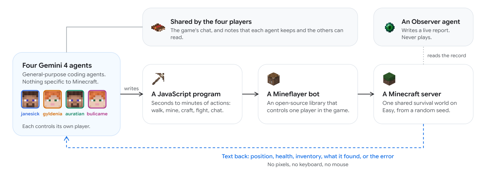

# Gemini Minecraft: Multi-agent collaboration in a long-running game

<!-- source-sha256: 033bd078d777ce4b800d978ab35122ebbb44a7856a6ad392decda4aefc0b795d -->

[简体中文](README.md)

> **Research reference only; reviewed and not reproduced because of cost.** No local agent execution, game success rate, GPU validation, or Evolve integration.

## Paper information

| Field | Details |
| --- | --- |
| Paper links | [arXiv 2610.22319](https://arxiv.org/abs/2610.22319); [pinned v1 full text](https://arxiv.org/html/2610.22319v1) |
| Company / institution | Google DeepMind; first author Maxence Faldor |
| First public release | 2026-10-15 17:51:32 UTC (arXiv v1; announced October 16) |
| Author code | No complete experiment harness found. [Mineflayer](https://github.com/PrismarineJS/mineflayer) is an upstream game library, not the research source. |
| Local adapter / stable key | `gemini-minecraft`, reference key with no executable adapter |
| Local implementation | No algorithm; documentation and [catalog metadata](https://github.com/daiwk/auto-research/blob/main/src/auto_research/paper_specs/catalog/agent-research/gemini-minecraft.json) only |
| Review status | Full experiment not reproduced; review complete; no local scores |

## Paper summary

### Background and main changes

Four acting agents write JavaScript programs to control Mineflayer characters. An Observer summarizes world state, while chat and notes carry progress. The study concerns long-horizon coordination, programmatic tools, and persistent state, not a new training objective.

### Architecture and data flow

~~~mermaid
flowchart TD
  O[Observer sees the world] --> N[Shared chat and notes]
  N --> A[Four acting agents]
  A --> P[JavaScript and Mineflayer programs]
  P --> W[Minecraft world]
  W --> O
  W --> A
~~~

<!-- paper-figure:start -->
### Original paper figure

> **Paper Figure 2:** Overall design and main components. From the [original paper](https://arxiv.org/abs/2610.22319); copyright remains with the authors. Click the image to open its source.
<!-- paper-figure:end -->

### Core equation

The paper has no new parameter-optimization formula. The following notation summarizes the interaction without defining a new algorithm:

$$
a_t^{(i)}=\pi_i(o_{\le t}^{(i)},m_t),\qquad s_{t+1}=T(s_t,a_t^{(1:4)}).
$$

Shared records do not replace feedback from the actual environment.

### Offline and online results reported in the paper

The authors report one successful run in a random Easy-difficulty world, about 27 hours and 24,000 model calls. **A single completion is not 100% success over multiple seeds** and establishes no cost or reliability advantage over other systems.

No production online A/B is reported. This is a game-interaction case study, not an industrial traffic experiment.

## Local reproduction

Only the reference, original figure, and cost review were completed. No commercial model was called and no game was run. The long interaction exceeds the single-card and local budget, so **the full experiment was reviewed and not reproduced because of cost**.

## Reproduction limits

No local capability metrics, training results, or Evolve operator. No fabricated success receipt. See the [batch acceptance contract](../../research-audits/oct17-supplement/README.md).
