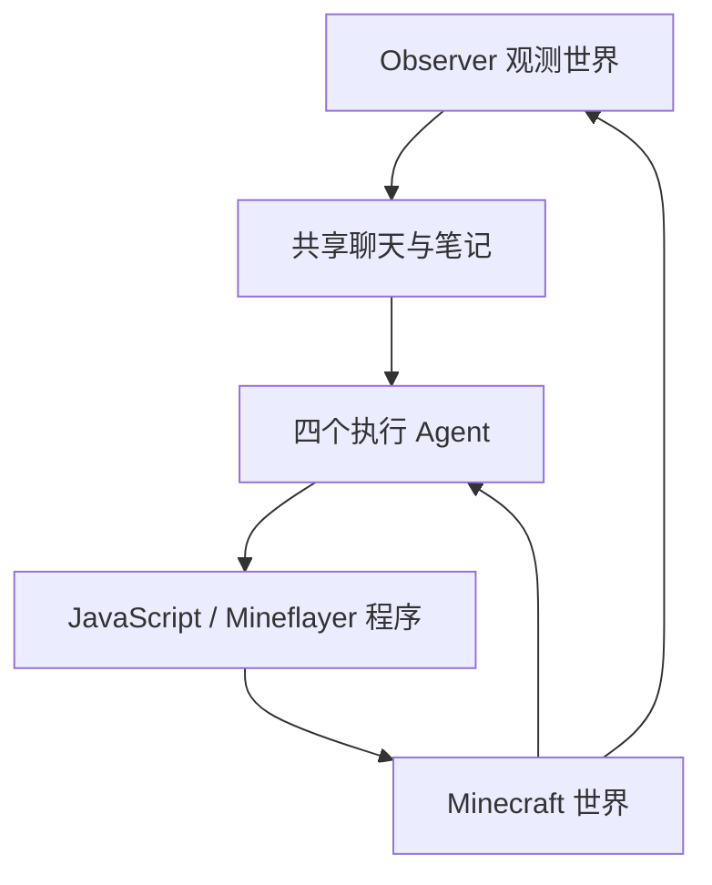
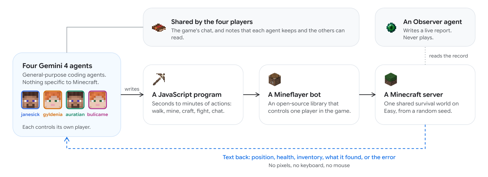

# Gemini Minecraft：长期游戏中的多 Agent 协作

> **仅研究资料；成本过高，不复现（审查 DONE）。** 没有本地执行 Agent、游戏成功率或 GPU 验证，不接入 Evolve。

## 论文信息

| 字段 | 内容 |
| --- | --- |
| 论文链接 | [arXiv 2610.22319](https://arxiv.org/abs/2610.22319)；[固定 v1 全文](https://arxiv.org/html/2610.22319v1) |
| 公司 / 机构 | Google DeepMind；一作 Maxence Faldor |
| 首次公开日期 | 2026-10-15 17:51:32 UTC（arXiv v1；10-16 公告） |
| 原作者代码 | 未找到完整实验 harness；[Mineflayer](https://github.com/PrismarineJS/mineflayer) 是上游游戏库，不是本文研究源码 |
| 本地 adapter / 稳定键 | `gemini-minecraft`（资料键，无可执行 adapter） |
| 本地复现代码 | 无算法实现；仅本文及 [catalog 元数据](https://github.com/daiwk/auto-research/blob/main/src/auto_research/paper_specs/catalog/agent-research/gemini-minecraft.json) |
| 验收状态 | 完整实验不复现 / 审查 DONE；无本地实验分数 |

## 原始论文总结

### 背景与主要改动

四个执行 Agent 通过编写 JavaScript 程序操纵 Mineflayer 角色；Observer 汇总世界状态，聊天和笔记传递进度。研究重点是长期协作、程序化工具与持久状态，而不是新训练目标。

### 架构与数据流

<!-- paper-figure:start -->
### 原论文关键图

> **原论文 Figure 2（关键图）**：展示原论文方法的总体设计和关键组成。图片来自[原论文](https://arxiv.org/abs/2610.22319)，版权归原作者所有；点击图片可查看来源。
<!-- paper-figure:end -->

### 核心公式

本文没有新的参数优化公式。可将交互概括为以下阅读记号（不是新增算法）：

$$
a_t^{(i)}=\pi_i(o_{\le t}^{(i)},m_t),\qquad s_{t+1}=T(s_t,a_t^{(1:4)}).
$$

其中共享记录不能替代真实环境反馈。

### 论文离线与线上效果

原文报告一个 Easy 难度随机世界中的成功案例，约27小时、24000次模型调用。**不能将一次通关改写成多种子100%成功率**，更不代表成本或可靠性优于其他系统。

生产线上 A/B：未报告；这是游戏交互案例，不是工业用户流量实验。

## 本地复现

只完成资料、原图和成本审查，不调用商业模型或运行游戏。原文长时交互超过本轮单卡/本地预算，完整实验标注 **成本过高，不复现（审查 DONE）**。

## 复现边界

无本地 capability 指标、训练结果或 Evolve 算子；不创建虚构成功回执。范围见[本批验收合同](../../research-audits/oct17-supplement/README.md)。
