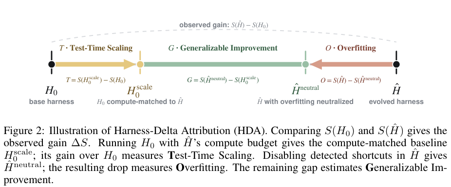

# HDA: Dissecting gains from harness evolution

<!-- source-sha256: 3e958ef2680b1a4b6a7c57c911bc5600f76f049dea860a42b502bb3e378958ae -->

[简体中文](README.md)

> `evaluation_protocol_interface` / L1 CPU. Implements attribution and control admission; it does not automatically establish that a harness generalizes.

## Paper information

| Field | Details |
| --- | --- |
| Paper | [Harness-Delta Attribution: Dissecting Gains From Harness Evolution](https://arxiv.org/abs/2610.22466) |
| Company / institution | First author Wenxuan Ding lists Amazon first and New York University second (affiliations 1 and 2 on the PDF front page). |
| First public release | 2026-10-15 17:39:38 UTC, arXiv v1; official October 19 announcement |
| Author code | [Wenwen-D/HarnessDeltaAttribution](https://github.com/Wenwen-D/HarnessDeltaAttribution) provides HDA skills, bootstrap, framework code, and artifacts. |
| Local adapter | None (`adapter: null`); protocol key `harness-decomposition` |
| Local implementation | `src/auto_research/agent_research/harness_decomposition.py`; `scripts/run_oct19_evening_agent_components.py` |

## Paper summary

### Background and main changes

A harness around the same frozen model can gain score through more inference compute or benchmark shortcuts. Even held-out data can share those shortcuts. HDA begins with a two-sided paired bootstrap of baseline/evolved per-item differences. If the gain is not significant, attribution stops. Otherwise, construct a compute-matched baseline and an evolved variant with detected shortcuts removed. **Both controls need task-specific human review.** See [Section 3](https://arxiv.org/html/2610.22466v1#S3).

~~~mermaid
flowchart LR
    B[Baseline H0] --> P[Paired bootstrap significance]
    E[Evolved H] --> P
    P --> C[Human review: compute-matched baseline]
    P --> N[Human review: minimally neutralize detected shortcuts]
    C --> D[Signed T / O / G attribution]
    N --> D
    D --> L[Residual is only an upper bound; test held-out separately]
~~~

Paper Figure 2 on PDF page 3 shows four arms and the three differences.

<!-- paper-figure:start -->
### Original paper figure

> **Paper Figure 2:** Observed gain is split into extra test-time compute, detected overfitting, and a residual generalization upper bound. The four arms and signed intervals are preserved. From the [original paper](https://arxiv.org/abs/2610.22466); copyright remains with the authors. Click the image to open its source.
<!-- paper-figure:end -->

### Core equation

$$
T=S(H_0^{scale})-S(H_0),\quad O=S(\hat H)-S(\hat H^{neutral}),\quad
G=S(\hat H^{neutral})-S(H_0^{scale}),\quad \Delta S=T+O+G.
$$

$O$ covers only detected, neutralizable mechanisms and is a lower bound on overfitting. $G$ can contain unknown shortcuts and is an upper bound on generalization, not transfer evidence. Raw differences retain signs. Display shares clip $O$, restrict $T$ to the remaining share, and allocate the rest to $G$, without changing the raw identity. If evolved compute did not increase, the compute control equals baseline.

### Paper results and negative findings

The paper covers 25 configurations across 11 models, three frameworks, and four task families. Of the 21 with significant search-set gains, mean shares are 54% detected overfitting and 14% extra inference compute. An ALFWorld winner became a deterministic controller with no model calls; high held-out success could still reflect a shared simulator shortcut. This does not invalidate all evolution: CREATE and other tasks show compute gains and residuals. See the [experiments and discussion](https://arxiv.org/html/2610.22466v1#S4).

## Local reproduction and limits

~~~bash
PYTHONPATH=src python scripts/run_oct19_evening_agent_components.py \
  --methods harness-decomposition --seeds 42,43,44 --device cpu \
  --output runs/oct19-evening-agent/harness-decomposition.json
~~~

All arms must have identical ordered item IDs, finite per-item scores, harness SHA256, and mean inference cost in the same unit. Controls need reviewer identity and rationale. The CPU kernel actually resamples 10,000 times and computes intervals, two-sided p-values, signed differences, display shares, and identity error. Compute-match tolerance is an explicit local parameter, not an assumed paper constant. Missing review or mismatched items/budgets are rejected. Zero-gain and noise controls do not enter attribution.

The interface does not find all shortcuts, edit source, or execute neutralization. Inputs are immutable measured four-arm results. Random fixture scores test the operator, not models. The interface does not call an actor or pass references or scored trajectories back. [Archived metrics](metrics/component-cpu-seeds42-44.json) record three seeds, bootstrap, and negative controls.

The full 25-configuration matrix spans models, evolution frameworks, and tasks, including SWE-bench containers and expensive reevaluation rounds. **Reviewed and not reproduced because of cost.** The small statistical kernel is implemented, not the full experiment. `diagnostic_only=true`, `promotion_eligible=false`, `evolve_integrated=false`.
