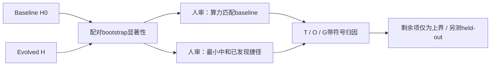
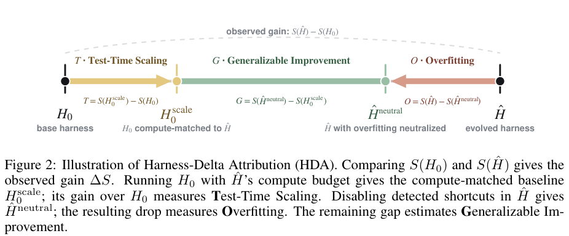

# HDA：拆开 Harness 进化收益

> `evaluation_protocol_interface` / L1 CPU。实现归因算子和控制接纳，不自动证明 Harness 可泛化。

## 论文信息

| 字段 | 内容 |
| --- | --- |
| 论文链接 | [Harness-Delta Attribution: Dissecting Gains From Harness Evolution](https://arxiv.org/abs/2610.22466) |
| 公司/机构 | 一作 Wenxuan Ding；第一单位 Amazon，第二单位 New York University（PDF 首页 1,2 标注） |
| 首次公开日期 | 2026-10-15 17:39:38 UTC，arXiv v1；10-19 官方公告 |
| 原文开源代码 | [Wenwen-D/HarnessDeltaAttribution](https://github.com/Wenwen-D/HarnessDeltaAttribution)，已有 HDA 技能、bootstrap、框架代码和工件 |
| 本地 Adapter | 无（`adapter: null`）；协议 key：`harness-decomposition` |
| 本地复现代码 | `src/auto_research/agent_research/harness_decomposition.py`；`scripts/run_oct19_evening_agent_components.py` |

## 原始论文总结

### 背景与主要改动

同一个冻结模型的 Harness 可以靠更多推理算力，也可以靠基准捷径涨分。甚至 held-out 数据也可能共享相同捷径。HDA 先对 baseline/evolved 的逐样本差做双侧 paired bootstrap；收益不显著时停止归因。显著时，构造算力匹配 baseline 与移除已检测捷径的 evolved，且**两种控制的构造都需要任务相关人审**。[方法 §3](https://arxiv.org/html/2610.22466v1#S3)



原图建议：原论文 **Figure 2，PDF 第3页**，四臂及三类差值关系。

<!-- paper-figure:start -->
### 原论文关键图

[](https://arxiv.org/pdf/2610.22466v1#page=3)

> **原论文 Figure 2（关键图）**：HDA 将观测收益拆成额外测试算力、检测到的过拟合与剩余可泛化上界；四臂位置和带符号区间均保留。图片来自[原论文](https://arxiv.org/abs/2610.22466)，版权归原作者所有；点击图片可查看来源。
<!-- paper-figure:end -->

### 核心公式

$$
T=S(H_0^{scale})-S(H_0),\quad O=S(\hat H)-S(\hat H^{neutral}),\quad
G=S(\hat H^{neutral})-S(H_0^{scale}),\quad \Delta S=T+O+G.
$$

$O$ 只对应检测且可中和的机制，是过拟合的下界估计；$G$ 还可能含未识别捷径，只是泛化改进上界，不能直接当迁移证据。原始差值保留符号；展示百分比分别截断 $O$、将 $T$ 限在剩余比例，再把余量记为 $G$，不修改原始等式。evolved 没增加算力时，算力控制就等于 baseline。

### 论文效果与负结果

11 个模型、3 种框架、4 类任务共25配置，21个搜索集显著增益配置平均54%可归于已检测过拟合、14%可由额外推理算力解释。ALFWorld 中某赢家变成零模型调用的确定性控制器，held-out 高成功率仍不能排除共享模拟器捷径。这不是“所有进化都无效”；CREATE 等存在算力收益和剩余项。[实验与讨论](https://arxiv.org/html/2610.22466v1#S4)

## 本地复现与边界

```bash
PYTHONPATH=src python scripts/run_oct19_evening_agent_components.py \
  --methods harness-decomposition --seeds 42,43,44 --device cpu \
  --output runs/oct19-evening-agent/harness-decomposition.json
```

接口要求四臂 item ID 顺序完全一致、逐样本有限分数、Harness SHA256 和同单位平均推理成本；控制必须携带人审者与依据。CPU 内核实际重采样10,000次，计算区间、双侧 p 值、原始差值、展示份额及数值恒等式误差。算力匹配容差是本地显式参数，不是假定原论文常数。没有人审、错配样本、错配预算一律拒绝；零增益/噪声对照不归因。

这里不实现“自动识别所有捷径”，也不自动改源代码或执行中和。输入是已完成的四臂不可变测量；本地 fixture 的随机分数只是算子测试，不是模型评测。接口本身不调用 actor，也不把 reference 或评分后的轨迹回传模型。[归档指标](metrics/component-cpu-seeds42-44.json)记录三 seed、bootstrap 和负对照。

原文25配置跨模型/演化框架/任务，含 SWE-bench 容器与多轮昂贵重评估，**完整矩阵成本过高，不复现（审查 DONE）**。小规模统计内核已实现与完整实验不复现并不矛盾。`diagnostic_only=true`、`promotion_eligible=false`、`evolve_integrated=false`。
