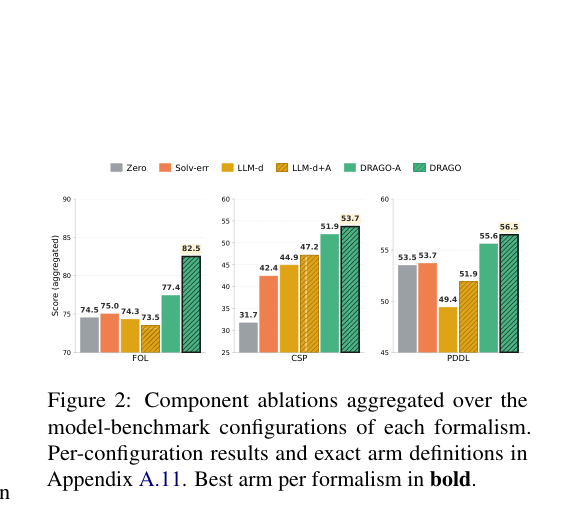

# DRAGO: Constraining formal-specification repair with verifiable diagnostics

<!-- source-sha256: 782a0f46ed3b1c6fbd600b0c0faf2668c7744c511fbb00b4b2ec7b9442cee3a0 -->

[简体中文](README.md)

> `component_only` / L1 CPU. A diagnostic subset for grounded STRIPS/PDDL, not the full three-language framework.

## Paper information

| Field | Details |
| --- | --- |
| Paper | [Repairing LLM-Generated Specifications with Deterministic Diagnosis](https://arxiv.org/abs/2610.22568) |
| Company / institution | First author Giovanni Vaccarino lists University of Oxford first, and also University of Illinois Chicago and Politecnico di Milano. |
| First public release | 2026-10-15 19:12:54 UTC, arXiv v1; official October 19 announcement |
| Author code | The paper mentions released code, but no verifiable author URL was found. The [corrected dataset](https://huggingface.co/datasets/gianniiii/planetarium-floor-tile-corrected) was verified; data release is not code release. |
| Local adapter | None (`adapter: null`); component key `drago` |
| Local implementation | `src/auto_research/agent_research/drago.py`; `scripts/run_oct19_evening_agent_components.py` |

## Paper summary

### Background and main changes

A formal specification can run without faithfully expressing the task. DRAGO turns SMT-LIB2, MiniZinc, and PDDL contracts, solver probes, and task-alignment checks into localized diagnostics and prompts a model for targeted repair. A candidate must preserve syntax, vocabulary, and output contracts, strictly reduce blocking diagnostics, and pass non-regression rules. Reference formalizations and final labels are used only for final scoring. See [Section 3 and Appendix A.2](https://arxiv.org/html/2610.22568v1#S3).

~~~mermaid
flowchart LR
    X[Public task and domain] --> P[Current formal specification]
    P --> D[Deterministic diagnostics and solver probes]
    D --> R[Repair proposal callback]
    R --> C[Rediagnose and require strict improvement without weakening]
    C -->|Pass| P
    C -->|Reject| B[Retain old state and stop]
    P --> G[Independent final reference scoring]
~~~

Paper **Figure 2** covers diagnostic and acceptance ablations; **Figure 3** shows Planetarium input rendering defects. They explain different algorithm and evaluation issues.

<!-- paper-figure:start -->
### Original paper figure

> **Paper Figure 2:** Component ablations on three formalisms. These are paper results, not local planning success. From the [original paper](https://arxiv.org/abs/2610.22568); copyright remains with the authors. Click the image to open its source.
<!-- paper-figure:end -->

### Core equation

$$
p_{t+1}=\begin{cases}q_t,&A(x,p_t,q_t)=1,\\p_t,&\text{otherwise},\end{cases}\qquad
w(D(q_t))<w(D(p_t)).
$$

The local PDDL subset uses typed **grounded STRIPS with positive preconditions** and two real probes:

- Delete-relaxed fixed point: ignore delete effects and repeatedly apply add effects of enabled actions. A goal outside the fixed point cannot be reached.
- BFS with delete effects: prove joint unsolvability only after exhausting reachable states. Reaching a budget returns unknown, not a fabricated diagnosis. Individually reachable goals may not be jointly reachable, so these probes are distinct.

The component also checks domain, predicate arity, object declarations, and public task category counts. Acceptance strictly reduces blocking weight, adds no blocking axis, keeps the goal count, and only moves object counts toward the requirement. A previously solvable specification must not regress to unsolvable or unknown. Rejection preserves the prior object and stops.

### Paper results and limits

Across five benchmarks the paper reports mean gains of 12.9 percentage points over zero-shot formalization and 8.7 over LLM self-diagnosis. Regressions on previously correct specifications fall from 11.8% to 1.3%. This is not a correctness oracle: a solvable specification of a different task can pass. Half of Planetarium floor-tile instances have rendering defects. The corrected condition is a separate ablation; fixes made by reading a reference must not enter test-time repair. See the [experiments and data audit](https://arxiv.org/html/2610.22568v1#S5).

## Local reproduction and limits

~~~bash
PYTHONPATH=src python scripts/run_oct19_evening_agent_components.py \
  --methods drago --seeds 42,43,44 --device cpu \
  --output runs/oct19-evening-agent/drago.json
~~~

The CPU fixture varies corridor size and executes a no-precondition path, joint-goal conflict, budget exhaustion, evidence-backed initial-state repair, and the negative control of deleting a goal. The proposal callback sees public Problem and Diagnosis only, not gold. The local budget counts expanded states, not the paper's ten-second solver timeout. This is a kernel diagnostic, not Planetarium data or model capability. See the [archived metrics](metrics/component-cpu-seeds42-44.json).

There is no PDDL text parsing or grounding, SMT-LIB2/Z3, MiniZinc, general negative-precondition or numeric planning, LLM formalization, or official evaluator. The trusted domain and proposer are integration callbacks, not an arbitrary-code sandbox. Types do not ensure natural-language semantic equivalence.

The paper uses **4×A100** for 30B/31B models and repeats multiple arms and seeds across five benchmarks. **The full experiment was reviewed and not reproduced because of cost.** `diagnostic_only=true`, `promotion_eligible=false`, `evolve_integrated=false`.
