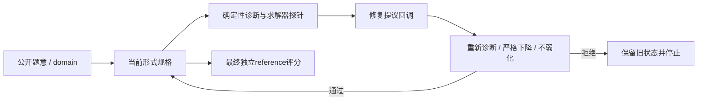
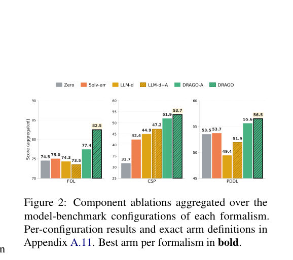

# DRAGO：用可验证诊断约束形式规格修复

> `component_only` / L1 CPU。实现 grounded STRIPS/PDDL 方向的诊断算子子集；不冒充完整三形式化语言框架。

## 论文信息

| 字段 | 内容 |
| --- | --- |
| 论文链接 | [Repairing LLM-Generated Specifications with Deterministic Diagnosis](https://arxiv.org/abs/2610.22568) |
| 公司/机构 | 一作 Giovanni Vaccarino；首列 University of Oxford，兼 University of Illinois Chicago、Politecnico di Milano |
| 首次公开日期 | 2026-10-15 19:12:54 UTC，arXiv v1；10-19 官方公告 |
| 原文开源代码 | 正文提及 released code，但核对时未找到可验证的作者代码 URL；已核 [修正数据集](https://huggingface.co/datasets/gianniiii/planetarium-floor-tile-corrected)，数据发布不等于代码已开源 |
| 本地 Adapter | 无（`adapter: null`）；组件 key：`drago` |
| 本地复现代码 | `src/auto_research/agent_research/drago.py`；`scripts/run_oct19_evening_agent_components.py` |

## 原始论文总结

### 背景与主要改动

形式规格“能运行”不等于“忠实表达了题意”。DRAGO 将 SMT-LIB2、MiniZinc 和 PDDL 的契约、求解器探针及题意对齐检查转为可定位诊断，再要求模型定向修复。候选必须保留语法/词表/输出合同，严格降低阻塞诊断，并满足防退化条件；参考形式化和最终标签只用于最后评分。[方法 §3、附录 A.2](https://arxiv.org/html/2610.22568v1#S3)



原图建议：原论文 **Figure 2** 为诊断/接纳消融；**Figure 3** 为 Planetarium 输入渲染缺陷。它们分别解释算法贡献和评测风险。

<!-- paper-figure:start -->
### 原论文关键图

[](https://arxiv.org/pdf/2610.22568#page=7)

> **原论文 Figure 2（关键图）**：DRAGO 在三种形式体系上的组件消融结果；是原文结果图，不是本地规划成功率。图片来自[原论文](https://arxiv.org/abs/2610.22568)，版权归原作者所有；点击图片可查看来源。
<!-- paper-figure:end -->

### 核心公式

$$
p_{t+1}=\begin{cases}q_t,&A(x,p_t,q_t)=1,\\p_t,&\text{otherwise},\end{cases}\qquad
w(D(q_t))<w(D(p_t)).
$$

本地 PDDL 方向子集提供有类型的**已实例化正前提 STRIPS**，执行两种真实探针：

- 删除松弛固定点：忽略 delete effect，反复加入可执行动作的 add effect；不在固定点里的目标一定不可达。
- 保留 delete effect 的 BFS：穷尽全部可达状态才证明联合无解；到达预算只返回未知，不能制造诊断。某些目标逐个可达但不能同时成立，两个探针因此不是同一检查。

另查 domain、谓词元数、对象声明及公开题意给定的分类数量。接纳要求阻塞权重严格下降、不新增阻塞轴、不减少目标数，且对象数只能朝题意要求靠近；原先可解的规格不能退化成无解或未知。拒绝时保留旧对象并停止。

### 论文效果与局限

原文5个 benchmark 中平均比零样本形式化提高12.9个百分点、比 LLM 自诊断提高8.7个百分点；原先正确规格的回归比例由11.8%降至1.3%。它不是正确性预言机：可解但表达了另一问题的规格仍可能逃过诊断。Planetarium floor-tile 半数实例存在渲染缺陷，论文修正条件是单列消融，不能将读取 reference 修题的过程混入测试时修复。[实验和数据审计](https://arxiv.org/html/2610.22568v1#S5)

## 本地复现与边界

```bash
PYTHONPATH=src python scripts/run_oct19_evening_agent_components.py \
  --methods drago --seeds 42,43,44 --device cpu \
  --output runs/oct19-evening-agent/drago.json
```

CPU fixture 随机化走廊规模，实际执行无前提路径、联合目标冲突、预算耗尽、证据支持的初态修复，以及“删掉目标就算修好”的负对照。proposal 回调只拿公开 Problem 和 Diagnosis，不拿金标准。预算单位是本地展开状态数，并非原文10秒求解器超时；fixture 是内核诊断，不是 Planetarium 数据或模型能力比较。[归档指标](metrics/component-cpu-seeds42-44.json)由统一收口生成。

这里没有 PDDL 文本解析/grounding，也没有 SMT-LIB2/Z3、MiniZinc、一般负前提/数值规划、LLM形式化或官方评测器。trusted domain 与 proposer 是受信任集成回调，不是执行任意外部代码的沙箱；类型合同也不能保证自然语言语义等价。

原文用 **4×A100** 服务30B/31B模型，跨5个 benchmark 多seed、多臂重评估，**完整实验成本过高，不复现（审查 DONE）**。`diagnostic_only=true`、`promotion_eligible=false`、`evolve_integrated=false`。
