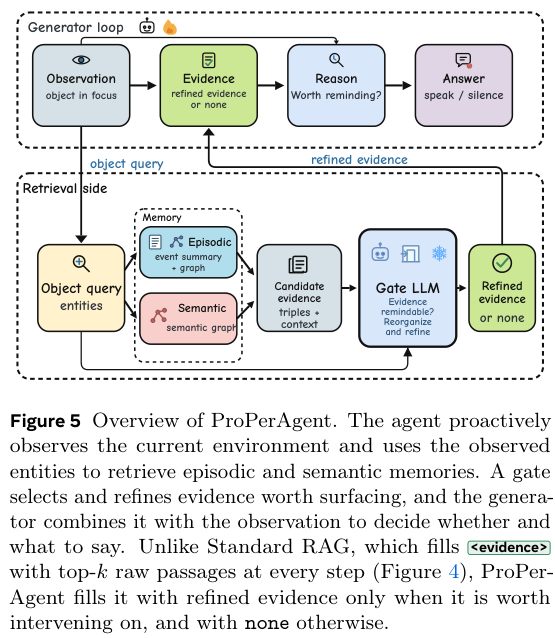

# MemoProAgent (formerly ProPerAgent): Knowing what to remember and when to speak

<!-- source-sha256: c5d42a39470ce72302a257e5a72a8794f61bd14a338215ab41e5ef18d9eec247 -->

[简体中文](README.md)

> `component_only` / L1 CPU mechanism diagnostic. Not a video agent integrated with ProPerMem or a full GRPO reproduction.

## Paper information

| Field | Details |
| --- | --- |
| Paper | [MemoProAgent: Toward Memory-Driven Proactive Assistance (v2)](https://arxiv.org/abs/2610.22671v2); v1 was titled ProPerAgent |
| Company / institution | First author Shenglai Zeng lists Michigan State University first and also Meta Reality Labs. The team includes Meta Reality Labs and Meta Superintelligence Labs. |
| First public release | 2026-10-15 21:40:17 UTC, arXiv v1. Announced October 19, not first released then. |
| Current revision | v2, 2026-10-21 05:59:44 UTC. Renamed MemoProAgent / MemoProBench and put code and data links on the front page. Not a new paper. |
| Author code | Meta's [Memo-Pro-Agent repository](https://github.com/facebookresearch/Memo-Pro-Agent) provides a GPM inference/evaluation harness and GRPO reward and launcher entry points, reviewed at `8563e58d3106c8e0b3108bff64c04d00e1c8f095` (2026-10-22 00:48:15 UTC). [CC-BY-NC-4.0](https://github.com/facebookresearch/Memo-Pro-Agent/blob/8563e58d3106c8e0b3108bff64c04d00e1c8f095/LICENSE) is a noncommercial source license, not OSI open source, and does not imply all training/evaluation assets are public. |
| Local adapter | None (`adapter: null`); component key `proper-agent` |
| Local implementation | `src/auto_research/agent_research/proper_agent.py`; `scripts/run_oct19_evening_agent_components.py` |

## Paper summary

### Background and main changes

A proactive assistant receives no user question. It must find evidence for intervening in long-term memory, and remind the user once at the right moment. Relevant memories do not necessarily warrant an interruption. ProPerAgent organizes memories into an episodic/semantic graph and retrieves through entity matching, one-hop links, and Personalized PageRank using current objects. A separate LLM gate keeps evidence worth acting on. The generator chooses speech or silence from the current view and its previous utterances. Training applies policy gradients to generated tokens only, not tool-injected evidence. See [Section 5 and Appendix I](https://arxiv.org/html/2610.22671v1#S5).

~~~mermaid
flowchart LR
    H[Past timestamped memories] --> G[Episodic and semantic graph with provenance]
    O[Current observations and objects] --> R[Entity matching / one hop / PPR]
    G --> R
    R --> T[Independent semantic gate: evidence or silence]
    O --> A[Generator decides when and what to say]
    T --> A
    A --> E[Full utterance trajectory]
    E --> S[Private content and trigger-window scoring]
~~~

The image below is PDF **Figure 5**, covering memory retrieval, gate, and generator. PDF Figure 8 covers data construction; HTML subfigures can shift numbering, so do not interchange them.

<!-- paper-figure:start -->
### Original paper figure

> **Paper Figure 5:** The loop connecting observations, episodic and semantic retrieval, gate, and generator. PDF Figure 5 is the method diagram; Figure 8 is data construction. From the [original paper](https://arxiv.org/abs/2610.22671); copyright remains with the authors. Click the image to open its source.
<!-- paper-figure:end -->

### Core equations

At each step the policy outputs $r_t\in\{\varnothing\}\cup\mathcal A$. The main metric requires content, timing, and count, not merely having been correct once:

$$
\mathrm{Perfect}=I[k=1]\;I[t_s\le f_1\le t_e+\delta]\;I[\mathrm{Good}(a_{f_1})],\quad \delta=2\text{s}.
$$

Other metrics include Hit, early and late utterances, repetitions, and utterance counts per segment. In a negative segment where silence is required, any utterance is a false trigger. Propagation uses the actual restart walk $p_{k+1}=\alpha s+(1-\alpha)P^\top p_k$; an open-loop flag does not replace the semantic gate.

### Paper results and negative findings

ProPerMem has 1,804 video–long-memory pairs with about 618K tokens per memory on average. In window mode, 27B Perfect is 7.0% for RAG, 37.5% for Harness, and 42.4% with GRPO. Hit does not imply no repetition or early reminder. Oracle content/timing experiments bound bottlenecks, not deployable capability. Inference/evaluation code is now public, but historical data require authorization. No official-data evaluation was run locally, so the CPU fixture is not official evaluation. See the [experiments and tables](https://arxiv.org/html/2610.22671v1#S6).

## Local reproduction and limits

~~~bash
PYTHONPATH=src python scripts/run_oct19_evening_agent_components.py \
  --methods proper-agent --seeds 42,43,44 --device cpu \
  --output runs/oct19-evening-agent/proper-agent.json
~~~

The component checks fact provenance, filters future timestamps, normalizes entity embeddings, builds edges and runs PPR, validates gate citations, and scores a causal utterance sequence jointly. Callers supply embeddings, extraction, semantic gate, and actor. One-hot vectors and deterministic CPU callbacks check interfaces, not vision or language. Restart coefficients, hub weights, and ranking trade-offs are explicit local choices, not purported author defaults.

An independent scorer holds trigger windows and content judgments. The actor gets only current observations, gated evidence, and prior utterances, not gold memory, windows, or judge outputs. Controls cover future memories, fabricated provenance, unknown judge results, and an **evaluation-side negative control** that always speaks oracle content: even correct content fails Perfect when repeated. That control is not part of the evaluated actor. Unscored items remain unknown, not dropped. Python callbacks are trusted integration, not a malicious-code sandbox.

Three seeds produce synthetic mechanism diagnostics, not formal multi-seed capability comparisons. Non-overwriting output holds per-seed metrics, fixture/source SHA256, and audit trajectories. See the [archived metrics](metrics/component-cpu-seeds42-44.json).

### v2 and author release scope (verified 2026-10-22)

The prior no-repository finding is obsolete. The [official arXiv history](https://arxiv.org/abs/2610.22671v2) dates v1 to October 15 21:40:17 UTC and v2 to October 21 05:59:44 UTC. v2 names MemoProAgent and MemoProBench, with official Meta links [on its front page](https://arxiv.org/html/2610.22671v2). v1's promise to release on publication is historical, not the v2 status. **This updates the same paper's revision facts; it is not a new release or algorithm delivery.** The stable key, code, and docs stay under `proper-agent`; the first-publication date remains v1's.

Meta's [pinned Memo-Pro-Agent commit](https://github.com/facebookresearch/Memo-Pro-Agent/tree/8563e58d3106c8e0b3108bff64c04d00e1c8f095) provides a GPM inference/evaluation harness. The README authors match the paper and note the rename from `properagent` to `memoproagent`. The [file-by-file comparison](https://github.com/facebookresearch/Memo-Pro-Agent/compare/5bf57aed9a865bc3489e5daa8040e243ec50fa85...8563e58d3106c8e0b3108bff64c04d00e1c8f095) to previously reviewed `5bf57aed9a865bc3489e5daa8040e243ec50fa85` shows four commits adjusting the affiliation banner, images, README, and compliance tests only, without new algorithms, training assets, or open data. Maintenance updates are not separate implementations.

Per the pinned [README reproducibility notes](https://github.com/facebookresearch/Memo-Pro-Agent/blob/5bf57aed9a865bc3489e5daa8040e243ec50fa85/README.md#data-and-reproducibility) and [data guide](https://github.com/facebookresearch/Memo-Pro-Agent/blob/5bf57aed9a865bc3489e5daa8040e243ec50fa85/docs/data.md), the 800 eval800 histories in `facebook/MemProBench` remain private and require authorization. Ego4D source videos must be acquired separately under its terms. The public checkout includes sample reference metadata, not videos, complete histories, or prebuilt graph/embedding indexes. Build indexes only with authorized data and model services, never by treating reference answers as retrieved memory.

The repository does contain a reward plugin and MS-Swift launcher in [`memoproagent/rl/train_grpo.py`](https://github.com/facebookresearch/Memo-Pro-Agent/blob/5bf57aed9a865bc3489e5daa8040e243ec50fa85/memoproagent/rl/train_grpo.py); it would be wrong to say it contains no training code. It does not establish release of full training data, post-training checkpoints, baseline matrices, or complete recipes that directly reproduce paper numbers. Its CPU Quick Start uses synthetic data and a scripted backend for integration checks. This follow-up corrects only provenance and scope: **author code was not run, ported, or validated**, and local implementation, metrics, and GPU validation are unchanged.

The paper's 27B GRPO uses **7×H100 for 14.6 hours**; evaluation adds long memory, video, and an LLM gate. **The full experiment was reviewed and not reproduced because of cost.** No toy training on a single A100/A30 or Mac stands in for it. `diagnostic_only=true`, `promotion_eligible=false`, `evolve_integrated=false`.
