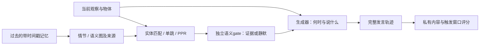
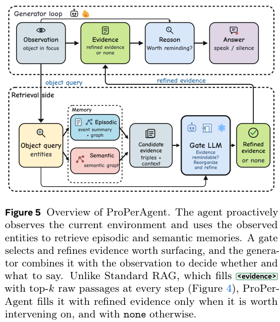

# MemoProAgent（原 ProPerAgent）：记住什么，还要知道何时开口

> `component_only` / L1 CPU 机制诊断。不是已接入 ProPerMem 的视频 Agent，也不是完整 GRPO 复现。

## 论文信息

| 字段 | 内容 |
| --- | --- |
| 论文链接 | [MemoProAgent: Toward Memory-Driven Proactive Assistance（v2）](https://arxiv.org/abs/2610.22671v2)；v1 原名 ProPerAgent |
| 公司/机构 | 一作 Shenglai Zeng；首列 Michigan State University，兼 Meta Reality Labs；团队包括 Meta Reality Labs、Meta Superintelligence Labs 等 |
| 首次公开日期 | 2026-10-15 21:40:17 UTC，arXiv v1；出现在 10-19 官方公告，不是 10-19 首发 |
| 当前论文版本 | v2，2026-10-21 05:59:44 UTC；更名 MemoProAgent / MemoProBench 并在首页直接列代码与数据链接，不是新论文首发 |
| 原文开源代码 | [Meta 官方作者仓库 Memo-Pro-Agent](https://github.com/facebookresearch/Memo-Pro-Agent) 已公开 GPM 推理 / 评测 harness 及 GRPO reward / launcher 入口；核对固定 commit `8563e58d3106c8e0b3108bff64c04d00e1c8f095`（2026-10-22 00:48:15 UTC）。[CC-BY-NC-4.0](https://github.com/facebookresearch/Memo-Pro-Agent/blob/8563e58d3106c8e0b3108bff64c04d00e1c8f095/LICENSE) 为非商用源码许可，不是 OSI 开源许可；不等于完整论文训练与评测资产均已公开 |
| 本地 Adapter | 无（`adapter: null`）；组件 key：`proper-agent` |
| 本地复现代码 | `src/auto_research/agent_research/proper_agent.py`；`scripts/run_oct19_evening_agent_components.py` |

## 原始论文总结

### 背景与主要改动

主动助理没有用户提问：它必须从长期记忆找出干预的依据，并在正确时机只提醒一次。相关记忆不一定意味着应该打断用户。ProPerAgent 用情节—语义图组织记忆，根据当前物体做实体匹配、单跳关联及 Personalized PageRank，再由独立 LLM gate 保留值得干预的证据；生成器结合当前画面与已说过的话，决定发言或静默。训练阶段只优化生成器产生的 token，工具注入的证据 token 不参与策略梯度。[方法 §5、附录 I](https://arxiv.org/html/2610.22671v1#S5)



下图使用原始 PDF **Figure 5**，展示记忆检索、gate 与生成器；PDF Figure 8 是数据构建图，HTML 的中间子图会造成编号偏移，不能混用。

<!-- paper-figure:start -->
### 原论文关键图

[](https://arxiv.org/pdf/2610.22671v1#page=10)

> **原论文 Figure 5（关键图）**：ProPerAgent 的观察、情节/语义记忆检索、gate 与生成器闭环。PDF Figure 5 才是方法图；Figure 8 是数据构建流程，不混淆二者。图片来自[原论文](https://arxiv.org/abs/2610.22671)，版权归原作者所有；点击图片可查看来源。
<!-- paper-figure:end -->

### 核心公式

每步策略输出 $r_t\in\{\varnothing\}\cup\mathcal A$。主指标不是“曾经答对”，而是同时满足内容、时机与次数：

$$
\mathrm{Perfect}=I[k=1]\;I[t_s\le f_1\le t_e+\delta]\;I[\mathrm{Good}(a_{f_1})],\quad \delta=2\text{s}.
$$

另报 Hit、提前、迟到、重复发言和每片段发言次数；应静默的负片段中，任何发言都是假触发。图传播使用实际重启随机游走 $p_{k+1}=\alpha s+(1-\alpha)P^\top p_k$，但不能用 open-loop 标志直接替代语义 gate。

### 论文结果与负结果

ProPerMem 包含 1,804 对视频—长期记忆，平均记忆约 618K token。窗口模式下，27B 模型的 RAG 基线 Perfect 为 7.0%，Harness 为 37.5%，加 GRPO 为 42.4%；Hit 并不意味着不会重复或提前提醒。论文的 oracle 内容/时机实验只是瓶颈分析上界，不是可部署能力。作者现已公开推理 / 评测代码，但相关历史数据仍需授权，本地未运行该官方数据评测，不能把 CPU fixture 改称“官方评测”。[实验及完整表](https://arxiv.org/html/2610.22671v1#S6)

## 本地复现与边界

```bash
PYTHONPATH=src python scripts/run_oct19_evening_agent_components.py \
  --methods proper-agent --seeds 42,43,44 --device cpu \
  --output runs/oct19-evening-agent/proper-agent.json
```

本地真实执行事实来源检查、未来时间过滤、归一化实体 embedding、图边/PPR、gate 引用接纳、因果发言序列和联合评分。embedding、事实抽取、语义 gate 与 actor 必须由调用方提供；CPU fixture 的 one-hot 向量和确定性回调只检查接口，不代表任何视觉或语言能力。图重启系数、hub 权重及排序取舍是公开可见的本地选择，论文未公开的系数不冒充原配置。

独立 scorer 持有触发窗口与内容判定；actor 只拿当前观察、gate 证据和过去发言，不拿 gold 记忆、窗口或 judge 结果。包含未来记忆、伪造来源、未知 judge 结果，以及“总是说出 oracle 内容”的**评测端负对照**，说明即使内容正确也会因重复而 Perfect 失败；负对照不进入被测 actor。未评分保留为未知，不剔除。Python 回调是受信任集成，不是恶意代码沙箱。

本地结果为三 seed 的合成机制诊断，不是正式多 seed 能力比较。输出含逐 seed 指标、fixture/source SHA256 与审计轨迹，拒绝覆盖；[归档指标](metrics/component-cpu-seeds42-44.json)由统一收口生成。

### v2 与作者源码发布范围更新（2026-10-22 核验）

旧记录“尚未找到官方实现”已过时：[arXiv 官方版本历史](https://arxiv.org/abs/2610.22671v2) 明确 v1 为 10 月 15 日 21:40:17 UTC，v2 为 10 月 21 日 05:59:44 UTC。v2 标题为 MemoProAgent、benchmark 名为 MemoProBench，且[首页已直接列出](https://arxiv.org/html/2610.22671v2) Meta 官方代码与数据链接。v1 的“将在正式发表时公开”是历史声明，不代表 v2 现状。**这是同一论文的版本事实更新，不是一次新首发或新算法交付。** 本地稳定键、代码和文档目录继续使用 `proper-agent`，首次公开日期保留 v1。

Meta 的 [Memo-Pro-Agent 当前固定提交](https://github.com/facebookresearch/Memo-Pro-Agent/tree/8563e58d3106c8e0b3108bff64c04d00e1c8f095) 已公开 GPM 推理 / 评测 harness；README 作者名单与本论文一致，并说明软件从 `properagent` 更名为 `memoproagent`。与此前核对的 `5bf57aed9a865bc3489e5daa8040e243ec50fa85` [逐文件比较](https://github.com/facebookresearch/Memo-Pro-Agent/compare/5bf57aed9a865bc3489e5daa8040e243ec50fa85...8563e58d3106c8e0b3108bff64c04d00e1c8f095)，新增四次提交仅调整机构 banner、图片、README 和合规测试，没有新增算法、训练资产或开放数据。不能把这些维护更新再计为一个新实现。

按该提交的 [README 数据与可复现性说明](https://github.com/facebookresearch/Memo-Pro-Agent/blob/5bf57aed9a865bc3489e5daa8040e243ec50fa85/README.md#data-and-reproducibility) 和 [数据指南](https://github.com/facebookresearch/Memo-Pro-Agent/blob/5bf57aed9a865bc3489e5daa8040e243ec50fa85/docs/data.md)，`facebook/MemProBench` 的800条 eval800 历史数据仍标注为 private、需要授权；Ego4D 源视频必须另行依其条款获取。公开 checkout 包含样本参考元数据，但不分发视频、完整历史文件或预构建图 / embedding 索引；索引需在具备授权数据和模型服务后构建，不能将参考答案直接当检索记忆。

仓库确有 [`memoproagent/rl/train_grpo.py`](https://github.com/facebookresearch/Memo-Pro-Agent/blob/5bf57aed9a865bc3489e5daa8040e243ec50fa85/memoproagent/rl/train_grpo.py) 的 reward 插件和 MS-Swift 启动入口，不能写成“没有任何训练代码”。但这不等于公开了完整论文训练数据、后训练 checkpoint、基线实验矩阵或可直接重现论文数值的全套配方。作者 CPU Quick Start 也明确只用合成数据与 scripted backend 检查集成。此次只修正来源元数据与边界，**没有运行、移植或验证作者代码，也不改变本地实现、已有指标或 GPU 验收状态**。

原文 27B GRPO 采用 **7×H100，14.6 小时**，且评测涉及长记忆、视频与 LLM gate。**完整实验成本过高，不复现（审查 DONE）**；不在单卡 A100/A30 或 Mac 上缩成玩具训练冒充结果。`diagnostic_only=true`、`promotion_eligible=false`、`evolve_integrated=false`。
