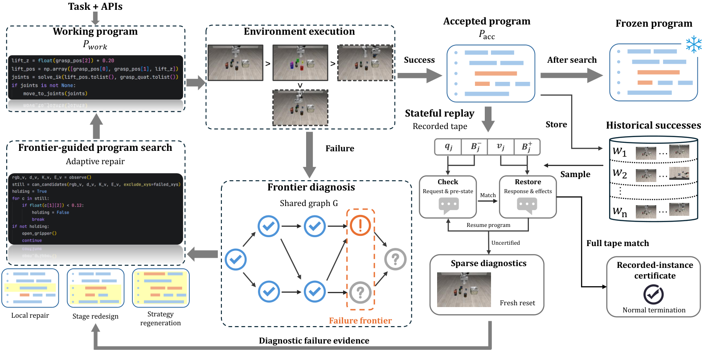

# SCOPE: Replaying successful evidence without rerunning a whole robot scene

<!-- source-sha256: 5f76e07f404cf9451f8d458b7a984d2ff35e45f0b7c1b7fb46357307539d6125 -->

[简体中文](README.md)

> `component_only` / L1 CPU state-replay component. Not a robot agent, full program search, or held-out capability evaluation.

## Paper information

| Field | Details |
| --- | --- |
| Paper | [SCOPE](https://arxiv.org/abs/2610.23128), reviewed at v1 |
| Company / institution | First author Junyang Shu; Wangxuan Institute of Computer Technology, Peking University |
| First public release | 2026-10-16 08:33:56 UTC, arXiv v1. Checked in the October 20 official announcement, not newly published that day. |
| Author code | [VDIGPKU/SCOPE](https://github.com/VDIGPKU/SCOPE) provides code and scripts under Apache-2.0. Its single-task example is not the full paper matrix. |
| Local adapter | None (`adapter: null`); component key `scope-replay` |
| Local implementation | `src/auto_research/agent_research/scope_replay.py`; `scripts/run_oct20_agent_components.py` |

## Paper summary

### Background and main changes

A robot-control program change can fix a new scene and break an old one. SCOPE builds a failure-frontier graph from development executions, distinguishing supported, refuted, and unknown checks. It continues search with local repairs, stage resets, or policy regeneration. It records complete API tapes for past successes. When candidate source changes, it selects up to three historical witnesses for local stateful replay; only a divergent instance may be scheduled for a sparse real-environment diagnostic. See [Section 3](https://arxiv.org/html/2610.23128v1#S3).

~~~mermaid
flowchart LR
    E[Development environment execution] --> N[Native success verdict]
    N --> A[Update accepted program]
    N --> W[API tape of successful instance]
    P[Candidate program] --> R[Complete stateful replay]
    W --> R
    R --> C[Same-instance certificate / divergence / unavailable]
    C --> D[Sparse diagnostic and subsequent search evidence]
~~~

Paper **Figure 2** covers stateful API replay and certification, whereas Figure 1 covers overall search. They are distinct; the original image is archived separately.

<!-- paper-figure:start -->
### Original paper figure

> **Paper Figure 1:** Stateful replay preserves API boundaries, reference aliases, and side effects to diagnose optimization failures and certify individual instances. Local coverage is limited to explicitly supported Python object graphs. From the [original paper](https://arxiv.org/abs/2610.23128); copyright remains with the authors. Click the image to open its source.
<!-- paper-figure:end -->

### Core equation

Each event in witness $w=(P_w,\xi_w,T_w)$ records the request $q_j$, public pre-state $B_j^-$, return value or exception $v_j$, and public post-state $B_j^+$:

$$
T_w=\{(q_j,B_j^-,v_j,B_j^+)\}_{j=1}^n.
$$

Replay the candidate from entry, matching requests and pre-states, restoring returns, exceptions, shared references, and public state mutations. Fully consuming the tape without extra external calls and terminating normally gives evidence for **the recorded instance $\xi_w$** under the paper's boundary assumptions, not equivalence over all inputs. Unknown nodes are not failures, and replay divergence is not an observed environment failure.

Only native environment success updates the accepted program. Replay is **not an acceptance or rollback gate**. The component must not reject a successful source merely because an old witness cannot replay.

### Offline and online results reported in the paper

On LIBERO-PRO the paper reports $80.66\pm1.46\%$, versus $74.14\pm3.11\%$ for ASPIRE with the same GLM-5.3-Flash. Robosuite gives $84.48\pm1.67\%$ versus $80.19\pm2.14\%$ for the same-backbone control. Real robot totals are 40/60 versus 24/60; fine manipulation remains harder. Replay takes about 4.62–6.59% of original execution time, not evidence that the entire learning system is cheap or a production A/B result. See [Section 4 and full tables](https://arxiv.org/html/2610.23128v1#S4).

## Local reproduction and limits

~~~bash
PYTHONPATH=src python scripts/run_oct20_agent_components.py \
  --methods scope-replay --seeds 42,43,44 --device cpu \
  --output runs/oct20-agent/scope-replay.json
~~~

The component actually records and replays trusted Python API callbacks over finite scalars, string-key dictionaries, lists, and tuples. It preserves mutable aliases, cycles, API returns pointing to existing containers, in-place side effects, and allowlisted built-in exceptions. Pre- and post-state use the same identity map, not per-item deep copies that break aliases. Conservative final public-state matching prevents changes after the final API call from being miscertified.

NumPy arrays or views, custom objects, unrecorded I/O, nondeterministic runtimes, and untrusted code are unsupported; they must be `unavailable` or fail certification assumptions, not count as success. Integrators bind callbacks to source IDs. This module does not execute arbitrary source text or sandbox malicious callbacks. It lacks the visual critic, frontier graph, LLM repair, and real-environment diagnostics.

The recorder invokes the native grader after full execution, never passing it to the tested program. Tests cover wrong arguments, broken aliases, early exit, extra calls, final-state edits, unavailable objects, and cross-instance use. The return-only negative control omits state restoration and must fail. Failure, divergence, and unavailability remain distinct. The [archived scalars](metrics/component-cpu-seeds42-44.json) are three-seed synthetic protocol diagnostics, not LIBERO success rates.

### Cost decision

Appendix B uses **8×PRO6000** for the language model and **8×A100** for vision/simulation, with 60 LIBERO task–setting pairs, seven Robosuite tasks, three independent learning runs, and physical robots. This does not fit a single A100/A30 or Mac budget. **The full experiment was reviewed and not reproduced because of cost.** Only the bounded CPU component is delivered: `diagnostic_only=true`, `promotion_eligible=false`, `evolve_integrated=false`.
