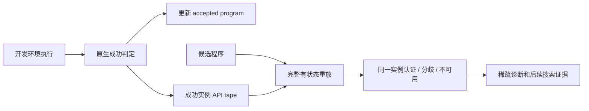
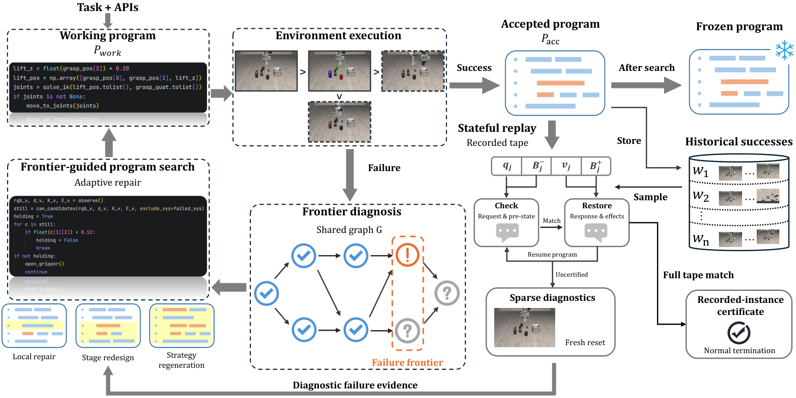

# SCOPE：重放成功证据，而不是重新跑完整机器人场景

> `component_only` / L1 CPU 状态重放组件；不是机器人 Agent、完整程序搜索或 held-out 能力评测。

## 论文信息

| 字段 | 内容 |
| --- | --- |
| 论文链接 | [SCOPE](https://arxiv.org/abs/2610.23128)，本批核对 v1 |
| 公司/机构 | 一作 Junyang Shu；北京大学王选计算机研究所 |
| 首次公开日期 | 2026-10-16 08:33:56 UTC，arXiv v1；本批在 10-20 官方公告核对，不称今日首发 |
| 原文开源代码 | [VDIGPKU/SCOPE](https://github.com/VDIGPKU/SCOPE)，已有源码、脚本与 Apache-2.0；仓库单任务示例不等于完整论文矩阵 |
| 本地 Adapter | 无（`adapter: null`）；组件 key：`scope-replay` |
| 本地复现代码 | `src/auto_research/agent_research/scope_replay.py`；`scripts/run_oct20_agent_components.py` |

## 原始论文总结

### 背景与主要改动

修改机器人控制程序可能修好新场景却破坏旧场景。SCOPE 从开发执行证据建立失败前沿图，区分有证据支持、被反驳和未知检查，按局部修补、阶段重设或策略重生成继续搜索。它记录过去成功实例的完整 API tape，在候选源变化时，抽取至多三个历史见证进行本地有状态重放；重放有分歧的实例才可能安排稀疏真实环境诊断。[§3](https://arxiv.org/html/2610.23128v1#S3)



原论文 **Figure 2** 是有状态 API 重放与认证图；Figure 1 是整体搜索流程。需保留二者区别。原图由本批统一资源流程处理。

<!-- paper-figure:start -->
### 原论文关键图

[](https://arxiv.org/html/2610.23128v1/Overview.png)

> **原论文 Figure 1（关键图）**：SCOPE通过有状态重放保留API边界、引用别名和副作用，以诊断优化失败并生成实例内认证；本地仅覆盖明确支持的Python对象图。图片来自[原论文](https://arxiv.org/abs/2610.23128)，版权归原作者所有；点击图片可查看来源。
<!-- paper-figure:end -->

### 核心公式

见证 $w=(P_w,\xi_w,T_w)$ 的每个事件记录请求 $q_j$、公共前状态 $B_j^-$、返回值或异常 $v_j$、公共后状态 $B_j^+$：

$$
T_w=\{(q_j,B_j^-,v_j,B_j^+)\}_{j=1}^n.
$$

候选从入口重放，逐步匹配请求和前状态，并恢复返回值、异常、共享引用和公共状态突变；完整消费 tape、无额外外部调用且正常终止，才在论文边界假设下为 **记录实例 $\xi_w$** 提供证据。它不是对所有输入的程序等价证明。未知节点不能当失败，重放分歧也不是观测到的环境失败。

尤其要注意：原生环境成功才更新 accepted program，重放**不是接受或回滚门**。成功源即使有旧实例无法重放，也不应被本地逻辑擅自拒绝。

### 论文离线与线上效果

LIBERO-PRO 为 $80.66\pm1.46\%$，相同 GLM-5.3-Flash 的 ASPIRE 为 $74.14\pm3.11\%$；Robosuite 为 $84.48\pm1.67\%$，同 backbone 对照 $80.19\pm2.14\%$。真实机器人总体 40/60 对 24/60；精细操作仍较难。重放仅约原始执行时间的 4.62–6.59%，不代表整套学习便宜，也不是生产线上 A/B。[§4 与完整表](https://arxiv.org/html/2610.23128v1#S4)

## 本地复现与边界

```bash
PYTHONPATH=src python scripts/run_oct20_agent_components.py \
  --methods scope-replay --seeds 42,43,44 --device cpu \
  --output runs/oct20-agent/scope-replay.json
```

真实执行可信 Python 回调的 API 记录与重放：有限标量、字符串键 dict、list、tuple，包含可变容器别名、循环引用、API 返回值指向既有容器、原地副作用和白名单内建异常。前后状态来自同一对象身份表；不能用逐项 deepcopy 破坏别名。另对最终公共状态做保守匹配，防止最后一次 API 之后的本地修改被误认证。

不支持 NumPy 数组/视图、自定义对象、未记录 I/O、非确定性运行时或不可信代码；这些必须是 `unavailable` 或不满足认证假设，而非成功证据。回调和 source 标识的对应由集成者负责，本模块不执行任意代码文本，也不是恶意回调沙箱。不实现视觉 critic、失败前沿图、LLM repair 或真实环境诊断。

原生 grader 只由 recorder 在完整执行之后调用，不传给被测程序。测试加入错误参数、破坏别名、提前退出、额外调用、终态修改、不可用对象和跨实例使用；return-only 负对照故意漏掉状态恢复，必须失败。失败、分歧与不可用分开保留。[归档标量](metrics/component-cpu-seeds42-44.json)是三 seed 合成协议诊断，不是 LIBERO 成功率。

### 成本决定

附录 B 使用 **8×PRO6000** 承载语言模型，另有 **8×A100** 承载视觉/仿真，并覆盖 60 个 LIBERO task–setting 对、7 个 Robosuite 任务、三次独立学习和实体机器人。单卡 A100/A30 或 Mac 无法低成本忠实覆盖。**完整实验成本过高，不复现（审查 DONE）**；只交付 CPU 有界机制，`diagnostic_only=true`、`promotion_eligible=false`、`evolve_integrated=false`。
