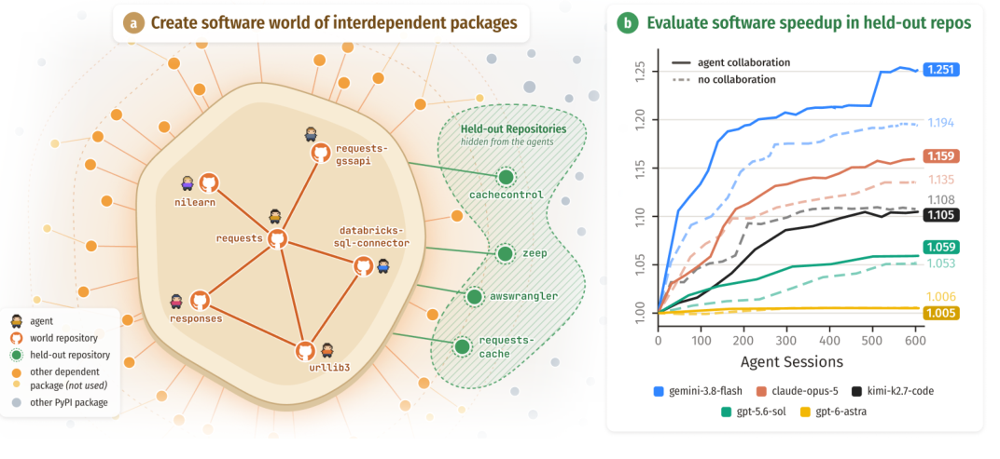

# World of SWECraft: Evaluating multi-agent collaboration in a real software ecosystem

<!-- source-sha256: 4f9b2949738c9c1c7202db6eff78e974e164d61aad39dccbc4315db4c3e103c3 -->

[简体中文](README.md)

> Research reference only. The full experiment was reviewed and not reproduced because of cost. There is no local software world, agent experiment, or capability metric.

## Paper information

| Field | Details |
| --- | --- |
| Paper links | [arXiv 2610.24061v1](https://arxiv.org/abs/2610.24061v1); [pinned PDF](https://arxiv.org/pdf/2610.24061v1) |
| Company / institution | First author Shannon Zejiang Shen: Massachusetts Institute of Technology; collaborators from UMD, UW, CMU, UMich, and Stanford. The catalog follows the affiliations in this paper rather than reclassifying it as Meta based on an author's other role. |
| First public release | 2026-10-16 17:59:39 UTC; announced on arXiv October 20 |
| Author code | The paper says its framework and traces are released through the [project page](https://szj.io/sw). That page returned 404 in this review, so the repository and license could not be verified. This establishes neither that the code is unreleased nor that a runnable implementation has been verified. |
| Local adapter / stable key | `world-of-swecraft`, reference key; `adapter: null` |
| Local implementation | None. Documentation and catalog entry only: `src/auto_research/paper_specs/catalog/agent-research/world-of-swecraft.json`. |

## Paper summary

### Background and main changes

Conventional coding-agent benchmarks assign a predefined issue, making it difficult to evaluate how multiple maintainers find work, divide it, and improve several repositories together. Software World is built from real dependency libraries. Agents collaborate over time through persistent memory, issues, pull requests, and releases. Hidden downstream packages test whether the collective work is actually useful.

SW-Env uses Harbor sessions and Forgejo to simulate software maintenance, with independent controls for communication permissions, repository ownership, and session budgets. SW-Eval installs frozen versions in hidden downstream packages and checks correctness and instruction counts. That helps prevent optimization only for visible microbenchmarks. Persistence across sessions is not one unbounded conversation.

~~~mermaid
flowchart LR
  P[Real dependency packages and ownership] --> E[SW-Env maintainer sessions]
  E --> C[Code / issues / PRs / releases]
  C --> N[Persistent state and next session]
  N --> E
  C --> S[Periodically freeze versions]
  S --> V[Isolated SW-Eval on hidden downstream packages]
  V --> R[Correctness gate and geometric mean of instruction ratios]
~~~

Figure 1 gives an overview of Software World, not a locally launched environment.

<!-- paper-figure:start -->
### Original paper figure

> **Paper Figure 1:** Real dependency libraries, collaborating maintainer agents, and hidden downstream evaluation. The right panel shows the authors' speedup curves with and without collaboration, not local results. From the [original paper](https://arxiv.org/abs/2610.24061v1); copyright remains with the authors. Click the image to open its source.
<!-- paper-figure:end -->

### Core equations

Let $I$ be the task instruction count. The speed ratio divides the initial count by the current count:

$$
r_t(k)=I_t(0)/I_t(k),\qquad
S(k)=\exp\left(\frac1{|T|}\sum_{t\in T}\log\tilde r_t(k)\right).
$$

When a package fails correctness, the strict rule assigns its tasks a ratio of 1 for that round. The carry rule uses the ratio from the most recent passing check; the paper's main result uses carry. Failed tasks must not be dropped before averaging. Instruction-count gains are not equivalent to wall-clock speedup. Implementing the equation alone would not reproduce the collaboration environment.

### Offline and online results reported in the paper

Three worlds cover networking, data science, the Web, and utility libraries. The study spans eight models, 55K sessions, over 180B tokens, and more than 10,000 hours of agent work. The authors report a best mean speedup of about 31% on hidden downstream tasks. Gains from collaboration, ownership, and budget vary by model. The paper also records negative outcomes such as stopping task search early or producing few improvements; larger models or more agents do not guarantee gains. No production user A/B test is reported. This is agent-evaluation research, not subject to the industrial recommendation A/B inclusion threshold.

## Local reproduction and cost decision

Full reproduction needs multi-repository builds, isolated deployment, code-execution sandboxes, real model sessions, and extensive hidden downstream evaluation. The original scale exceeds the low-cost budget of a single A100/A30 or local Mac. **The full experiment was reviewed and not reproduced because of cost.** No unknown project scripts were cloned or executed, no local agent results were fabricated, no automatic run was queued, and no Evolve integration is claimed.
