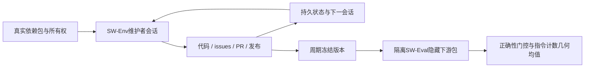
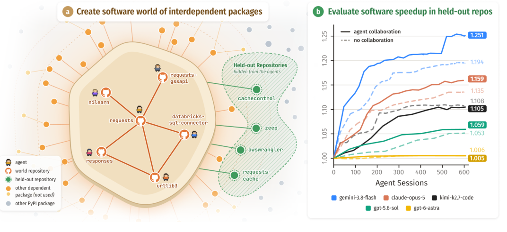

# World of SWECraft：真实软件生态中的多Agent协作评测

> 仅研究资料，**成本过高，不复现（审查 DONE）**。没有本地软件世界、Agent实验或能力指标。

## 论文信息

| 字段 | 内容 |
| --- | --- |
| 论文链接 | [arXiv 2610.24061v1](https://arxiv.org/abs/2610.24061v1)；[固定PDF](https://arxiv.org/pdf/2610.24061v1) |
| 公司 / 机构 | 一作Shannon Zejiang Shen：Massachusetts Institute of Technology；合作UMD、UW、CMU、UMich、Stanford。以本文所列机构为准，不凭某作者兼任关系改成Meta论文 |
| 首次公开日期 | 2026-10-16 17:59:39 UTC；10月20日arXiv公告 |
| 原作者代码 | 原文宣称通过[项目页](https://szj.io/sw)发布框架和traces；本轮项目页404，实际仓库与许可证未核验，不能写成“未发布”或“已核验可运行” |
| 本地 adapter / 稳定键 | `world-of-swecraft`（资料键）；`adapter: null` |
| 本地复现代码 | 无；仅本文与`src/auto_research/paper_specs/catalog/agent-research/world-of-swecraft.json` |

## 原始论文总结

### 背景与主要改动

传统代码Agent评测通常分配一个预定义issue，难以衡量多个维护者如何自主找任务、分工和跨仓库改进。Software World由真实依赖库构成，让Agent用持久记忆、issue、PR和发布进行长期协作，以不可见的下游包检查群体产出是否真正有用。

SW-Env用Harbor会话和Forgejo模拟软件维护环境，通信权限、仓库所有权与会话预算可独立控制；SW-Eval在隐藏依赖包上安装冻结版本，测正确性与指令计数，避免只优化自己看到的微基准。多会话持久状态不是无限增长的单条对话。

原文Figure1是Software World总览，不代表本地已启动环境。

<!-- paper-figure:start -->
### 原论文关键图

> **原论文 Figure 1（关键图）**：Software World 的真实依赖库、维护者Agent协作和隐藏下游评测；右图是作者实验中协作/不协作的提速曲线，不是本地结果。图片来自[原论文](https://arxiv.org/abs/2610.24061v1)，版权归原作者所有；点击图片可查看来源。
<!-- paper-figure:end -->

### 核心公式

令任务指令计数为I，速度比为初始值除当前值：

$$
r_t(k)=I_t(0)/I_t(k),\qquad S(k)=\exp\left(\frac1{|T|}\sum_{t\in T}\log\tilde r_t(k)\right).
$$

包正确性失败时，strict将该包任务本轮记为1，carry采用最近一次通过检查的速度比；原文主结果用carry。不能丢弃失败任务后再平均，不能将墙钟加速与指令计数收益等同。仅实现该公式也不等于复现协作环境。

### 论文离线与线上效果

三种世界覆盖网络、数据科学、Web与工具库；8模型、55K会话、180B以上tokens，总计超过10000小时Agent工作。作者报告最佳隐藏下游平均提速约31%，不同模型对协作、所有权和预算的收益不同；论文亦保留提前停止找任务、改进很少等负面结果，不保证模型规模或多Agent必然提升。无生产用户A/B；本条是Agent评测研究，不适用工业推荐A/B筛选门槛。

## 本地复现与成本判断

完整复现需要多仓库构建、隔离部署、代码执行沙箱、真实模型会话及大量隐藏下游评测；原论文规模已明显超过单卡A100/A30与Mac低成本预算。**成本过高，不复现（审查 DONE）**。不克隆和执行未知项目脚本、不伪造本地Agent成绩、不保留自动运行队列，也不宣称Evolve已接入。
