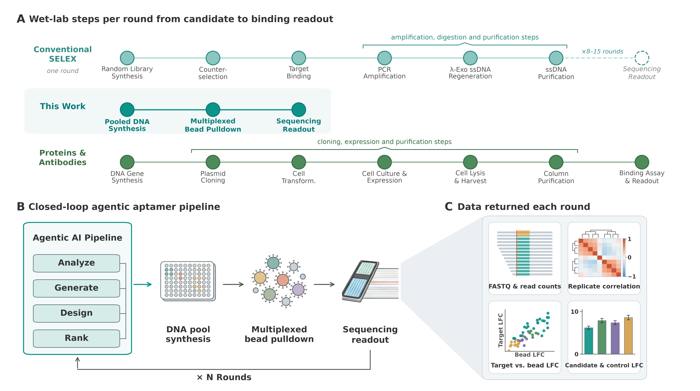

# Aptamer Lab Loop: Grounding agent self-improvement in experimental feedback

<!-- source-sha256: 04537c56a0fd0380f330a5c30d1868004883a188206430f491172cf5e9309c9a -->

[简体中文](README.md)

> Google-priority research reference. The full experiment was reviewed and not reproduced because of cost. No low-cost proxy is labeled an implementation, and the entry is not queued for automatic training.

## Paper information

| Field | Details |
| --- | --- |
| Paper links | [arXiv v1](https://arxiv.org/abs/2610.24806v1); [official Google publication page](https://research.google/pubs/aptamers-as-a-sandbox-for-lab-in-the-loop-agentic-molecular-discovery/) |
| Original title | Aptamers as a sandbox for lab-in-the-loop agentic molecular discovery |
| Company / institution | First author Zachary Cutts: Google Research; collaborators from Stanford, Google Cloud, and DeepMind |
| First public release | 2026-10-17 18:21:50 UTC. A new catalog entry is not a new publication. |
| Author code | The paper lists third-party research tools and supplementary materials, but no complete author agent-harness repository was found. Open-source dependencies do not make the entire author system open source. |
| Local adapter / stable key | `aptamer-lab-loop`; `adapter: null`, reference only |
| Local implementation | No algorithm implementation. Normalized catalog spec: `src/auto_research/paper_specs/catalog/agent-research/aptamer-lab-loop.json`. |

## Paper summary

### Background and main changes

The study puts computational design and physical measurements into a multi-round feedback loop, so the agent can use evidence of both success and failure to adjust the next round. The key is not simply running an agent for more rounds: physical measurements can contradict computational scores. The paper shows disagreement between some predictive proxies and measured outcomes. This note discusses research orchestration and evidence limits only; it does not provide laboratory procedures.

~~~mermaid
flowchart LR
  A[Past experimental data and research hypotheses] --> B[Agent proposes the next round of designs]
  B --> H[Human authorization and physical lab platform]
  H --> C[Physical measurements and counterexamples]
  C --> A
~~~

<!-- paper-figure:start -->
### Original paper figure

> **Paper Figure 1:** Multiple rounds connect research design, physical experiments, and data feedback. From the [original paper](https://arxiv.org/abs/2610.24806v1); copyright remains with the authors. This is not a local implementation or execution record.
<!-- paper-figure:end -->

### Core mechanism and evaluation

Candidates are proposed from previously visible experimental data, then evaluated with new physical measurements. Computational proxies do not replace the experimental endpoint; the feedback retains cross-reactivity and failures. The paper covers three rounds and about 4,400 constructs. Candidate sets and interventions vary by round, so a change in hit rate is not a machine-learning gain on the same fixed test set.

### Offline and online results reported in the paper

The results are from a laboratory study, not a production or internet A/B test. Physical validation is not interchangeable with an LLM benchmark, agent task success rate, or software simulation score.

## Local reproduction and cost decision

The full study needs a specialist laboratory, physical measurements, and multiple 7–10 day feedback cycles. It cannot be reproduced at low cost on a single A100/A30 or a local Mac. Based on Results R.1 and Figure 1, **the full experiment was reviewed and not reproduced because of cost**. No model download, experiment, or proxy test was started.

There is no GPU receipt, local capability metric, or Evolve integration. The decision can be reconsidered only if additional resources or experimental authorization are explicitly provided and an executable plan exists. It does not block the regular review watermark.
