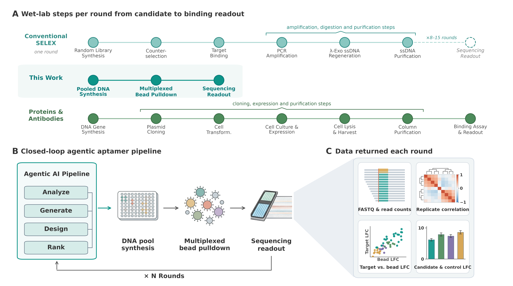

# Aptamer Lab Loop：以真实实验反馈约束Agent自改进

> Google优先资料收录；完整实验**成本过高，不复现（审查 DONE）**。没有低成本代理被标成实现，不进入自动训练队列。

## 论文信息

| 字段 | 内容 |
| --- | --- |
| 论文链接 | [arXiv v1](https://arxiv.org/abs/2610.24806v1)；[Google官方页](https://research.google/pubs/aptamers-as-a-sandbox-for-lab-in-the-loop-agentic-molecular-discovery/) |
| 原文标题 | Aptamers as a sandbox for lab-in-the-loop agentic molecular discovery |
| 公司 / 机构 | 一作Zachary Cutts：Google Research；合作Stanford、Google Cloud/DeepMind |
| 首次公开日期 | 2026-10-17 18:21:50 UTC；目录新增不等于今日首发 |
| 原作者代码 | 原文列有第三方科研工具与补充资料，未找到完整作者Agent harness仓库；依赖开源不等于作者全系统开源 |
| 本地 adapter / 稳定键 | `aptamer-lab-loop`；`adapter: null`，资料条目 |
| 本地复现代码位置 | 无算法实现；规范化规格位于`src/auto_research/paper_specs/catalog/agent-research/aptamer-lab-loop.json` |

## 原始论文总结

### 背景与主要改动

该研究把计算设计与真实实验测量放进多轮反馈闭环，让Agent利用成功和失败证据调整下一轮策略。关键不是把Agent多跑几轮，而是实物测量可以否定计算评分；论文显示一些预测代理与实际测量不一致。这里仅讨论研究编排与证据边界，不提供生物实验操作流程。

<!-- paper-figure:start -->
### 原论文关键图

> **原论文 Figure 1**：研究设计、物理实验及数据反馈的多轮关系。图片来自[原论文](https://arxiv.org/abs/2610.24806v1)，版权归原作者所有；不是本地实现或运行证据。
<!-- paper-figure:end -->

### 核心机制与评测

候选由前轮可见实验数据产生，再用新的真实测量评价，不以计算代理代替实验终点；反馈中保留交叉反应与失败证据。正文包含三轮、约4400个构建体的研究。不同轮次的候选集和干预不同，命中比例变化不是同一固定测试集上的机器学习提升。

### 论文离线与线上效果

论文报告实验室结果而非生产A/B；未报告互联网线上A/B。物理验证不能等价为LLM benchmark、Agent任务成功率或软件模拟分数。

## 本地复现与成本决策

完整研究需要专业实验室、物理测量与多轮7–10天反馈周期，无法在单A100/A30或本地Mac低成本完成。依据Results R.1/Figure1直接标记**成本过高，不复现（审查 DONE）**，未启动模型下载、实验运行或无意义代理测试。

没有GPU回执、没有本地能力指标、没有Evolve集成。仅在后续明确新增资源/实验授权且出现可执行方案时重新考虑，不阻塞日常审查水位。
