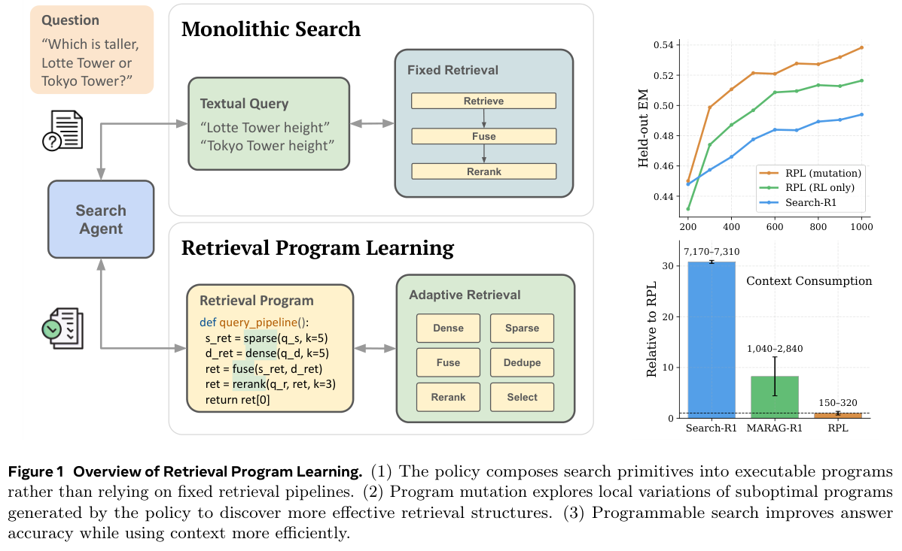

# RPL: Exploring programmable retrieval through structural mutations

<!-- source-sha256: 4d76525fdffa5b6b2b80c6edeca04b18238a2f018752ad63bbc3b4da41635ae8 -->

[简体中文](README.md)

## Paper information

| Field | Details |
| --- | --- |
| Paper | [Learning to Program Retrievals](https://arxiv.org/abs/2610.24854); [reviewed v1 full text](https://arxiv.org/html/2610.24854v1) |
| Company / institution | First author Kyuyoung Kim: KAIST AI / Meta Superintelligence Labs. The paper states the work was done at Meta. |
| First public release | 2026-10-17 20:03:09 UTC. The October 20 header is not the first public release of arXiv v1. |
| Author code | October 29 follow-up verified [Meta's retrieval-programs repository](https://github.com/facebookresearch/retrieval-programs) at `992fda1f5f0eb01a8fb70202ff8f7a65aed48465`. Original work is CC BY-NC 4.0; vendored components retain their individual licenses, as documented in LICENSE. This supersedes the earlier finding that no repository link had been located. |
| Local adapter | `rpl` is a component key, not a full training adapter. |
| Local implementation | `src/auto_research/agent_research/retrieval_program.py`; `scripts/run_oct21_rpl.py` |

> **CPU-only typed-program component.** No policy model, BM25/E5/Qwen neural retrieval or reranking, arbitrary Python execution, cross-turn Python state, GRPO, or distillation training is implemented.

The repository follow-up updates author-code provenance only. It does not copy upstream code, modify the local execution path, or raise the validation tier. A newly public official repository does not count as a newly published paper.

## Paper summary

### Background and main changes

A fixed retrieval pipeline ties together the retrieval count, fusion, and the context returned to the model. RPL lets the policy generate short programs that compose sparse and dense retrieval, reciprocal rank fusion (RRF), deduplication, and reranking. Only explicitly printed evidence is returned to the model. To explore under sparse rewards, RPL preserves the policy's existing queries and applies grammar-constrained structural mutations to the last retrieval program. When a mutated program passes execution verification, the policy generates a continuation with its evidence, and distillation is interleaved with RL. See [Section 3 and Appendix B](https://arxiv.org/html/2610.24854v1#S3).

~~~mermaid
flowchart TD
    Q[Queries already produced by the policy] --> P[Constrained retrieval program]
    P --> SDK[Retrieval / RRF / deduplication / reranking]
    SDK --> O[Only explicitly selected evidence enters the model context]
    P --> M[Structural mutation preserving the original query pool]
    M --> V[Training-side execution verification]
    V --> C[Regenerate a continuation with actual evidence]
    C --> S[Program supervision and incorrect-answer masking]
    S --> RL[Paper distillation then continued RL, not implemented locally]
~~~

<!-- paper-figure:start -->
### Original paper figure

> **Paper Figure 1, PDF page 2:** The left side illustrates changes to retrieval structure; the right shows the authors' training and context results, not local measurements. From the [original paper](https://arxiv.org/pdf/2610.24854v1); copyright remains with the authors. The graphic, legend, and full caption were checked for clipping.
<!-- paper-figure:end -->

### Core equations

$$
\mathcal U(p)\subseteq 2^{Q_p}\times\{\mathrm{dense},\mathrm{sparse},\mathrm{fuse}\}
\times\{3,5,10,20,50\}\times\{0,3,5,10,20\}.
$$

The last dimension is the number of documents retained by reranking; zero means no reranking. Multiple retrieval calls must be fused, duplicate calls are disallowed, and the output must stay within budget. Distance compares retrieval mode changes, adding or removing reranking, query subset changes, steps on the retrieval-width ladder, and steps on the reranking-width ladder, in that order. Only this typed grammar subset is implemented locally.

$$
\mathcal D_{\mathrm{mut}}=\{(x,p',y'):\ V_{\mathrm{ret}}(p')=1\}.
$$

A verified program can remain in supervision even if its answer is wrong, but the answer span is masked. Environment observations are never supervised. Only the training-side verifier may access gold; it is not passed to the program or continuation actor.

### Offline and online results reported in the paper

The authors compare 4B/8B models on seven QA benchmarks and GlobalQA, reporting gains in multi-hop QA and context efficiency. See [Section 4 and Appendix A](https://arxiv.org/html/2610.24854v1#S4) for results and failure cases. No production A/B test is reported. The local work checks grammar and execution only, does not generate QA answers, and does not report synthetic support-document coverage as QA accuracy.

## Local reproduction

~~~bash
PYTHONPATH=src python scripts/run_oct21_rpl.py \
  --device cpu --seeds 42,43,44 \
  --output runs/oct21-rpl/fresh-result.json
~~~

`RetrievalProgram` supports up to four distinct queries, widths from the paper's ladder, and up to 20 explicitly returned documents. `execute` interprets dataclasses and calls an injected SDK; it does not parse or execute Python source. Multi-route retrieval actually performs RRF. An identical ID with different contents is rejected within any route, within a result list, or across routes; only exact duplicates are removed. Reranking cannot inject documents outside the retrieved set. The RRF constant of 60 is an explicit local convention. The local output cap counts documents; it does not implement the paper's 2,048-token observation cap.

`verified_mutation` tries the smallest structural distance first and breaks ties by actual candidate count and call count. It allows at most 256 executions and defaults to 64. If the budget runs out, it may return no solution. The training verifier is separate from the continuation context, which contains only the public question, program, and printed evidence. `supervision_spans` is a span-level contract, not a token mask or SFT trainer. Arbitrary Python control flow and cross-turn local state are not implemented, so this is not a full RPL reproduction.

### Data, results, and negative controls

The fixture revision is `synthetic-rpl-sdk-rankings@oct21-contract-v1`. The pinned ranking callback is not a neural retriever. The original width-three program cannot see the fifth support document; an actually executed width-five mutation retrieves it. Another check retrieves 20 candidates but prints only three documents, and wrong answers are excluded from supervision. The original program is the negative control; output is not built directly from gold. See the [actual CPU metrics](metrics/component-cpu-seeds42-44.json).

### Cost and reproduction limits

Appendix C uses 4B/8B policies, 1,000 training steps for QA and 500 for GlobalQA, a batch size of 512, and five rollouts per prompt. Each training run uses 8×H100, with a separate 8×H100 node for reranking. **The full experiment was reviewed and not reproduced because of cost.** No full Wikipedia index or large-model RL run was used merely to demonstrate expense. The low-cost component does not need CUDA. `diagnostic_only=true`, `promotion_eligible=false`, `evolve_integrated=false`.
