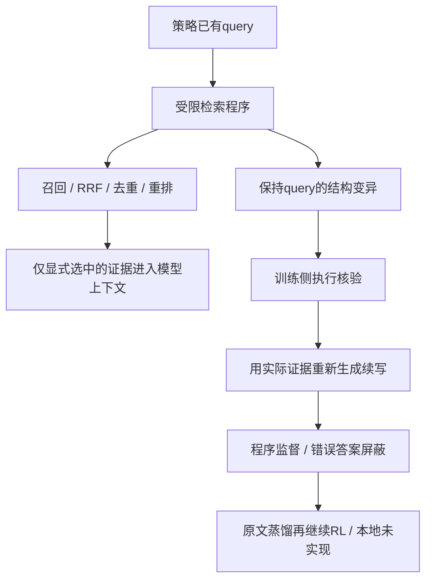
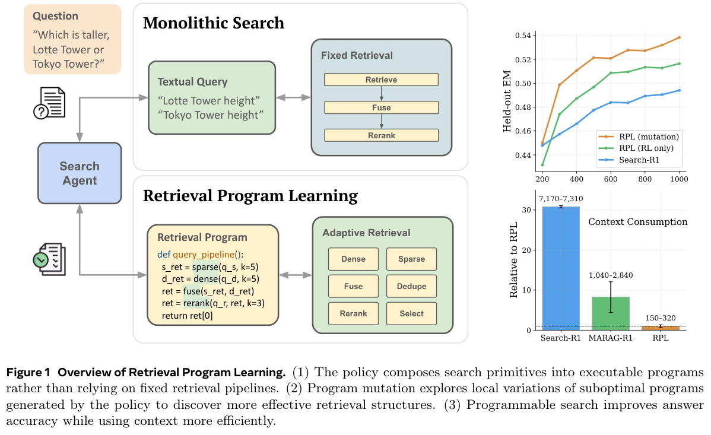

# RPL：用结构变异探索可编程检索

## 论文信息

| 字段 | 内容 |
| --- | --- |
| 论文链接 | [Learning to Program Retrievals](https://arxiv.org/abs/2610.24854)，核对[v1正文](https://arxiv.org/html/2610.24854v1) |
| 公司/机构 | 一作Kyuyoung Kim：KAIST AI / Meta Superintelligence Labs；论文明确工作在Meta完成 |
| 首次公开日期 | 2026-10-17 20:03:09 UTC；正文页眉的October 20不是arXiv v1首次公开日期 |
| 原文开源代码 | 作者宣称发布代码，但v1正文、arXiv页及[一作官方主页](https://kykim0.github.io/publications/)本轮未找到可核验的RPL仓库链接；不标为已验证开源 |
| 本地 Adapter | `rpl`为组件键，不是完整训练adapter |
| 本地复现代码 | `src/auto_research/agent_research/retrieval_program.py`；`scripts/run_oct21_rpl.py` |

> **仅CPU typed-program组件。** 不实现策略模型、BM25/E5/Qwen神经检索/重排、任意Python执行、跨轮Python状态、GRPO或蒸馏训练。

## 原始论文总结

### 背景与主要改动

固定检索pipeline把召回数量、融合和返回上下文绑在一起。RPL让策略生成短程序组合稀疏/稠密召回、RRF、去重和重排，只将显式打印的证据交回模型。为解决稀疏奖励难探索的问题，保留策略已有query，对最后一次检索程序做受语法约束的结构变异；执行核验通过后生成续写轨迹，再穿插蒸馏与RL。[§3及附录B](https://arxiv.org/html/2610.24854v1#S3)



<!-- paper-figure:start -->
### 原论文关键图

[](https://arxiv.org/pdf/2610.24854v1#page=2)

> **原论文Figure 1，PDF第2页**：左侧展示检索结构变化，右侧是作者的训练/上下文结果，不是本地结果。图片来自[原论文](https://arxiv.org/pdf/2610.24854v1)，版权归原作者所有；已检查图形、图例及完整说明未裁断。
<!-- paper-figure:end -->

### 核心公式

$$
\mathcal U(p)\subseteq 2^{Q_p}\times\{\mathrm{dense},\mathrm{sparse},\mathrm{fuse}\}
\times\{3,5,10,20,50\}\times\{0,3,5,10,20\}.
$$

最后一维为重排保留数，0表示不重排。多次召回必须融合、无重复调用，并遵守输出预算。距离按模态变化、增删重排、query子集变化、召回宽度阶数、重排宽度阶数依次比较；本地只实现这个typed grammar子集。

$$
\mathcal D_{\mathrm{mut}}=\{(x,p',y'):\ V_{\mathrm{ret}}(p')=1\}.
$$

答案错误仍可保留核验过的程序监督，但屏蔽答案span；环境观察从不监督。Gold只允许训练侧verifier访问，不能传给程序或续写actor。

### 论文离线与线上效果

作者在七个QA基准及GlobalQA上比较4B/8B模型，报告多跳QA与上下文效率收益；结果和失败条件见[§4及附录A](https://arxiv.org/html/2610.24854v1#S4)。没有生产线上A/B。本地仅测语法与执行，不生成QA答案，不把构造支持文档覆盖率写成QA准确率。

## 本地复现

```bash
PYTHONPATH=src python scripts/run_oct21_rpl.py \
  --device cpu --seeds 42,43,44 \
  --output runs/oct21-rpl/fresh-result.json
```

`RetrievalProgram`最多4个不同query，宽度取论文阶梯，最多20篇显式输出；`execute`只解释数据类并调用注入的SDK，不解析或执行Python源码。多路检索实际执行RRF，单路、列表内部或跨路遇到相同ID不同内容时统一拒绝，只有内容完全一致的重复才去重；重排不得注入召回外文档。RRF常数60是明确的本地惯例；输出是文档数上限，不是假装实现了论文2048-token观测限制。

`verified_mutation`优先试最小结构距离，同距离用实际候选量/调用量破同分，最多256次、默认64次执行；耗尽预算可返回无解。训练verifier与续写上下文分离，后者只有公开问题、程序和打印证据。`supervision_spans`是span级合同，不是token mask或SFT训练器。没有实现原文自由Python控制流及跨轮局部状态，因此不能称完整RPL复现。

### 数据、结果与负对照

构造版本为`synthetic-rpl-sdk-rankings@oct21-contract-v1`；固定ranking回调不是神经retriever。原宽度3的程序看不到第5个支持文档，实际执行的宽度5变异可以覆盖；另验证宽召回20条、只打印3篇，错误答案不监督。原程序是负对照，不由gold直接构造输出。[实际CPU指标](metrics/component-cpu-seeds42-44.json)

### 成本与复现边界

原文附录C为4B/8B策略、QA训练1000步/GlobalQA 500步、batch512、每prompt5个rollout；每次训练用8×H100，重排还需独立8×H100节点。**成本过高，不复现（审查 DONE）**；不为证明昂贵而下载完整Wikipedia索引或试跑大模型RL。低成本组件不需要CUDA。`diagnostic_only=true`、`promotion_eligible=false`、`evolve_integrated=false`。
