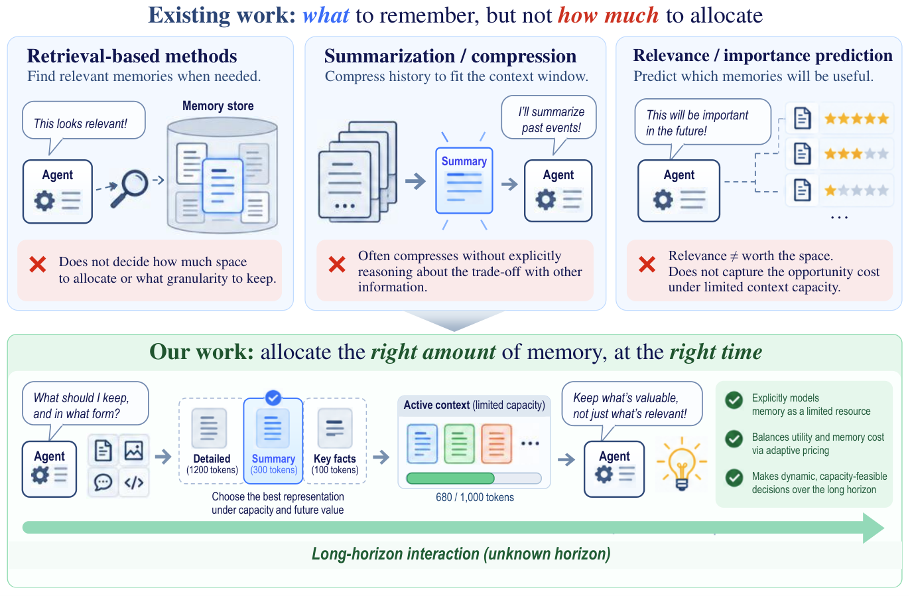

# MemPrice: Pricing memory detail instead of filling the context window

<!-- source-sha256: d4ee0743c138d1d79e69a22798bddc199b6cea29fbbbcb6d1410a067b48b8c40 -->

[简体中文](README.md)

> `component_only` / CPU L1 mechanism diagnostic. This validates allocation and state updates, not long-memory question answering or agent capability.

## Paper information

| Field | Details |
| --- | --- |
| Paper | [MemPrice](https://arxiv.org/abs/2610.24955), reviewed at v1 |
| Company / institution | First author Yiming Zong, Industrial Engineering and Decision Analytics, Hong Kong University of Science and Technology |
| First public release | 2026-10-18 02:11:53 UTC, arXiv v1. The October 20 announcement is not the first release. |
| Author code | The paper lists an [anonymous repository](https://anonymous.4open.science/r/ICLR2027-MemPrice), which could not be accessed and verified in this review. The complete official implementation is not confirmed. |
| Local adapter | None (`adapter: null`); component key `memprice` |
| Local implementation | `src/auto_research/agent_research/memprice.py`; `scripts/run_oct20_agent_components.py` |

## Paper summary

### Background and main changes

During a long interaction, the future usefulness of a past detail is usually unknown. Keeping memory by relevance alone ignores competition for the same context space. MemPrice offers five representations per memory item: raw, summary, abstraction, keywords, and delete. It allocates the limited tokens jointly, with a virtual queue that accumulates occupancy pressure and raises the price of retaining detail. Details deleted from the current window cannot reappear on their own; they can only be re-extracted from the external raw archive at refresh time under a fixed procedure. See [Section 3 and Appendix G](https://arxiv.org/html/2610.24955v1#S3).

~~~mermaid
flowchart LR
    H[Currently visible history] --> O[External compression and utility estimation]
    O --> D[Exact multiple-choice knapsack]
    Q[Persistent pressure queue and price] --> D
    D --> C[Memory within capacity]
    C --> Q
    A[Raw archive] --> R[Fixed refresh procedure]
    R --> H
~~~

Paper **Figure 2** shows the allocation framework. **Algorithm 1** states that refresh does not reset the queue or the global round count. The original figure is archived separately; the diagram above is a redraw, not a copy of the paper's figure.

<!-- paper-figure:start -->
### Original paper figure

> **Paper Figure 1:** MemPrice assigns different fidelities per memory item and uses dynamic prices and long-run pressure to control context usage. The local implementation covers knapsack allocation and the queue, not the pictured LLM utility estimator. From the [original paper](https://arxiv.org/abs/2610.24955); copyright remains with the authors. Click the image to open its source.
<!-- paper-figure:end -->

### Core equations

Let $B$ be the hard capacity for historical memory, $s_i^{(j)}$ the tokenizer-measured size, and $\hat u_i^{(j)}$ the utility estimate under the current information constraints:

$$
\max_{(c_i):\sum_i s_i^{(c_i)}\le B}
\sum_i\left(\hat u_i^{(c_i)}-\frac{\lambda_t}{B}s_i^{(c_i)}\right),\quad
\lambda_t=\frac{cQ_t}{\sqrt t},\qquad
Q_{t+1}=\max(0,Q_t+G_t/B-\alpha).
$$

This is an exact multiple-choice knapsack problem, not a per-item greedy rule. $\alpha=0.8$ is the average occupancy target; the hard capacity still applies in each round. The paper proves a conditional hindsight comparison on the realized state trajectory and a worst-case linear regret result for the independent-state hindsight comparator. It does not establish that memory selection is always optimal.

### Offline and online results reported in the paper

The paper reports LongMemEval-S, LoCoMo, AppWorld, and WebShop results across multiple budgets, three serving models, and three random seeds. The budget-constrained method has an overall advantage, but Full Context is a resource-unmatched reference and is not surpassed in every setting. No production A/B test is reported. In Setting I the final question is not visible during memory construction. In Setting II the current task goal is visible, but future tool outputs and evaluation state are not. See the [experiments and information contract](https://arxiv.org/html/2610.24955v1#S5).

## Local reproduction and limits

~~~bash
PYTHONPATH=src python scripts/run_oct20_agent_components.py \
  --methods memprice --seeds 42,43,44 --device cpu \
  --output runs/oct20-agent/memprice.json
~~~

The CPU component executes sparse integer dynamic programming, repairs utility monotonicity, enforces non-increasing fidelity, updates pressure, and preserves state across refresh boundaries. Trusted callers supply token counts and compressed contents; character count is not token count. Refresh only permits the next round's candidates to be rebuilt from an archive. It does not implement the paper's LLM compression or utility models or BM25 archive retrieval. The upstream caller also has to ensure text at a given level was derived from the existing content: a local fidelity-level check cannot prove semantic provenance.

Validation compares objectives and hard capacity against independent exhaustive search on small random problems. Negative controls include suboptimal greedy allocation, invalid sizes, duplicate keys, a high price forcing deletion, and a refresh that must not reset the queue. `allocate` has no query, answer, or gold parameter. Random utilities are synthetic solver inputs, not LLM valuation capability. Results include per-seed records, fixture/source SHA256, and trajectories, and cannot be overwritten. The [archived scalars](metrics/component-cpu-seeds42-44.json) come from the shared closeout process; mechanism success is not reported as a task improvement.

### Cost decision

The full matrix involves GLM-5.3-Flash, DeepSeek-V4.1-Flash, Qwen3.8-Flash, multiple datasets and budgets, repeated compression and valuation, and three seeds. The paper's reported cost cannot be reliably converted to single-A100/A30 runtime. The local component runs only bounded DP. **The full experiment was reviewed and not reproduced because of cost.** No API calls, model downloads, or long-trajectory probes were made. `diagnostic_only=true`, `promotion_eligible=false`, `evolve_integrated=false`.
