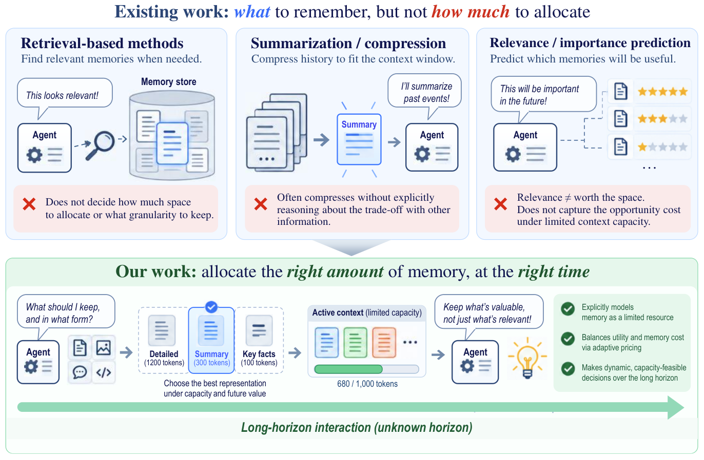

# MemPrice：给记忆细节定价，而不是一味塞满上下文

> `component_only` / L1 CPU 机制诊断。只验证分配和状态更新，不代表长记忆问答或 Agent 能力。

## 论文信息

| 字段 | 内容 |
| --- | --- |
| 论文链接 | [MemPrice](https://arxiv.org/abs/2610.24955)，本批核对 v1 |
| 公司/机构 | 一作 Yiming Zong；香港科技大学 Industrial Engineering and Decision Analytics |
| 首次公开日期 | 2026-10-18 02:11:53 UTC，arXiv v1；10-20 公告收录，不称 10-20 首发 |
| 原文开源代码 | [论文所列匿名仓库](https://anonymous.4open.science/r/ICLR2027-MemPrice)；本轮无法访问核验，不能声称已核实完整官方实现 |
| 本地 Adapter | 无（`adapter: null`）；组件 key：`memprice` |
| 本地复现代码 | `src/auto_research/agent_research/memprice.py`；`scripts/run_oct20_agent_components.py` |

## 原始论文总结

### 背景与主要改动

长交互里，过去某个细节会不会有用通常事先未知。单纯按相关性保留记忆会忽略各条信息对同一上下文容量的竞争。MemPrice 给每项记忆提供 raw、summary、abstraction、keywords、delete 五级表示，联合分配有限 token；再用随占用累积的虚拟队列提高保留细节的价格。当前窗口中已经删掉的细节不能凭空恢复，只有刷新时从外部原始归档按固定流程重新提取。[§3 与附录 G](https://arxiv.org/html/2610.24955v1#S3)


原论文 **Figure 2** 展示记忆分配框架，**Algorithm 1** 明确刷新不重置队列和全局轮数。原图由本批统一资源流程归档，不把本页重绘图冒充原图。

<!-- paper-figure:start -->
### 原论文关键图

[](https://arxiv.org/html/2610.24955v1/comparison.png)

> **原论文 Figure 1（关键图）**：MemPrice对每条记忆分配不同保真表示，并以动态价格和长期压力控制上下文；本地只实现背包分配与队列，不实现图中的LLM估值。图片来自[原论文](https://arxiv.org/abs/2610.24955)，版权归原作者所有；点击图片可查看来源。
<!-- paper-figure:end -->

### 核心公式

令 $B$ 为历史记忆硬容量，$s_i^{(j)}$ 为 tokenizer 测得大小，$\hat u_i^{(j)}$ 为当前允许信息下的效用估计：

$$
\max_{(c_i):\sum_i s_i^{(c_i)}\le B}
\sum_i\left(\hat u_i^{(c_i)}-\frac{\lambda_t}{B}s_i^{(c_i)}\right),\quad
\lambda_t=\frac{cQ_t}{\sqrt t},\qquad
Q_{t+1}=\max(0,Q_t+G_t/B-\alpha).
$$

这是精确多重选择背包，不是逐项贪心。$\alpha=0.8$ 是平均占用目标，单轮硬容量仍必须成立。论文只对已实现状态轨迹上的 hindsight 比较给出条件性保证；它也证明独立状态 hindsight 的最坏线性遗憾，不支持“总能最优记忆”的表述。

### 论文离线与线上效果

论文在 LongMemEval-S、LoCoMo、AppWorld、WebShop 上报告多预算、三个服务模型和三个随机种子的结果；预算内方法整体有优势，但 Full Context 是不匹配资源的单独参考，并非处处被超过。没有生产线上 A/B。Setting I 构建记忆时连最终问题都不能见；Setting II 可见当前任务目标，不能见未来工具结果或评测状态。[实验与信息合同](https://arxiv.org/html/2610.24955v1#S5)

## 本地复现与边界

```bash
PYTHONPATH=src python scripts/run_oct20_agent_components.py \
  --methods memprice --seeds 42,43,44 --device cpu \
  --output runs/oct20-agent/memprice.json
```

CPU 组件真实运行稀疏整数动态规划、效用单调修复、降保真约束、压力更新和刷新跨界状态。token 大小与压缩内容由可信调用方给出，不能把字符数当真实 token。刷新只开放下一轮从归档重新形成的候选，不实现论文的 LLM 压缩/效用模型或 BM25 归档恢复。相同等级的文本是否确实由现有内容压缩而来，也需要上游保证；本地等级检查不能证明语义来源。

验收使用独立穷举参照比较随机小问题的目标值、硬容量，加入贪心次优负对照、非法大小/重复 key，以及高价格迫使删除和刷新不重置队列的检查。`allocate` 根本没有 query、answer、gold 参数；随机效用是给求解器的合成输入，不是 LLM 估值能力。结果含逐 seed、fixture/source SHA256 和轨迹；输出不可覆盖。[归档标量](metrics/component-cpu-seeds42-44.json)由统一收口流程生成，不把机制成功率换算成任务提升。

### 成本决定

完整矩阵涉及 GLM-5.3-Flash、DeepSeek-V4.1-Flash、Qwen3.8-Flash、多数据集/预算、重复压缩估值与三种子，论文未给出可可靠换算为单卡 A100/A30 时长的运行成本。本地只执行有界 DP；**完整实验成本过高，不复现（审查 DONE）**，不发起 API、模型下载或长轨迹试跑。`diagnostic_only=true`、`promotion_eligible=false`、`evolve_integrated=false`。
