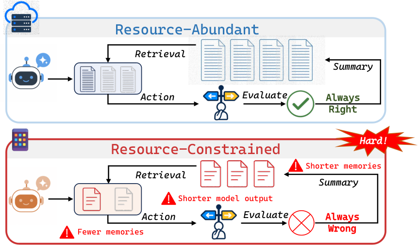

# TokenWorth: Learning memory value from completed-task feedback

<!-- source-sha256: 90b3484bbfe1df29e3211984309bb1103289680355a5e412ca961d770937b172 -->

[简体中文](README.md)

> **L1 CPU mathematical and temporal protocol; diagnostic only.** Selected memory associations are not causal effects or agent capability evidence.

## Paper information

| Field | Details |
| --- | --- |
| Paper | [Remembering Has a Price: Learning Memory Worth under Resource Constraints](https://arxiv.org/abs/2610.26453) |
| Affiliations | First author Guannan Lai: School of Artificial Intelligence and State Key Laboratory for Novel Software Technology, Nanjing University. |
| First public release | 2026-10-19 14:09:45 UTC |
| Author code | [AIGNLAI/TokenWorth](https://github.com/AIGNLAI/TokenWorth) includes tokenworth_core and environments; the official tasks were not run locally. |
| Local key | `tokenworth`; no adapter |
| Local code | `src/auto_research/agent_research/tokenworth.py` |
| Local evidence | [Local mechanism metrics](metrics/component-cpu-seeds42-44.json) |

## What the paper changes

Relevant memories can consume scarce interaction, output and storage budgets. Fit interpretable base features (similarity, utility, reliability, recency) and a query-conditioned Recursive Feature Machine residual using absolute hash differences and access frequency. Fast updates fit residuals and slow updates adapt the diagonal metric. One score drives retrieval, admission and eviction.

### Original paper figure



Original figure from the reviewed paper, reused without redrawing.

### Core equations

$$
s_t(q,m)=w_t^\top\phi(q,m)+\eta_t f_t(z),\qquad
\mathcal L(w)=\sum_j\log(1+e^{-y_jw^\top\phi_j})+0.1\|w-w_0\|^2,
$$

$$
K_M(z,z')=e^{-\sqrt{(z-z')^TM(z-z')}},\quad
\alpha=(K_M+0.01I)^{-1}\delta,\quad
M' = \operatorname{NormClip}\bigl(0.75M+0.25\operatorname{mean}[\nabla f\odot\nabla f]\bigr).
$$

Initialize $w_0=[1,0.1,0.1,0.02]$; only actually selected pairs receive completed-task labels $y=2r-1$, residual $y-[2\sigma(s_{base})-1]$. Base/fast/slow windows are 256/128/256; deterministic Newton backtracking, 0.5 smoothing and clipping for base. Refit KRR after AGOP and ramp residual gain over three fits. Coincident points use symmetric zero subgradient. Admit verified successful public trajectories only. At capacity, require novelty or mean probe value > best existing by 0.02 with positive fraction ≥0.45; evict the minimum, possibly the new candidate. Otherwise replace nearest only if utility <0.5 and gain >0.10. Probe current plus up to eight past retrieved queries, not future tests.

### Results reported by the authors

The authors report favorable DB/OS/KG success and output tokens under fixed budgets, but transfer is mixed: local BigCodeBench 43.1%, ALFWorld 73.5%; API BigCodeBench 50.6% is below RAG 50.9%. OutputTok excludes input and controller compute. No production A/B or local model result.

## Local reproduction and limits

512-dimensional token/character 3–5-gram hashing, Newton, Laplacian KRR, analytic gradients, diagonal AGOP, FIFO and memory gates. SHA256/Unicode tokenization are local conventions. Paper DB schedule 50/50/200 feedback updates; diagnostic 10/8/24. `begin` exposes only public memory; `finish` uses externally graded completed outcome, only selected pair. Block another retrieval before finish and failed-task writes. No hidden answers/future tasks, model call or sandbox guarantee. Independent kernel/finite differences, AGOP update, Newton descent, feedback/time/capacity and evict-new negative control. Three CPU seeds remain L1, not Evolve.

```bash
PYTHONPATH=src python scripts/run_oct20_agent_components.py \
  --methods tokenworth --seeds 42,43,44 --device cpu \
  --output runs/oct20-agent/tokenworth.json
```

### Full experiment: not reproduced

Qwen2.5-14B/A800, DeepSeek-V4-Flash API, environments and nine baseline types, including 1,140 BigCodeBench and 574 ALFWorld sequential tasks. Full experiment not reproduced, without checkpoint, long rollouts or retries.

### Additional references

[Paper Section 4](https://arxiv.org/html/2610.26453v1#S4) · [Paper Section 5](https://arxiv.org/html/2610.26453v1#S5) · [Original figure resource](https://arxiv.org/html/2610.26453v1/intro.png)
