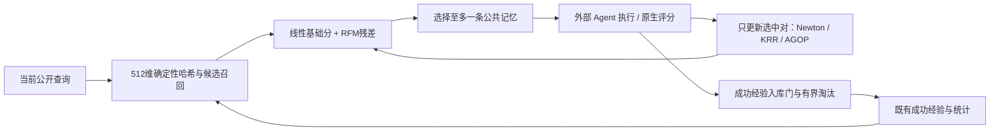
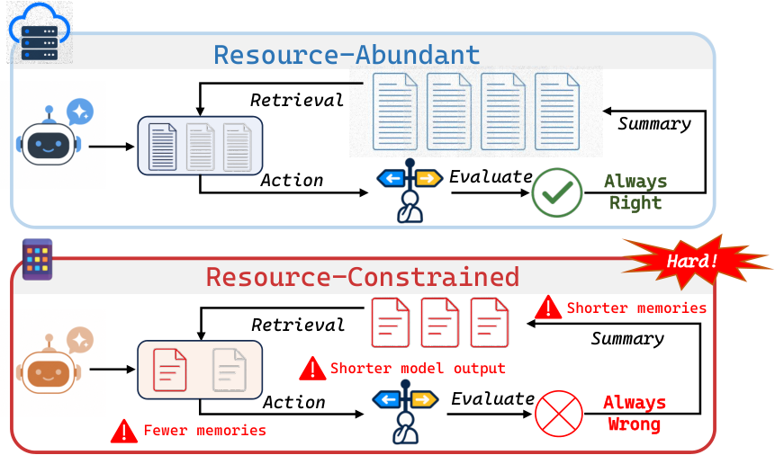

# TokenWorth：从已完成任务反馈学习哪条记忆值得留下

> `component_only` / L1 CPU 数学与时序诊断。学习的是选中记忆关联的执行结果，不是反事实因果贡献，也不是 Agent 能力验证。

## 论文信息

| 字段 | 内容 |
| --- | --- |
| 论文链接 | [Remembering Has a Price: Learning Memory Worth under Resource Constraints](https://arxiv.org/abs/2610.26453)，本批核对 v1 |
| 公司/机构 | 一作 Guannan Lai；南京大学人工智能学院、计算机软件新技术国家重点实验室 |
| 首次公开日期 | 2026-10-19 14:09:45 UTC，arXiv v1；10-20 官方公告 |
| 原文开源代码 | [AIGNLAI/TokenWorth](https://github.com/AIGNLAI/TokenWorth)，已有 tokenworth_core 和环境代码；不据此声称本地跑过官方任务 |
| 本地 Adapter | 无（`adapter: null`）；组件 key：`tokenworth` |
| 本地复现代码 | `src/auto_research/agent_research/tokenworth.py`；`scripts/run_oct20_agent_components.py` |

## 原始论文总结

### 背景与主要改动

生成长度、交互次数和记忆容量同时受限时，相关记忆也可能浪费稀缺预算。TokenWorth 用四维可解释基础特征学习稳定规律，再用 Recursive Feature Machine（RFM）校正查询相关的非线性残差。快更新拟合残差价值，慢更新调整特征几何；同一个价值模型既用于检索，也用于有界记忆库的写入和淘汰。[§4 与附录 B](https://arxiv.org/html/2610.26453v1#S4)



原论文 **Figure 2** 展示完整价值学习和记忆生命周期框架；本页重绘与原图分开，原图由统一资源流程归档。

<!-- paper-figure:start -->
### 原论文关键图

[](https://arxiv.org/html/2610.26453v1/intro.png)

> **原论文 Figure 1（关键图）**：TokenWorth的资源受限记忆问题：长记忆、昂贵工具和模型输出共同竞争预算；这是动机图，不是本地能力成绩。图片来自[原论文](https://arxiv.org/abs/2610.26453)，版权归原作者所有；点击图片可查看来源。
<!-- paper-figure:end -->

### 核心公式

基础特征为相似度、效用、可靠性和近期性，残差特征还包括哈希向量绝对差与访问频率：

$$
s_t(q,m)=w_t^\top\phi(q,m)+\eta_t f_t(z),\qquad
\mathcal L(w)=\sum_j\log(1+e^{-y_jw^\top\phi_j})+0.1\|w-w_0\|^2,
$$

其中 $w_0=[1,0.1,0.1,0.02]$。只有真实选中对接收任务结束标签，$y=2r-1$，残差 $\delta=y-[2\sigma(s_{base})-1]$。KRR 与对角 AGOP 为：

$$
K_M(z,z')=e^{-\sqrt{(z-z')^TM(z-z')}},\quad
\alpha=(K_M+0.01I)^{-1}\delta,\quad
M' = \operatorname{NormClip}\bigl(0.75M+0.25\operatorname{mean}[\nabla f\odot\nabla f]\bigr).
$$

基础、快、慢反馈窗口上限为 256/128/256；基础分用确定性 Newton 回溯优化、0.5 平滑和坐标限幅。AGOP 更新后重新拟合 KRR，残差影响在前三次拟合线性增大。核在完全重合点不可微，本地采用对称零次梯度，并对非重合点用有限差分验算。

只允许外部验证成功的公共轨迹形成新记忆。满库时，足够新颖，或探针平均分超过**最佳既有记忆** 0.02 且正分比例至少 0.45，才进入扩展库；然后淘汰最低价值者，**新候选可以立即被自己淘汰**。未过门时仅在最近邻效用低于 0.5、价值提升大于 0.10 时替换。探针是当前查询加最多八个历史发生过检索的查询，不是未来评测题。

### 论文离线与线上效果

主实验在固定资源限制下的 DB/OS/KG 取得较优成功率和输出 token 用量。附加迁移并非全面领先：本地 BigCodeBench 43.1%、ALFWorld 73.5%，优势较小；API BigCodeBench 50.6% **低于 RAG 的 50.9%**。OutputTok 不包括输入 token 或控制器计算，不能解读为总推理成本。没有生产线上 A/B。[§5、附录 C](https://arxiv.org/html/2610.26453v1#S5)

## 本地复现与边界

```bash
PYTHONPATH=src python scripts/run_oct20_agent_components.py \
  --methods tokenworth --seeds 42,43,44 --device cpu \
  --output runs/oct20-agent/tokenworth.json
```

CPU 组件实际实现 512 维 token/字符 3–5 gram 哈希、Newton、Laplacian KRR、解析梯度与对角 AGOP、FIFO、检索及入库门。哈希函数 SHA256 和 Unicode 分词是明确的本地确定性选择，不声称与未指定细节位级相同。默认使用论文 DB 调度（基础/KRR/AGOP 每 50/50/200 个**反馈**更新），诊断 runner 为缩短覆盖周期显式用 10/8/24，不能混作官方实验参数。没有调用语言模型或学习语义编码器。

`begin(query)` 只返回当前可见公共记忆；`finish(reward)` 必须在外部原生评分后调用，只更新真正使用的那一对。未结束任务禁止下一次检索，失败任务不能创建“成功记忆”。当前题的参考答案、隐藏测试和未来任务不能进入记忆。模型收到的 reward 是已结束任务反馈，不是当前 actor 输入；可信调用方仍须保证原生 grader 来源，Python 接口不是安全沙箱。

验收使用逐元素独立核矩阵解、非重合点有限差分、AGOP 非恒等更新、logistic 目标下降、选择性反馈、时序拒绝和容量检查；加入“通过入库就永远保留”的负对照。合成随机任务结果并不等于模型学会解任务。[归档标量](metrics/component-cpu-seeds42-44.json)来自三 seed CPU 机制测试，不能进入 evolve 晋级。

### 成本决定

完整实验使用 Qwen2.5-14B/A800 和 DeepSeek-V4-Flash API，多个交互环境与九类基线，附加 1,140 个 BigCodeBench、574 个 ALFWorld 顺序任务及环境服务。**完整实验成本过高，不复现（审查 DONE）**；不下载 checkpoint、不启动长轨迹。`diagnostic_only=true`、`promotion_eligible=false`、`evolve_integrated=false`。
