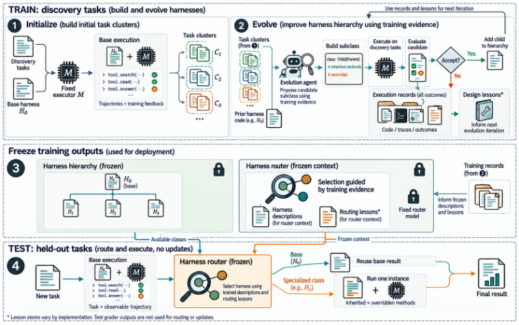

# OO-Harness: Evolving specialized agent harnesses through inheritance

<!-- source-sha256: e728a40b74e6d6c5e8688c4914cbb6c6cf0ce56ce1056b226195290a6cef83fb -->

[简体中文](README.md)

> **CPU inheritance, acceptance and frozen-routing diagnostic only.** No full official benchmarks.

## Paper information

| Field | Details |
| --- | --- |
| Paper | [Object-Oriented Harness: Evolving Agent Harnesses through Object-Oriented Design](https://arxiv.org/abs/2610.28380) |
| Affiliations | First author Gaotang Li: UIUC; work during a Google Cloud AI Research internship, with Google collaborators. |
| First public release | 2026-10-20 15:32:52 UTC |
| Author code | No verified author implementation. Benchmark and baseline repositories are not OO-Harness source. |
| Local key | `oo-harness`; no adapter |
| Local code | `src/auto_research/agent_research/oo_harness.py` |
| Local evidence | [Local mechanism metrics](metrics/component-cpu-seeds42-44.json) |

## What the paper changes

A shared harness can interfere across tasks; copying it per cluster impedes reuse. Specialize by subclassing and overriding prompts, tools or hooks. Improve on discovery clusters, then freeze classes and experience and route from task and observable base trajectory. Ancestor methods run in one instance, not extra agents.

### Original paper figure



Original figure from the reviewed paper, reused without redrawing. See [figure provenance](assets/provenance.json).

### Core equations

$$
\operatorname{accept}(H',c)=[S_c(H')>S_c^{\mathrm{current}}]\land\operatorname{checks}(H',c).
$$

$$
H^*=\rho(t,\omega(t),\{H_0\}\cup\{H_c\},\mathcal L_\rho).
$$

Require strict target-cluster gain and extra checks; no all-task guarantee. Parents can come from other clusters. Deployment sees no reference, grader or verdict. A 0.7 self-reported confidence gate is an ablation, not calibrated success or a required condition.

### Results reported by the authors

AutomationBench, Workspace-Bench and Toolathlon-GYM; Table 1 AutomationBench partial score 61.62 base to 77.41. Three independent executor runs/method. No production A/B or comparable fixture capability.

## Local reproduction and limits

`HarnessDiscovery` accepts trusted classes, never executes strings. `freeze` copies routable classes, ancestors and experience without scores. Discovery and declared held-out IDs are disjoint; clusters use discovery only. Exact public types and whitelist reconstruction strip hidden metadata including nested observations. Run Base once and reuse if selected; specialization gets fresh same-initial-state tools. Factory must provide reset; no rollback of real effects is assumed. Monkeypatch checks are not a sandbox for callbacks or gold embedded in text. The scripted public-write fixture tests inherited missing-write hook against its removal, tie rejection, hidden fields, reset and exhaustion. No LLM candidate generation, clustering, routing, benchmark or Evolve.

```bash
PYTHONPATH=src python scripts/run_oct21_oo_harness.py \
  --device cpu --seeds 42,43,44 \
  --output runs/oct21-oo-harness/fresh-result.json
```

### Full experiment: not reproduced

Claude Opus 4.8 evolution, Gemini 3.5 Flash executor, Claude Sonnet 5 router, up to 40 search rounds per benchmark, hundreds of tasks and three repetitions. No paid API matrix, long run or retry.

### Additional references

[Full paper](https://arxiv.org/html/2610.28380v1) · [Paper Section 3](https://arxiv.org/html/2610.28380v1#S3) · [Paper Figure 3](https://arxiv.org/html/2610.28380v1#S3.F3) · [Paper Table 1](https://arxiv.org/html/2610.28380v1#S4.T1)
