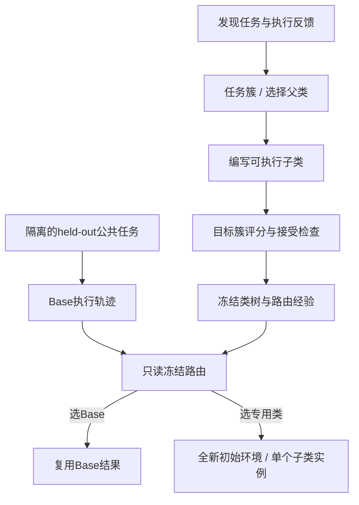
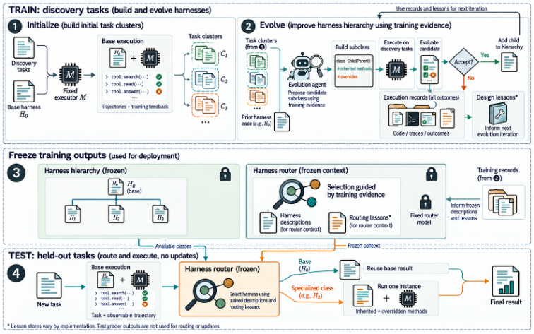

# OO-Harness：通过继承组织和进化专用 Agent Harness

## 论文信息

| 字段 | 内容 |
| --- | --- |
| 论文链接 | [Object-Oriented Harness](https://arxiv.org/abs/2610.28380)，核对[v1正文](https://arxiv.org/html/2610.28380v1) |
| 公司/机构 | 一作Gaotang Li：University of Illinois Urbana-Champaign；工作在Google Cloud AI Research实习期间完成，多位合作作者来自Google |
| 首次公开日期 | 2026-10-20 15:32:52 UTC；不是Google网页被索引的日期 |
| 原文开源代码 | 本轮未找到作者发布的官方实现；基准与对照方法的仓库不视为OO-Harness代码 |
| 本地 Adapter | `oo-harness`为组件键，不是完整论文CLI adapter |
| 本地复现代码 | `src/auto_research/agent_research/oo_harness.py`；`scripts/run_oct21_oo_harness.py` |

> **CPU组件诊断，不是完整论文复现。** 可执行的继承、接受规则和冻结路由边界已实现；LLM编写候选、自动任务聚类、模型路由及三个官方长程基准没有实现。

## 原始论文总结

### 背景与主要改动

全任务共用一个harness可能互相干扰；为每类任务复制完整实现又难以复用。作者将专用harness写成父类的子类，只覆盖需要改变的prompt、工具或执行hook。发现阶段围绕任务簇改进，部署阶段冻结代码和经验，再用任务及可观察base轨迹选择完整类；父类方法在一个实例里执行，不是额外运行多个祖先Agent。[§3](https://arxiv.org/html/2610.28380v1#S3)



<!-- paper-figure:start -->
### 原论文关键图

[](https://arxiv.org/html/2610.28380v1#S3.F3)

> **原论文Figure 3**：训练轨迹用于构建可继承的harness树，冻结后才路由held-out任务；测试评分不得回流。图片来自[原论文](https://arxiv.org/html/2610.28380v1)，版权归原作者所有。已检查文字、箭头与四阶段完整性。
<!-- paper-figure:end -->

### 核心公式

$$
\operatorname{accept}(H',c)=[S_c(H')>S_c^{\mathrm{current}}]\land\operatorname{checks}(H',c).
$$

只有目标簇严格提升且额外检查通过才接受，不保证所有任务均改善。父类可以来自其他已有簇。部署时选择

$$
H^*=\rho(t,\omega(t),\{H_0\}\cup\{H_c\},\mathcal L_\rho).
$$

这里没有测试参考答案、grader分数或裁决。原文0.7自报置信度门槛是路由消融设置，不是经过校准的成功概率，本地不把它当主算法条件。

### 论文离线与线上效果

原文比较AutomationBench、Workspace-Bench及Toolathlon-GYM；例如表1中AutomationBench平均部分得分由Base的61.62增至77.41。各方法三次独立executor运行，完整结果见[表1](https://arxiv.org/html/2610.28380v1#S4.T1)。没有生产线上A/B。这些是作者结果，不能与本地脚本fixture计数横向比较。

## 本地复现

```bash
PYTHONPATH=src python scripts/run_oct21_oo_harness.py \
  --device cpu --seeds 42,43,44 \
  --output runs/oct21-oo-harness/fresh-result.json
```

`HarnessDiscovery`只接受可信的Python类，不从字符串`exec`候选。它保存发现阶段的接受和拒绝记录；`freeze`只复制当前可路由类描述、必要祖先类和路由经验，不传发现分数。发现/held-out ID必须不相交，任务簇只允许发现集ID，部署只接受预声明held-out任务。Actor和路由入口只接受exact `PublicTask`并按白名单重建对象，拒绝附带gold字段的子类；工具观察也拒绝子类并重建，不能借嵌套对象携带隐藏grader元数据。

路由前先运行Base；选Base时直接复用，选专用类时经`tool_factory`创建相同初始条件的新工具环境。调用方必须确保factory真正重建环境，不能把真实外部系统的已发生副作用当作可自动回滚。方法替换检查可以发现冻结后monkeypatch，但这不是Python回调、闭包或工具的安全沙箱。公共输入中夹带的gold也无法由字符串类型自动识别，调用方仍负责隔离。

### 数据、结果与负对照

构造数据版本为`synthetic-oo-harness-public-write@oct21-contract-v1`。固定脚本actor故意在读完后提前结束；继承的missing-write检查阻止结束，随后实际调用写工具。去掉同一个完成检查的负对照不会写入。另核对同分拒绝、隐藏字段不进入路由顶层、Base只执行一次、专用类环境重置与轮次耗尽不伪装成功。[实际CPU指标](metrics/component-cpu-seeds42-44.json)

该actor不是LLM，fixture任务不是官方benchmark；多seed只改变公开payload，不能证明Agent能力提升。返回的完成文本也不是参考答案替身，只记录运行时机制。

### 成本与复现边界

论文完整配置包括Claude Opus 4.8进化、Gemini 3.5 Flash固定executor、Claude Sonnet 5路由、每基准最多40轮搜索、数百发现/测试任务以及三次重复。完整付费API和长程环境矩阵超出本轮单A100/A30或Mac的低成本预算。**成本过高，不复现（审查 DONE）**，不下载模型、不试跑完整实验、不自动重试。`diagnostic_only=true`、`promotion_eligible=false`、`evolve_integrated=false`；不是统一Evolve的可晋级算子。
