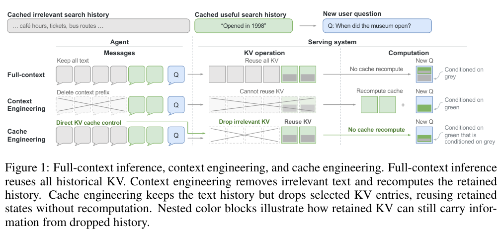

# Cache Engineering for Agents: Editing active KV without rewriting text

<!-- source-sha256: ad57cfde13d4b4bbb9bb4c0b53a9d0689cb150e5c230648f3f5addb3dd77a5c3 -->

[简体中文](README.md)

> **Reference entry only.** No local AKV serving operator, experiment, metric or GPU receipt.

## Paper information

| Field | Details |
| --- | --- |
| Paper | [Cache Engineering for Agents](https://arxiv.org/abs/2610.28577) |
| Affiliations | First author Tianyu Fu: Tsinghua University; collaborators include The Chinese University of Hong Kong. |
| First public release | 2026-10-20 17:32:24 UTC |
| Author code | [Author AKV repository](https://github.com/thu-nics/AKV), verified from the paper backlink and repository description. |
| Local key | `cache-engineering`; no adapter |
| Local code | No executable local implementation. |
| Local evidence | No local experiment, metrics or GPU receipt. |

## What the paper changes

Rewriting early conversation text invalidates later KV and requires prefill. Keep logical text unchanged; drop old tool-response KV and optionally reposition retained keys. AKV extends a radix structure with position versions, eviction and recovery and explores RSI-generated cache policies. A cache state depends on operation history, not merely the final token prefix.

### Original paper figure

Original figure from the reviewed paper, reused without redrawing. See [figure provenance](assets/provenance.json).

### Core equations

$$
\operatorname{drop}(P):\quad\mathcal C\leftarrow\mathcal C\setminus\{C_i:i\in P\}.
$$

$$
K\leftarrow R(q)R(p)^{-1}K.
$$

Drop leaves logical text, retained positions and next append position unchanged. Reposition rotates the RoPE key from $p$ to $q$ without modifying values. Different drop timings can leave different KV even with identical text and retained tokens, so reuse must account for history.

### Results reported by the authors

On deep-search and SWE tasks the paper reports +1.7 percentage points and 27.7% lower cost versus conventional summarization, plus serving throughput and P95 latency improvements. These are author evaluations, not production A/B or local results.

## Local reproduction and limits

No model download, inference, operator, local command or Evolve. A small RoPE calculation would not constitute AKV serving or RSI; consult upstream for installation.

### Full experiment: not reproduced

Serving uses eight A800-80GB devices, four prefill/four decode, TP4, GPT-OSS-120B, MiniMax-M2.7 and MiroThinker-1.7-Mini, plus repeated long-horizon agent evaluation. Not reproduced on one A100/A30 or Mac; no automatic retry.

### Additional references

[Full paper](https://arxiv.org/html/2610.28577v1) · [Paper Section 3](https://arxiv.org/html/2610.28577v1#S3) · [Paper Section 3.3](https://arxiv.org/html/2610.28577v1#S3.SS3) · [Paper Section 5](https://arxiv.org/html/2610.28577v1#S5) · [Paper PDF](https://arxiv.org/pdf/2610.28577v1) · [Paper PDF, p. 2](https://arxiv.org/pdf/2610.28577v1#page=2)
