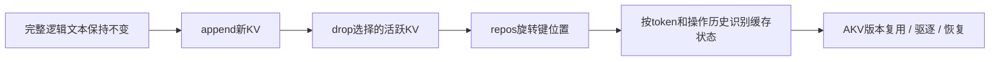
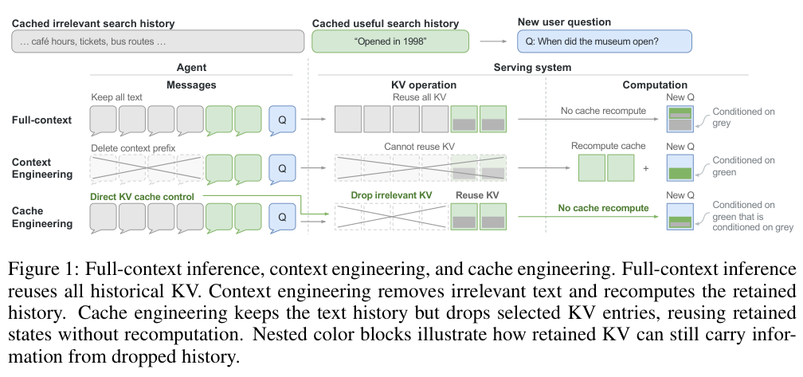

# Cache Engineering：直接操作 Agent 的活跃 KV 缓存

## 论文信息

| 字段 | 内容 |
| --- | --- |
| 论文链接 | [Cache Engineering for Agents](https://arxiv.org/abs/2610.28577)，核对[v1正文](https://arxiv.org/html/2610.28577v1) |
| 公司/机构 | 一作Tianyu Fu：Tsinghua University；合作单位包括香港中文大学 |
| 首次公开日期 | 2026-10-20 17:32:24 UTC |
| 原文开源代码 | [作者官方AKV仓库](https://github.com/thu-nics/AKV)，已核对论文回链和仓库说明 |
| 本地 Adapter | `cache-engineering`为资料键，未注册可执行adapter |
| 本地复现代码 | **未实现**；本目录只有论文说明与原图，不含本地serving算子或实验指标 |

> **成本过高，不复现（审查 DONE）。** 这是一条已完成审查的高成本资料记录，不是待自动训练队列，不计入可运行能力。

## 原始论文总结

### 背景与主要改动

删改早期对话文本会使后续KV失效，重prefill又产生费用。作者保留逻辑文本，直接drop旧工具响应的KV，必要时repos重设保留键的位置；缓存状态取决于操作发生的历史，不能只根据最终token前缀判断是否可复用。AKV基于扩展radix结构管理位置版本、驱逐与恢复，并探索RSI生成缓存策略。[§3–4](https://arxiv.org/html/2610.28577v1#S3)

<!-- paper-figure:start -->
### 原论文关键图

> **原论文Figure 1，PDF第2页**：完整上下文、文本侧压缩与KV侧操作对比，包含历史条件依赖的示意。图片来自[原论文](https://arxiv.org/pdf/2610.28577v1)，版权归原作者所有；已检查完整图、说明和右侧条件标记可读。
<!-- paper-figure:end -->

### 核心公式

$$
\operatorname{drop}(P):\quad\mathcal C\leftarrow\mathcal C\setminus\{C_i:i\in P\}.
$$

drop不改逻辑序列、保留键的位置或下一个追加位置。repos把保留项重新编号，RoPE键由位置$p$移动到$q$：

$$
K\leftarrow R(q)R(p)^{-1}K.
$$

Value保持不变。相同最终文本和保留token，也可能因drop时机不同而形成不同KV；忽略操作历史会错误复用。[§3.3–3.4](https://arxiv.org/html/2610.28577v1#S3.SS3)

### 论文离线与线上效果

作者在深度搜索和SWE任务上报告相对传统摘要平均得分增加1.7个百分点、成本减少27.7%；serving吞吐和P95延迟也有改善。这是论文Agent/serving评测，**不是生产线上A/B**，不是本库实测。[§5](https://arxiv.org/html/2610.28577v1#S5)

## 本地复现

**本轮未实现、未运行、未下载模型。** 不提供本地执行命令，不生成GPU收据或虚构指标；上游安装方式请看作者仓库。不能用少量RoPE张量运算冒充已接入AKV系统、真实推理或RSI。

### 成本与复现边界

原文serving配置使用8×NVIDIA A800-80GB：4卡prefill、4卡decode、TP4，模型包括GPT-OSS-120B、MiniMax-M2.7和MiroThinker-1.7-Mini，并包含多次长程Agent评测。当前一张A100/A30或Mac无法以本轮低成本完成这套多模型、多GPU、长上下文矩阵。**成本过高，不复现（审查 DONE）**，不阻塞审查水位，不自动重试；没有local operator、可晋级Evolve映射或能力比较资格。
