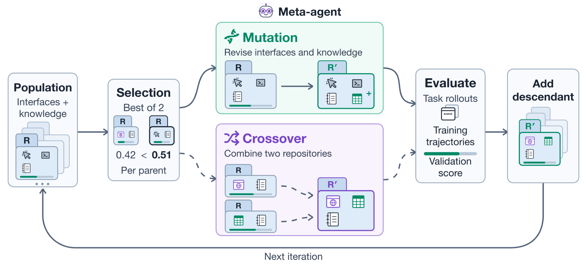

# Agent S4: Evolving computer-use interfaces from experience

<!-- source-sha256: 594db9848f5821ac8ce76c6887c74633984fd8cd104c7170db1b157e4eb0a44f -->

[简体中文](README.md)

> **CPU control-plane diagnostic, not a full Agent S4 reproduction.** Scripted actors/builders only exercise contracts.

## Paper information

| Field | Details |
| --- | --- |
| Paper | [Evolving Agent Interfaces](https://arxiv.org/abs/2610.28601) |
| Affiliations | Co-first authors Saaket Agashe and Yuzhe Yang: UC Santa Barbara. Work performed at Simular; see PDF affiliations. |
| First public release | 2026-10-20 17:47:37 UTC |
| Author code | [Agent-S / agent_s4](https://github.com/simular-ai/Agent-S/tree/58187e364e3024076540892f5f69d1efc218b74f/agent_s4), Apache-2.0, pinned `58187e364e3024076540892f5f69d1efc218b74f`. |
| Local key | `agent-s4`; no adapter |
| Local code | `src/auto_research/agent_research/agent_s4.py` |
| Local evidence | [Local mechanism metrics](metrics/component-cpu-seeds42-44.json) |

## What the paper changes

Store executable interfaces and their usage knowledge together. Hold the task actor and harness fixed while the meta-agent modifies how it can observe and act, not merely composing tools. The builder sees unlabeled training traces only; validation traces, tasks, diagnostics and scores are withheld and used for parent selection.

### Original paper figure



Original figure from the reviewed paper, reused without redrawing. See [figure provenance](assets/provenance.json).

### Core equations

$$
R=(\mathcal I(R),K(R)).
$$

$$
F_{val}(R)=\frac{1}{|\mathcal T_{val}|}\sum_{x\in\mathcal T_{val}}V_x(\operatorname{Rollout}(A,R,C,x)).
$$

Uniformly sample two eligible candidates and select higher validation score; crossover chooses a distinct second parent. Retain even lower-scoring evaluated children. Search uses mean partial credit; final OSWorld V2 ranks binary success then partial score, ScienceBoard by success. Do not conflate criteria.

### Results reported by the authors

Across all 108 OSWorld V2 tasks the paper reports Qwen3.8-27B at 21.3% binary success (3.8× fixed interfaces); ScienceBoard 41.4→58.6%. Both include their 15 validation tasks and are not wholly independent test sets. Repeated validation risks overfitting. No production A/B or local ability gain.

## Local reproduction and limits

`Population.advance` alternates mutation/crossover and atomically adds evaluated children; `BuilderContext` only carries parents, public unlabeled traces and lineage. Public task/trace reconstruction strips attached gold fields and rejects subclasses. `prune_lowest` removes parent eligibility, not lineage or final candidacy. `denoise_top` revalidates fixed top-k atomically without training or offspring; `selected` returns frozen content. No arbitrary exec, multi-island migration, SQLite resume, AWS or Landlock. API separation is not a callback sandbox. Three seeds run nine synthetic integer tasks (3 train/6 validation), testing isolation, duplicates, lineage, invalid/missing scores, atomicity, IDs, paths and final-vs-search choice, not model accuracy or Evolve.

```bash
PYTHONPATH=src python scripts/run_oct21_agent_s4.py \
  --device cpu --seeds 42,43,44 \
  --output runs/oct21-agent-s4/fresh-result.json
```

### Full experiment: not reproduced

Qwen3.8-27B as actor/meta-agent, 30 generations, per repository OSWorld 30+15 and ScienceBoard 48+15 tasks, up to 300 steps, up to two/one hours for train/validation, 108/169 final tasks and cloud desktops. No 27B download, paid VM, full trial or retry.

### Additional references

[Full paper](https://arxiv.org/html/2610.28601v1) · [Paper Section 3](https://arxiv.org/html/2610.28601v1#S3) · [Paper Figure 3](https://arxiv.org/html/2610.28601v1#S3.F3) · [Paper Section 4](https://arxiv.org/html/2610.28601v1#S4)
