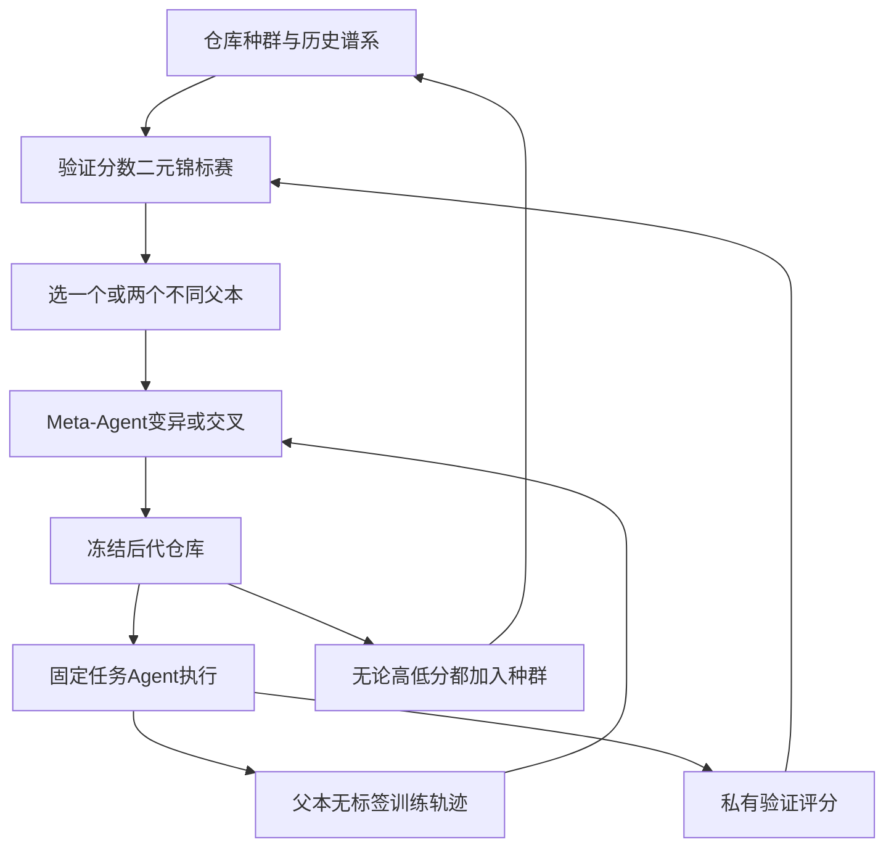
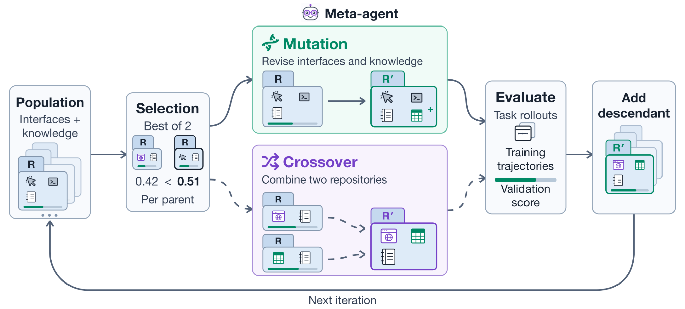

# Agent S4：从经验进化计算机操作接口

## 论文信息

| 字段 | 内容 |
| --- | --- |
| 论文链接 | [Evolving Agent Interfaces](https://arxiv.org/abs/2610.28601)，核对[v1正文](https://arxiv.org/html/2610.28601v1) |
| 公司/机构 | 一作Saaket Agashe与并列一作Yuzhe Yang：University of California, Santa Barbara；工作在Simular完成。PDF首页有机构上标，HTML显示不完整 |
| 首次公开日期 | 2026-10-20 17:47:37 UTC（arXiv v1），10月21日公告 |
| 原文开源代码 | [官方Agent-S/agent_s4](https://github.com/simular-ai/Agent-S/tree/58187e364e3024076540892f5f69d1efc218b74f/agent_s4)，Apache-2.0，固定核对`58187e364e3024076540892f5f69d1efc218b74f` |
| 本地 Adapter | `agent-s4`是组件键，不是完整论文CLI adapter |
| 本地复现代码 | `src/auto_research/agent_research/agent_s4.py`；`scripts/run_oct21_agent_s4.py` |

> **CPU控制平面组件诊断，不是完整Agent S4复现。** 忠实实现种群选择、反馈隔离和谱系规则；本地脚本Actor/Builder只是固定测试夹具，不会自行发明或执行新接口，不构成Agent能力提升证据。

## 原始论文总结

### 背景与主要改动

固定GUI、shell或浏览器接口决定Agent能观察和执行什么。重复点击、逐格编辑、冗长输出等低效行为，既可能来自模型，也可能来自接口设计。Agent S4把接口代码与使用经验一起保存为仓库，固定任务Agent的模型和Harness，由Meta-Agent依据训练轨迹修改仓库。不同于只积累由现有工具组成的技能，它允许改变操作和观察本身。

搜索过程中，训练轨迹没有成功标签；验证任务、轨迹、诊断和分数不交给Meta-Agent。验证分数只决定下一步选哪个父仓库。变异修改一个父本，交叉整合两个不同父本；后代即使暂时分数较低也保留，避免把进化等同于逐轮贪心接受。[§3与Algorithm 1](https://arxiv.org/html/2610.28601v1#S3)



<!-- paper-figure:start -->
### 原论文关键图

[](https://arxiv.org/html/2610.28601v1#S3.F3)

> 原论文Figure 3：训练轨迹供构建者诊断，验证结果仅用于种群选择。图片来自[原论文](https://arxiv.org/html/2610.28601v1)，版权归原作者所有。已核对图中文字和反馈方向，非本地生成示意图。
<!-- paper-figure:end -->

### 核心公式

接口仓库包括可执行接口及其使用知识：

$$
R=(\mathcal I(R),K(R)).
$$

私有验证分数为：

$$
F_{val}(R)=\frac{1}{|\mathcal T_{val}|}\sum_{x\in\mathcal T_{val}}V_x(\operatorname{Rollout}(A,R,C,x)).
$$

每一步从种群均匀抽两个候选，取验证分数较高者；交叉选择第二父本时排除第一父本。后代加入`R_population ∪ {R_child}`，不是仅在严格提升时替换父本。OSWorld V2最终选择先比较完整成功率，再以平均部分得分打破平局；ScienceBoard使用成功率。搜索时锦标赛用平均部分得分，不混淆两种选择标准。

### 论文离线与线上效果

原文报告：OSWorld V2全部108任务上，Qwen3.8-27B结合进化接口达到21.3%二元成功率，为同模型固定接口的3.8倍；ScienceBoard从41.4%提高到58.6%。两项均为作者的完整计算机操作评测，**未报告生产线上A/B**。主结果包含各自15个验证任务，不能把全表数字说成完全独立的测试集。论文还讨论重复验证噪声与过拟合风险。[§4–7](https://arxiv.org/html/2610.28601v1#S4)

## 本地复现

```bash
PYTHONPATH=src python scripts/run_oct21_agent_s4.py \
  --device cpu --seeds 42,43,44 \
  --output runs/oct21-agent-s4/fresh-result.json
```

### 已实现的控制器子集

| 组件 | 行为及核验 |
| --- | --- |
| `Population.advance` | 交替变异/交叉；二元锦标赛；交叉父本不同；子代先完成评估再原子加入；低分后代仍保留 |
| `BuilderContext` | 只包含父仓库、父本无标签训练轨迹及谱系；不传验证指令、轨迹、诊断或分数 |
| `PublicTask` / `PublicTrajectory` | 只转发白名单公共字符串，拒绝子类；重建对象丢弃动态附加的gold字段 |
| `prune_lowest` | 只撤销最低分父本资格，不删除谱系；若会淘汰所有候选则跳过 |
| `denoise_top` | 固定当前Top-k重新执行验证，累计均值；不创建子代、不重跑训练；任一评分失败均不部分更新 |
| `selected` | 分离搜索父本适应度与OSWorld最终二元成功优先规则；从全部已记录仓库选择，撤销父本资格不删除最终候选；返回冻结内容副本 |

与上游工程的差异：本地依据论文保留被淘汰候选及其谱系作为审计记录，未复制上游多岛迁移、SQLite恢复、AWS启动或Landlock沙箱。`Repository`保存代码文本和使用知识；本模块不`exec`任意源代码。调用方提供可信的任务Agent、Builder和私有验证grader。这是API数据隔离，不是Python进程沙箱；闭包、回调或字符串本身若已经夹带gold，本模块无法自动识别。真正接入模型时仍须用进程/权限边界保护验证器。

### 数据、结果与负对照

使用`synthetic-agent-s4-control-plane@oct21-followup-v1`，每个seed仅9项小整数读取任务，3项无标签训练、6项验证。固定Actor和Builder只触发控制器分支；仓库中的文件名是测试版本标记，不冒充真实接口实现。测量种群规模、交叉父本去重、低分后代保留、淘汰后谱系完整、重复验证调用次数和反馈隔离；不报告“Agent正确率提升”。三seed只检验可复现的控制流程。[CPU诊断指标](metrics/component-cpu-seeds42-44.json)

测试另外覆盖NaN/缺失评分拒绝、重复验证原子性、训练/验证ID冲突、仓库路径越界、训练不调用grader、最终选择与搜索分数不一致时的正确行为。

### 成本与复现边界

完整实验使用Qwen3.8-27B同时担任任务Agent与Meta-Agent，30代进化；OSWorld V2每仓库执行30个训练及15个验证任务，ScienceBoard为48+15；任务最多300步，训练/验证每任务分别可达2小时或1小时，另有108/169任务终评和部分重复验证，需要真实AWS桌面虚拟机。单卡A100/A30或Mac无法将这一长程多臂矩阵视为低成本实验。此为配置推断，不是已经运行的计时结果。

**成本过高，不复现（审查 DONE）**。不下载27B权重、不启动付费云VM、不试跑完整基准、不自动重试；CPU控制器诊断不需要CUDA验收。保持`diagnostic_only=true`、`promotion_eligible=false`、`evolve_integrated=false`，未接入统一Evolve晋级。
