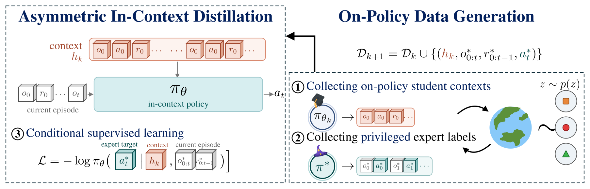

# ASTEROID: Learning exploration from on-policy context and privileged demonstrations

<!-- source-sha256: 28bc580348b6037fb4ba276294f12befb70925e9efc8f23757a060e512d0226b -->

[简体中文](README.md)

> **L1 small causal Transformer in a bounded BAMDP; diagnostic only.** Full exploration and robot experiments not reproduced.

## Paper information

| Field | Details |
| --- | --- |
| Paper | [Asymmetric On-Policy Distillation Learns In-Context Exploration](https://arxiv.org/abs/2610.30105v1) |
| Affiliations | First author Sriyash Poddar: University of Washington. Jacob Krantz, Matthew Chang, Xavier Puig and Roozbeh Mottaghi note work performed at Meta. |
| First public release | 2026-10-21 17:50:31 UTC (announced 2026-10-22) |
| Author code | [WEIRDLabUW/asteroid](https://github.com/WEIRDLabUW/asteroid) at `95eee5ee66488af3aaa0aa55a09ae163b1ca3778`, linked from the [author project](https://weirdlabuw.github.io/asteroid/). No LICENSE/COPYING or open license verified; independent local implementation. |
| Local key | `asteroid`; no adapter |
| Local code | `src/auto_research/agent_research/asteroid.py` |
| Local evidence | [Local mechanism metrics](metrics/component-cuda-seeds42-44.json); [A100 validation receipt](../../gpu-validations/asteroid-a100-20261022.json) |

## What the paper changes

A privileged expert can solve hidden-goal tasks immediately, but expert-only imitation omits context showing how to explore after failure. Collect current student episodes first, then a complete successful expert episode for the same latent task. Use public student history to condition expert-action imitation and grow context across rounds. Fixed-latent BAMDP uses cross-episode history; general POMDP uses expert takeover from reached states. This is not gold in the prompt or ordinary one-step DAgger.

### Original paper figure



Original figure from the reviewed paper, reused without redrawing. See the [original SVG](assets/paper-figure-03.svg) and [figure provenance](assets/provenance.json).

### Core equations

$$
h_k=(\tau_0,\ldots,\tau_{k-1}),\quad \tau_j\sim\pi_{\theta_{k-1}}(\cdot\mid h_j,o),
\quad \tau^*\sim\pi^*(\cdot\mid z).
$$

$$
\mathcal D_k=\mathcal D_{k-1}\cup
\{(h_k,o^*_{0:t},r^*_{0:t-1},a_t^*)\}_{t=0}^{H-1},
\quad
\mathcal L=-\frac1{|\mathcal D_k|}\sum\log\pi_\theta(a_t^*\mid h_k,o^*_{0:t},r^*_{0:t-1}).
$$

Supervise only expert query actions, never student context actions. Deployment starts empty, uses observations/rewards alone and slides the window beyond training length; it cannot query the expert.

### Results reported by the authors

The authors report exploration and interaction efficiency across 11 environments and sim-to-real robot transfer. No production A/B. Three-door diagnostics do not reproduce Darkroom/Key-Door/Habitat/Procgen or the paper's capability values.

## Local reproduction and limits

`ThreeDoorTask` holds a hidden door across episodes; observation is constant and each door choice is a complete one-step episode. `CausalHistoryStudent` uses width 24, four heads and one layer, with public actions, rewards, episode markers and positions only. Initialize at k=0 with expert examples, then k=1,2 collect from the previous student before adding paired successful expert episodes. Eight tasks per goal each round, cumulative data, 18 Adam updates/round, 54 total. Labels are stored separately and only query NLL is optimized. `deploy` is tested with a failing teacher callback. Tests check CE, actual gradients/update, causal masking, label isolation, order, success-only supervision and history sensitivity. Three fixed seeds check mechanism, not a validation/test comparison or Evolve capability.

```bash
OMP_NUM_THREADS=1 MKL_NUM_THREADS=1 PYTHONPATH=src python -m pytest tests/test_asteroid.py -q

OMP_NUM_THREADS=1 MKL_NUM_THREADS=1 PYTHONPATH=src python -c \
  'from auto_research.agent_research.asteroid import diagnostic; print(diagnostic(42))'
```

### Full experiment: not reproduced

Appendix F.1 reports about 1–6 hours on one L40 for normal training, largely rollout-bound, two RTX 4090s for robot tasks and roughly eight hours for the state expert, plus UR5e hardware. No general POMDP takeover, multi-step expert, sim/robot transfer, large run or retry.

### Additional references

[Paper Figure 3](https://arxiv.org/html/2610.30105v1#S5.F3)
