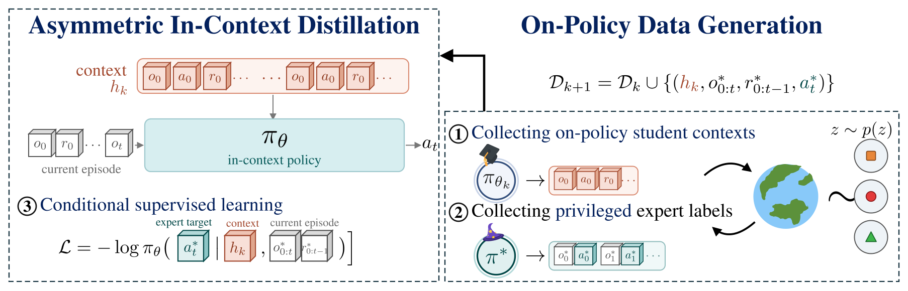
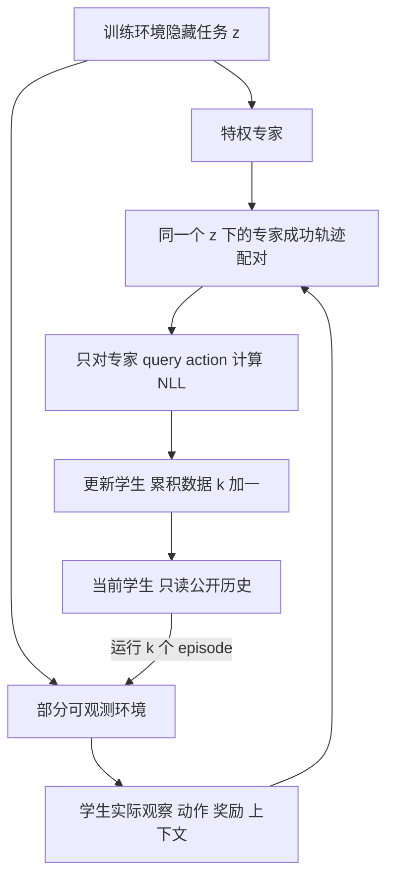

# ASTEROID：用在策略上下文蒸馏学习探索

> 本地状态：**L1 核心机制组件，diagnostic only**。本地真实训练一个微型因果 Transformer，保留论文 Algorithm 1 的 episode 级在策略上下文与教师轨迹监督；不宣称复现论文的探索能力、样本效率或机器人效果。完整多环境与机器人实验：**成本过高，不复现（审查 DONE）**；不自动重试、不阻塞审查。

## 论文信息

| 字段 | 内容 |
|---|---|
| 论文 | [Asymmetric On-Policy Distillation Learns In-Context Exploration](https://arxiv.org/abs/2610.30105v1) |
| 公司 / 作者机构 | 一作 Sriyash Poddar：University of Washington；合作作者 Jacob Krantz、Matthew Chang、Xavier Puig、Roozbeh Mottaghi 标注工作在 Meta 期间完成，不能把一作归为 Meta |
| 原始发布日期 | 2026-10-21 17:50:31 UTC，arXiv v1；10 月 22 日公告，二者不混为一谈 |
| 原作者代码 | [WEIRDLabUW/asteroid](https://github.com/WEIRDLabUW/asteroid)，作者项目页直接链接；固定检查 revision `95eee5ee66488af3aaa0aa55a09ae163b1ca3778` |
| 原作者代码许可 | 源码可见，但固定版本未找到 LICENSE / COPYING，GitHub license API 返回 404；**未确认开放许可，不复制作者源码**。本地按公开论文独立实现 |
| 项目页 | [University of Washington 作者项目页](https://weirdlabuw.github.io/asteroid/) |
| 本地 Adapter / key | `asteroid`；独立组件，无能力评测 adapter，`evolve_integrated=false` |
| 本地代码 | `src/auto_research/agent_research/asteroid.py` |
| 本地入口 | `CausalHistoryStudent`、`collect_iteration`、`train_bounded`、`deploy`、`diagnostic(seed, device)` |
| 指标产物 | `metrics/component-cuda-seeds42-44.json`（由真实 GPU 运行后统一审校生成；本页不预填 CUDA 结果） |
| GPU 验证 | `docs/gpu-validations/asteroid-a100-20261022.json`；`requires_gpu_validation=true`，最终验收以提交的有效 receipt 为准 |

## 原始论文总结

### 背景与主要改动

部分可观测任务中，专家知道隐藏目标，因而总能直接成功；只模仿专家，学生看不到“失败后如何继续搜索”的上下文。ASTEROID 让**当前学生先探索**，再在同一个隐藏任务下收集专家的**完整成功轨迹**。学生用自己的观察、动作和奖励历史预测专家动作，迭代扩大可学习的上下文长度。

这不是把金标放入 Agent prompt，也不是固定离线行为克隆，更不应简化成只在学生当前状态上打单步标签的普通 DAgger。论文区分两种采样：固定 latent 的 BAMDP 使用跨 episode 上下文；一般 POMDP 在学生到达的中间状态进行专家 takeover。

<!-- paper-figure:start -->
### 原论文关键图



图片来自[原论文](https://arxiv.org/html/2610.30105v1#S5.F3) Figure 3，[原 SVG](assets/paper-figure-03.svg) 未改写，PNG为其2倍渲染；已目视核对公式、三阶段与箭头。版权归原作者所有，论文为 CC BY 4.0；资产来源和 SHA-256 见 `assets/provenance.json`。
<!-- paper-figure:end -->



### 核心公式

第 $k$ 轮先在任务 $z$ 上采集当前学生的上下文，再独立执行同任务的专家 episode：

$$
h_k=(\tau_0,\ldots,\tau_{k-1}),\quad \tau_j\sim\pi_{\theta_{k-1}}(\cdot\mid h_j,o),
\quad \tau^*\sim\pi^*(\cdot\mid z).
$$

对专家轨迹中的 query，只监督专家动作，**不把学生上下文动作当作正确标签**：

$$
\mathcal D_k=\mathcal D_{k-1}\cup
\{(h_k,o^*_{0:t},r^*_{0:t-1},a_t^*)\}_{t=0}^{H-1},
\quad
\mathcal L=-\frac1{|\mathcal D_k|}\sum\log\pi_\theta(a_t^*\mid h_k,o^*_{0:t},r^*_{0:t-1}).
$$

部署时 $h_0=\varnothing$，只从在线观察与反馈增长历史；超过训练长度时使用滑动窗口。不能在部署时调用特权专家。

### 论文离线与线上效果

论文在 11 类环境报告更有效的探索与交互效率，并包含模拟到真实机器人迁移；这些是原论文结果，不是本地测量。未报告互联网产品线上 A/B。本地不重跑其 Darkroom / Key-Door / Habitat / Procgen 全部实验，也不使用本地三门诊断支撑原论文数值。

## 本地复现

### 保留的定义机制与缩小边界

- 环境采用论文正文的三门 BAMDP：隐藏门在本次任务的多个 episode 间保持不变，观察恒为 0；每次选择一扇门构成一个**完整的单步 episode**。因此专家轨迹的长度也是 1，不能把该边界推广到多步任务。
- 学生是可训练的 24 维、4 头、1 层因果 Transformer；输入只编码公开的动作、奖励、episode 结束标记和位置。常量观察省略数值嵌入，没有隐藏目标、专家动作或后验表输入。
- $k=0$ 用无上下文的成功专家 episode 初始化；随后 $k=1,2$ 由上一轮学生采集完整上下文，再追加同一隐藏门的成功专家 episode。每轮每个训练目标门 8 次任务，数据累计；每轮 18 次 Adam 更新，共 54 步。
- 教师标签和学生输入分别存储。`imitation_loss` 只在末端专家 query 计算交叉熵；学生上下文来自真实随机采样，不用手工规则排除失败门，也不把解析 Bayesian posterior 当成学生。
- `deploy` 从空历史出发，只使用环境返回的奖励；单元测试会将教师函数替换为立即失败，验证部署不请求特权标签。

### 数据、指标与对照协议

这是生成式机制诊断，没有公开 benchmark split，也没有 validation 选模、test 能力对比或 evolve 晋级。训练 NLL 仅用于检查真实优化，不是测试集性能。固定 seeds 42、43、44；预算预先固定，不根据“是否成功”延长训练。

独立检查包括：交叉熵与 log-softmax 公式一致、embedding/head 的真实梯度、参数真实更新、同公开历史不同教师标签不改变输入、因果 mask 阻止读取未来、学生 rollout 先于教师、只保留成功专家轨迹，以及奖励历史的负控敏感性。对照不是一个伪造“成功率为 1”的 gold-reading Agent。

```bash
OMP_NUM_THREADS=1 MKL_NUM_THREADS=1 PYTHONPATH=src python -m pytest tests/test_asteroid.py -q

OMP_NUM_THREADS=1 MKL_NUM_THREADS=1 PYTHONPATH=src python -c \
  'from auto_research.agent_research.asteroid import diagnostic; print(diagnostic(42))'
```

CUDA 使用同一入口 `diagnostic(42, device="cuda")`。CPU 三种子诊断已执行，不能替代 NVIDIA 验证。输出只包含有限标量、seed 与布尔契约，不输出探索准确率或原论文提升。

### 高成本完整实验

原文 Appendix F.1：常规模型单张 L40 训练约 1-6 小时，主要瓶颈为环境 rollout；机器人任务用 2 张 RTX 4090，状态专家约需 8 小时训练；还包含 UR5e 实体硬件实验。本文完整实验**成本过高，不复现（审查 DONE）**。当前组件只验证 Algorithm 1 在有限 BAMDP 中真实可训练，不复现一般 POMDP takeover、多步专家轨迹、仿真或机器人迁移；不进入能力榜或 evolve promotion。

### 代码映射

| 论文机制 | 本地实现 |
|---|---|
| 部分可观测历史 / 特权教师隔离 | `PublicEpisode`、`ThreeDoorTask`、`public_tokens` |
| history-conditioned 因果策略 | `CausalHistoryStudent` |
| Algorithm 1 上下文采集与成功专家轨迹 | `collect_iteration`、`ExpertExample` |
| 数据累积、上下文课程与真实优化 | `train_bounded`、`imitation_loss` |
| Algorithm 2 无专家部署 | `deploy` |
| 公式、隔离与负控诊断 | `diagnostic`、`tests/test_asteroid.py` |
