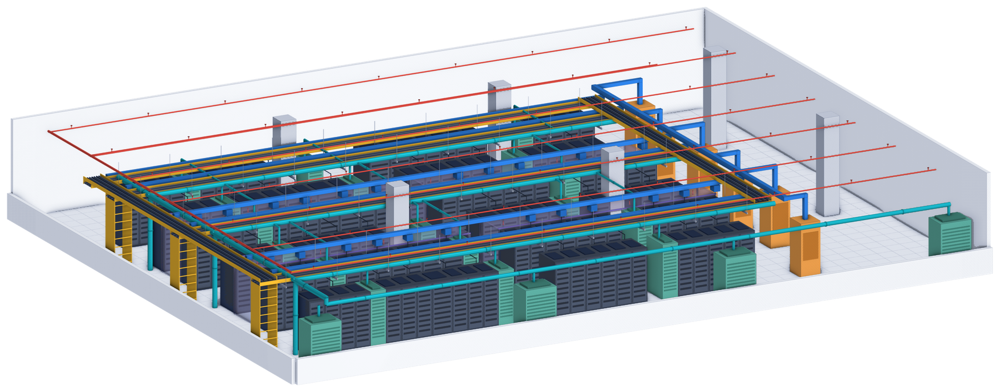

# PLE: Offline artifact and scoring contracts for engineering tasks

<!-- source-sha256: 9be812a11a5fdd73a4e84b9f22d2056c01b63c208023b72da975fd07e18cd470 -->

[简体中文](README.md)

> **L1 CPU artifact and aggregation contract; diagnostic only.** No actual engineering work or external grading run.

## Paper information

| Field | Details |
| --- | --- |
| Paper | [PLE: Physical-Engineering's Last Exam](https://arxiv.org/abs/2610.30537v1) |
| Affiliations | First author Rujun Han: Google Cloud AI Research; affiliations include Google and Google Cloud AI Research. |
| First public release | 2026-10-21 23:45:56 UTC (announced 2026-10-23) |
| Author code | [google-research/ple](https://github.com/google-research/ple), Apache-2.0 at `70ed96281d87380926a0d7c08e21799fd5edee63` (October 23 public-dev protocol). Paper CC BY 4.0; data license separate. |
| Local key | `physical-engineering-exam`; no adapter |
| Local code | `src/auto_research/agent_research/physical_engineering_exam.py` |
| Local evidence | [Local mechanism metrics](metrics/component-cpu-seeds42-44.json) |

## What the paper changes

85 long structural, civil, electrical and mechanical tasks require reviewable artifacts from mixed-format files. Experts author tasks or review Creator–Solver iterations. Judges and references stay hidden. The local path freezes artifact bytes and checks provenance before accepting external grades.

### Original paper figure



The unredrawn output overview is one panel, not all of Figure 3 or a local artifact. See [figure provenance](assets/provenance.json).

### Core equations

$$
s=0.4p+0.6GO',\qquad
O'=\operatorname{clip}\left(\frac{O-O_{naive}}{1-O_{naive}},0,1\right).
$$

$p$ is constraint pass fraction; $G=1$ only when all hard constraints pass. Baseline objective must be below one, defaulting to zero when absent. Expert rubrics average weighted binary verdicts. Generic formulas do not replace the two special site/MEP graders. Score over all declared tasks with missing results zero, then average three runs; report both population and sample SD because upstream does not specify ddof.

### Results reported by the authors

Best author configuration averages 50.6%, about 27M tokens and 63 minutes per task. No production A/B or local engineering performance; this page is not engineering advice.

## Local reproduction and limits

Pinned setup has 29 public dev and 56 hidden tests. Raw YAML SHA `c36cab6f0f3a1ab613e5b507e13dad80f56d3eec370019969965f5a32edaed1e`, data revision `535cf0a8af68126e3f00a1441cf736754a0cda4b`, canonical parsed digest `d9d0e20eccffc8b105f34ae46b50bb4bb7bdc5ab35402d453bcd644bcde4cbfb`. Upstream records the latest runtime HF commit rather than enforcing the configured revision or per-task hash. `FileEntry`/`audit_artifacts` inspect supplied bytes/mode only in standard layout; cover declared files, traversal, UTF-8, casefold conflicts, symlink/gitlink, LFS and size. Message-only only where allowed. Git blob SHA1 and harness SHA256 exclude .env, Git metadata and artifacts. Provenance mismatches warn; no available tasks rejects. Manifest reward is not a grade. No fallback aliases, Git replay/attributes, secret scan, grader, host reads or proof of authorship. External paired average difference strictly above 0.25 flags review, not disqualification. Three seeds change synthetic bytes, not model outcomes; no CUDA or Evolve.

```bash
PYTHONPATH=src python -m pytest tests/test_physical_engineering_exam.py
PYTHONPATH=src python -c 'from auto_research.agent_research.physical_engineering_exam import diagnostic; print(diagnostic(42))'
```

### Full experiment: not reproduced

Author means imply roughly 268 agent-hours and $68.85\times10^8$ tokens (6.885B) for 85 tasks × three runs in one configuration, not local measurements. Protocol allows six hours/task, about 17GB image, paid/server models, separate judges and hidden tasks. No downloads, probes or retries.

### Additional references

[Full paper](https://arxiv.org/html/2610.30537v1) · [Paper Figure 3](https://arxiv.org/html/2610.30537v1#S3.F3) · [Original figure resource](https://arxiv.org/html/2610.30537v1/figures/task_3d/output_overview.png)
