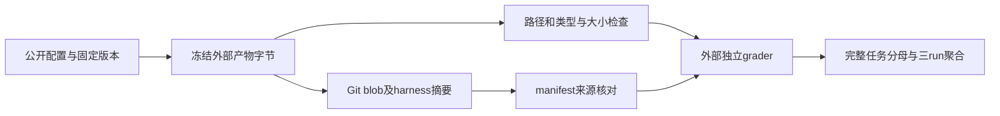
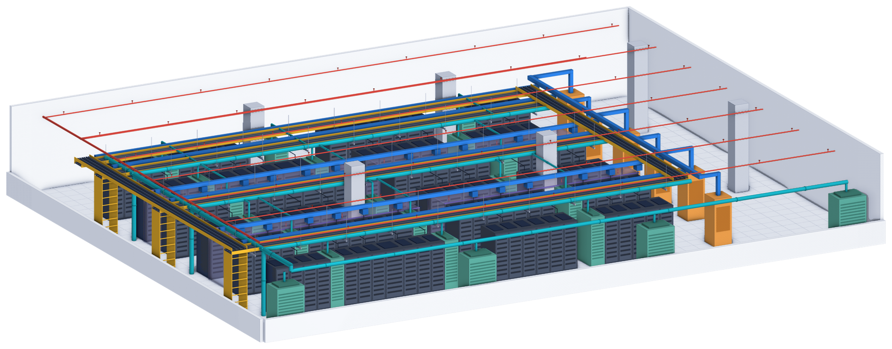

# PLE：物理工程考试的离线产物与评分协议

## 论文信息

| 字段 | 内容 |
| --- | --- |
| 论文链接 | [arXiv 2610.30537 v1](https://arxiv.org/abs/2610.30537v1)；[固定正文](https://arxiv.org/html/2610.30537v1) |
| 原文标题 | PLE: Physical-Engineering's Last Exam |
| 公司 / 机构 / 学校 | 一作 Rujun Han，首机构 Google Cloud AI Research；作者栏列Google及Google Cloud AI Research，不是因为调用Gemini而推断机构 |
| 首次公开日期 | 2026-10-21 23:45:56 UTC（arXiv v1）；10月23日公告，本轮是近期补漏，不是10月24日新首发 |
| 原作者代码 | [Google官方仓库](https://github.com/google-research/ple)，固定 revision `70ed96281d87380926a0d7c08e21799fd5edee63`（10月23日最终29项dev协议发布）；代码 Apache-2.0，论文 CC BY 4.0；数据按其独立发布许可，本轮未下载任务数据 |
| 本地 adapter / 稳定键 | `physical-engineering-exam`；`adapter: null`、`component_only`。与推荐模型PLE无关 |
| 本地复现代码目录 | `src/auto_research/agent_research/physical_engineering_exam.py`；`tests/test_physical_engineering_exam.py` |
| 完整实验 | **成本过高，不复现（审查 DONE）**；无自动重试、训练或Evolve队列 |

## 原始论文总结

### 背景与主要改动

PLE把专业工程工作组织为85项长时任务，覆盖结构、土木、电气及机械；输入是多格式项目文件，输出是可审查的工程产物。任务由专家编写，或经Creator–Solver迭代后由专家复核；裁判与参考解不向solver暴露。正文、实验及附录已读，最新公开提交协议另按固定代码版本核验。



本地只执行配置、产物检查与给定外部评分的聚合；图中的独立grader仍是**未运行的外部步骤**。不会把合成文件当作真实工程结果。

<!-- paper-figure:start -->
### 原论文关键图

[](https://arxiv.org/html/2610.30537v1#S3.F3)

这是Figure 3的**输出概览面板**，不是整张多面板图，也不是本地生成结果。图片来自[原论文](https://arxiv.org/html/2610.30537v1#S3.F3)，版权归原作者所有，CC BY 4.0。[原始PNG](https://arxiv.org/html/2610.30537v1/figures/task_3d/output_overview.png)原样保存并目视确认；[来源与哈希](assets/provenance.json)。
<!-- paper-figure:end -->

### 核心公式

论文约束型设计项用Eq.1/2：

$$
s=0.4p+0.6GO',\qquad
O'=\operatorname{clip}\left(\frac{O-O_{naive}}{1-O_{naive}},0,1\right).
$$

$p$为约束通过比例，所有硬约束通过时$G=1$，否则为0。任一硬约束失败时目标分被切断；$O_{naive}<1$，无基线时取0。专家rubric则按给定权重计算二元verdict的加权通过率。两者都只接收外部裁判结果，本地不判断物理可行性、法律规范或引用正确性。论文两类site/MEP特殊grader不能用通式替代。

完整任务集$T$的每run评分为$|T|^{-1}\sum_{t\in T}s_t$，缺失结果为0；最终均值为三个run均值的算术平均，不能只对成功项求平均。公开规则未说明标准差的ddof，本地同时明确输出population/sample两种口径，不把任一种冒称为官方唯一定义。

### 论文离线与线上效果

原文最强配置平均50.6%，约27M tokens、63分钟每任务；这是作者模型结果，不是本地测得。未报告生产线上 A/B。工程审查和法规信息只是论文输入背景，本组件不向用户给出工程设计建议。

## 本地复现

### 固定协议与公开配置

10月23日官方代码固定29项public dev、56项hidden test。任务配置的原始YAML SHA256为 `c36cab6f0f3a1ab613e5b507e13dad80f56d3eec370019969965f5a32edaed1e`，对应配置内数据revision为 `535cf0a8af68126e3f00a1441cf736754a0cda4b`。测试夹具仅含公开配置转成的JSON，不含题目环境、grader、参考解或任务答案。

`dev_set_digest` 对解析后数据用排序键、紧凑UTF-8 JSON求SHA256，故YAML注释/换行不影响；固定指纹为 `d9d0e20eccffc8b105f34ae46b50bb4bb7bdc5ab35402d453bcd644bcde4cbfb`。**最新上游runner运行时取HF最新commit并记录以供regrade，并不强制使用配置内revision或逐任务hash**；本地只校验这份固定配置，不声称已下载或认证实际任务目录。

### 离线验收接口

`FileEntry`只持有实际字节、路径与mode，不接受文件回调；`audit_artifacts`不读宿主文件系统，不执行命令、容器、脚本或模型。限定支持标准 `artifacts/<task>/files/<container path>` 布局，检查声明产物覆盖、路径穿越、UTF-8、casefold文件/目录冲突、符号链接/gitlink、LFS指针及公开大小上限。grader只读final message时允许消息产物，否则仅消息不可用；轨迹不是答案。

Git blob采用SHA1的Git对象编码；harness摘要对mode、blob和路径求SHA256，排除`.env`、git元数据和产物目录。manifest版本/配置/harness/文件字节不一致按官方口径记来源警告，不自动判提交拒绝；没有任何可用任务才拒绝。manifest的本地`reward`从不当成正式grade。

这是有界标准布局审计，不实现官方fallback别名、git索引/attributes核验、删除文件重放、密钥扫描、文档变更特例或完整提交平台。字节摘要只能证明一致性，不能证明产物由某个模型生成，也不能替代live reproduction。`reproduction_check`仅对外部成对分数检查平均差严格大于0.25的人工复核标记，不自动取消资格。

```python
from auto_research.agent_research.physical_engineering_exam import aggregate_three_runs

# 输入必须由独立外部grader生成；没有调用grader或读取manifest.reward。
summary = aggregate_three_runs(["task-a", "task-b"],
                               [{"task-a": 1.0}, {"task-b": 1.0}, {}])
assert summary["mean"] == 1/3  # 缺失分数为0，分母固定
```

### 验证与结果

```bash
PYTHONPATH=src python -m pytest tests/test_physical_engineering_exam.py
PYTHONPATH=src python -c 'from auto_research.agent_research.physical_engineering_exam import diagnostic; print(diagnostic(42))'
```

[三seed CPU合同产物](metrics/component-cpu-seeds42-44.json)由统一runner冻源记录。这里seed只改变合成字节；不是三个模型运行种子，不产生工程任务成功率。固定 `L1`、`diagnostic_only=true`、`promotion_eligible=false`、`evolve_integrated=false`、`model_calls=0`；CPU接口不需要GPU回执。没有benchmark能力接入、训练adapter或Evolve晋级。

### 成本与未复现范围

单A100/A30或Mac不能消除85项长时Agent及裁判的总成本。按作者63分钟/27M tokens均值估计，单配置85任务×3run约268 agent小时、68.85亿tokens；这只是由原文均值推算，不是本地耗时。完整矩阵还含多模型/多harness；最新官方协议每任务上限6小时、镜像约17GB并需付费或服务端模型、独立judge及隐藏任务。因此**成本过高，不复现（审查 DONE）**，不下载任务镜像/大权重、不启动昂贵试跑或自动重试。低成本离线接口不验证工程或Agent能力。
