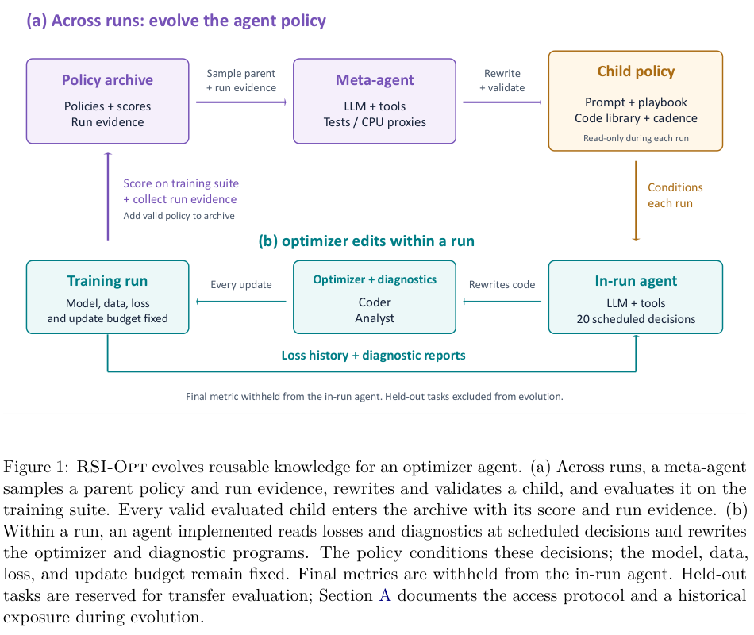

# RSI-Opt: Evolving optimizer-agent policies across training runs

<!-- source-sha256: 56521f574579870f5c042e71c28f6e7014d707bfc73c9761f496a04b14c5e653 -->

[简体中文](README.md)

> **Reference entry only.** No local optimizer agent or cross-run controller; full experiments not reproduced due to cost.

## Paper information

| Field | Details |
| --- | --- |
| Paper | [RSI-Opt: Recursive Self-Improvement Optimizer Agents For Model Training](https://arxiv.org/abs/2610.32026v1); [reviewed full text](https://arxiv.org/html/2610.32026v1) |
| Affiliations | First author Binghang Lu: Purdue University; Yige Sun: independent; Guang Lin: Purdue. |
| First public release | 2026-10-23 01:05:11 UTC (announced 2026-10-26) |
| Author code | No verified method source. [OPAL](https://github.com/xingjian-bai/opal) is the underlying framework, not the cross-run RSI-Opt policy evolution code. Paper/figure CC BY 4.0. |
| Local key | `rsi-opt`; no adapter |
| Local code | No executable local implementation. |
| Local evidence | No local experiment, metrics or GPU receipt. |

## What the paper changes

A coding agent edits optimizer code at 20 preset opportunities using actual training loss and diagnostics while model, data order, loss, batch size and update count are fixed. A short check can roll back an anomalous updater. The outer meta-agent inherits and edits prompts, natural-language playbooks, libraries and cadence; it checks syntax, fields and size with at most two repairs. All valid evaluated children, including regressions, enter the archive. Inner agents cannot see final metrics, but outer scoring uses them; a suite's split named test is not proof of unseen-task transfer. Base LLM weights stay fixed.

### Original paper figure

Original figure from the reviewed paper, reused without redrawing. See [figure provenance](assets/provenance.json).

### Core formulation

Parent sampling favors high scores but discounts expanded branches: $P(p)\propto\operatorname{sigmoid}(\lambda(s_p-\tilde s))/(1+n_p)$. Normalize task direction and scale with $z_{t,s}=d_t(h_t(m_{t,s})-\mu_t)/\sigma_t$, using log10 PDE error and raw metrics elsewhere, and average tasks and seeds equally. Small baseline variance can dominate; this is not significance testing. Raw-space table means are not the PDE per-seed log-space selection score, and summary moments do not give paired CIs or seed-win counts.

### Results reported by the authors

The paper reports transfer on training-suite, held-out ML and PDE tasks against static, tuned-static and fixed-prompt controls. A static baseline tuned on the evaluated metric is an optimistic oracle. Appendix A discloses early access to one held-out noisy-label task description; exposed policies and descendants were excluded, but archive summaries could transmit information indirectly. This is unresolved, not complete isolation. Shell/tool audit also cannot establish all generated-code access paths. No production A/B or local result.

## Local reproduction and limits

No generated optimizer code is executed, and neither parent sampling alone nor a generic evolution controller represents the complete method. No metrics, receipts, capability promotion or Evolve integration.

### Full experiment: not reproduced

Sections 4/5.8 cover nine single-GPU tasks, including CIFAR ResNet/ViT, FineWeb GPT-34M, MNIST flow UNet, WikiText LSTM and PDEs with 10k–30k updates. Static reference uses five seeds, evolution two, re-evaluation of the top three two more and final runs another three. Opus 5.5/GPT-5.5/GPT-6.1 use high reasoning; final RSI runs average 3.65–4.61M input and 24–42K output tokens before training, proxy tasks or waiting. No downloads, paid matrix, generated code or automatic retry.

### Additional references

[Paper PDF](https://arxiv.org/pdf/2610.32026v1)
