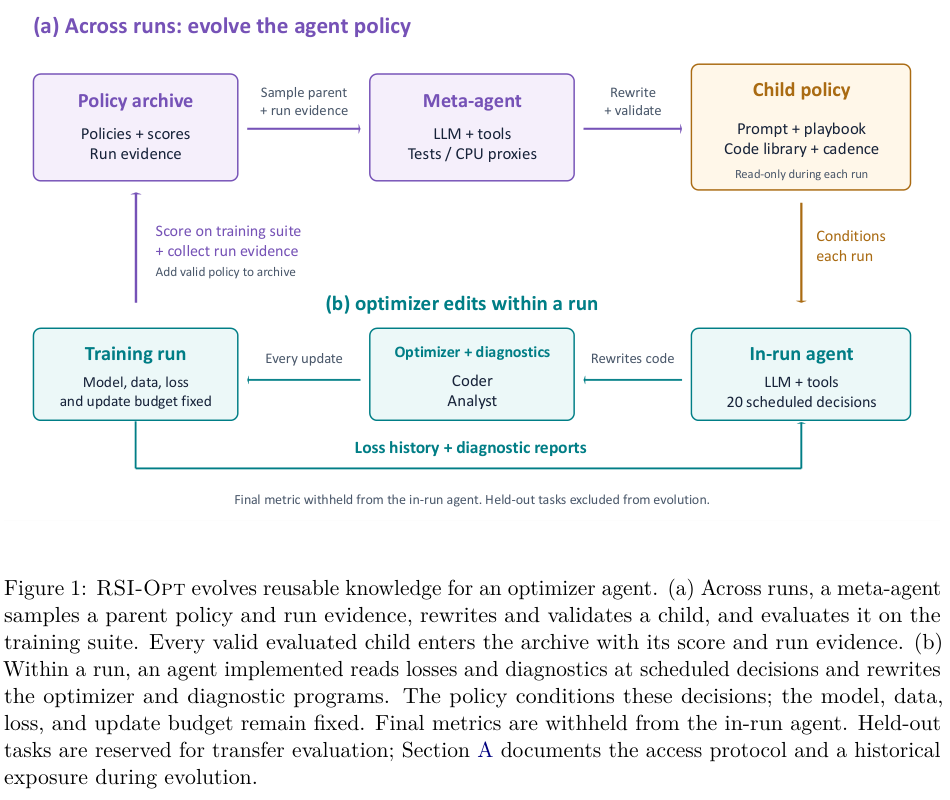

# RSI-Opt：跨训练运行进化优化器 Agent 的策略

RSI-Opt 内层让 coding-agent 根据真实训练损失和诊断改写优化器程序，外层再继承并进化 prompt、playbook、代码库和决策节奏。它进化的是控制优化器改写的 Agent 策略，不是简单选一个现成 optimizer，也不更新底层 LLM 的权重。

> **仅文献与成本收录**。完整实验：**成本过高，不复现（审查 DONE）**；不自动重试，不阻塞水位。没有可执行 adapter、operator、命令、metrics 或 GPU receipt。

## 论文信息

| 字段 | 内容 |
|---|---|
| 论文 | [RSI-Opt: Recursive Self-Improvement Optimizer Agents For Model Training](https://arxiv.org/abs/2610.32026v1) |
| 固定方法版本 | [arXiv v1 全文](https://arxiv.org/html/2610.32026v1) |
| 公司 / 作者机构 | 一作 **Binghang Lu，Purdue University**；其他作者为 Yige Sun（Independent Researcher）、Guang Lin（Purdue） |
| 原始发布日期 | **2026-10-23 01:05:11 UTC**，arXiv v1；2026-10-26 公告 |
| 原作者代码 | **未找到可核验方法仓库**。原文链接 [OPAL](https://github.com/xingjian-bai/opal) 作为所依托的训练/Agent 框架，不等于公开了 RSI-Opt 的跨运行策略演化代码 |
| 固定 SHA / 源码许可 | 本方法源码未核验，SHA/许可不适用；不挪用 OPAL 的版本充作方法实现。论文/原图 CC BY 4.0 |
| 本地 Adapter / key | `rsi-opt`；`adapter=null` |
| 本地复现代码位置 | **无**：仅资料与审查，不执行 LLM 生成的 optimizer 程序 |
| 本地验证 | 不训练、不生成 metrics/receipt；`requires_gpu_validation=false`、`gpu_validation_passed=false` |

## 原始论文总结

### 背景与主要改动

单次优化器 Agent 能根据当前训练调整程序，却不会自动把经验带到下一次训练。RSI-Opt 让代码 Agent 根据真实训练证据改写 updater，再将 prompt、自然语言 playbook、代码 library 与 cadence 作为可继承策略，通过外层训练评估递归演化。

内层训练保持模型、数据顺序、loss、batch size 和更新步数固定，Agent 在 20 个预定机会读取训练损失/诊断；异常更新器经过短试验后回滚。

外层 meta-agent 读取父策略及运行证据，改写子策略并做语法/字段/大小校验，最多两次修复。所有通过校验并完成评估的子策略都保留到 archive，包括比父策略差的结果。训练任务的最终指标不向内层 Agent 暴露，但会用于外层策略评分；这不意味着训练套件上命名为 test 的指标可以称为未见任务泛化。

<!-- paper-figure:start -->
### 原论文关键图

图片来自[原论文](https://arxiv.org/pdf/2610.32026v1)，版权归原作者所有。由固定 PDF 第 4 页 Figure 1 直接 2x 栅格化，保留完整 caption，未重绘；裁切位置、CC BY 4.0 许可、SHA-256 和目视核验见 `assets/provenance.json`。
<!-- paper-figure:end -->

### 核心公式

父策略抽样权重为 $P(p)\propto\operatorname{sigmoid}(\lambda(s_p-\tilde s))/(1+n_p)$，同时偏向高分并降低过度扩展同一分支。任务得分先做方向和尺度归一化：$z_{t,s}=d_t(h_t(m_{t,s})-\mu_t)/\sigma_t$，其中 PDE error 的 $h_t=\log_{10}$，其他 ML 指标直接用原值；策略再对任务和种子等权平均。

这个 z-score 只是聚合，不是显著性检验；静态基线方差很小的任务可占很大权重。论文最终表格另用打印均值的 raw-space summary，不能与 PDE 逐 seed log-space selection score 混为同一值，也不能从均值/标准差反推出 paired CI 或 seed-win 次数。

### 论文离线与线上效果

原文在训练套件、held-out ML 和 PDE 上报告策略转移，保留静态配方、调参静态配方及固定 prompt Agent 对照。调参静态基线在评估指标本身选学习率，是乐观 oracle，不是可部署 tuning 协议。论文未报告线上 A/B；本地未跑这些模型，不伪报提升。

Appendix A 披露，早期 meta-agent 曾读取一个 held-out noisy-label 任务描述，相关策略及后代后来被排除；但 meta-agent 仍可读其他 archive 分支的总结，**排除暴露分支不能证明信息没有经 archive 摘要间接传播**。原文承认该 provenance 问题未解决。不能将其迁移结果描述为已完全证明隔离，也不能把 shell/tool audit 当作生成程序所有可能访问路径的保证。

## 本地复现

仅规范收录方法、风险、原图和成本；没有本地优化器 Agent 或跨run控制器，没有用父策略采样公式冒充整篇论文。`promotion_eligible=false`、`evolve_integrated=false`。不会把已有通用进化控制器的名字登记为“已集成”。

### 高成本完整实验

Sec.4/5.8 涉及 9 个单 GPU 训练任务，包括 CIFAR ResNet/ViT、FineWeb GPT-34M、MNIST flow UNet、WikiText LSTM 与 10k–30k 更新的 PDE。静态参考 5 seeds；进化使用 2 seeds，再对前 3 策略用另 2 seeds 重评，最终另 3 seeds。Agent 使用高 reasoning 的 Opus 5.5、GPT-5.5、GPT-6.1；RSI 每个最终 run 平均约 **3.65–4.61M input token、24–42K output token**，还未包括所有模型训练、CPU 代理实验和暂停等待成本。

完整跨运行搜索明显超过单张 A100/A30 或 Mac 的短时复现预算，**成本过高，不复现（审查 DONE）**。不下载模型/数据，不启动付费 API 矩阵，不执行生成代码，不自动重试；不将未实跑的定义性链路拆成 heuristic 以制造“完成”。
