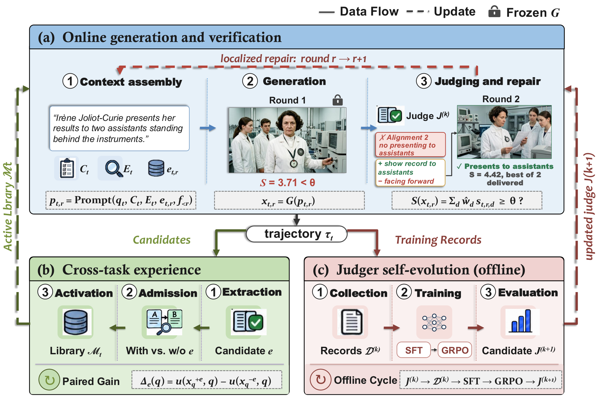

# ImageRSI: Verification-guided image repair, experience admission and judge training

<!-- source-sha256: 8bf2ee750308ca3ca85124eadf510b9a51de1b60643ef75558083808da9ab4e2 -->

[简体中文](README.md)

> **Reference entry only.** Full generation, API and training experiments not reproduced due to cost (review complete).

## Paper information

| Field | Details |
| --- | --- |
| Paper | [ImageRSI: Verification-Driven Recursive Self-Improvement for Agentic Image Generation](https://arxiv.org/abs/2610.32120v1); [reviewed full text](https://arxiv.org/html/2610.32120v1) |
| Affiliations | First author Shuo Han: USTC (first affiliation) and Alibaba Qwen Business Unit; collaborators include Xidian University. Use of a Gemini judge is not Google authorship. |
| First public release | 2026-10-23 03:42:21 UTC (announced 2026-10-26) |
| Author code | No verifiable author repository in the reviewed v1. No method source revision/license; paper and original figure CC BY-SA 4.0. |
| Local key | `image-rsi`; no adapter |
| Local code | No executable local implementation. |
| Local evidence | No local experiment, metrics or GPU receipt. |

## What the paper changes

Keep the original requirements fixed, generate an image, collect evidence on five criteria and repair specific defects. Extract experience as Trigger, Negative Trigger, Action, Effect and Side Effects; do not activate it directly. Compare with/without experience on the same request, input, generation settings and seed using a blinded independent evaluator, then test separately on a holdout. Train the judge offline between collection rounds, not within the same evaluation request or from external test verdicts.

### Original paper figure

Original figure from the reviewed paper, reused without redrawing. See [figure provenance](assets/provenance.json).

### Core formulation

For active dimensions use normalized weights $\hat w_d=w_da_d/\sum_j w_ja_j$ and $S(x)=\sum_d\hat w_ds_d$, with threshold 4.5 and hard vetoes. An inference adapter supplies a constant if the trained judge emits no confidence; this is not calibration. Paired experience value is $\Delta_e(q)=u(x_q^{+e},q)-u(x_q^{-e},q)$ under a separate evaluator $u$, not the in-loop score. Count both gains and regressions. Allow one initial image plus two repairs; returning the highest-scoring fallback is not acceptance. Use response-token SFT and GRPO on disjoint requests. Severe false accepts, hallucinations and omissions have low rewards that other dimensions cannot offset. Repeated full train/redeploy cycles remain proposed.

### Results reported by the authors

The paper reports Qwen-Image-2.0 MindBench CSA of 22.4% for direct generation and 48.2% for ImageRSI, and 65.66% on 431 ImageReq-Bench test requests. CSA requires all checklist items and treats generation/judgment failures as failures; it is not the mean five-dimensional score. Gemini 3.1 Pro evaluates externally. No production A/B or local result.

## Local reproduction and limits

No executable generator, semantic judge, repair, paired admission or judge post-training. No surrogate scorer, fake tests, metrics, GPU receipt or Evolve integration.

### Full experiment: not reproduced

The full setup uses Qwen-Image-2.0, Wan2.7-Image and Nano Banana Pro, MindBench 500 prompts, ImageReq 530 experience plus 431 test prompts, roughly 2,000 judge-training prompts, up to three generations per prompt and external Gemini 3.1 Pro evaluation plus SFT/GRPO. Total single-device cost is not reported; no weight/data download, trial or retry.

### Additional references

[Paper Figure 2](https://arxiv.org/html/2610.32120v1#S3.F2)
