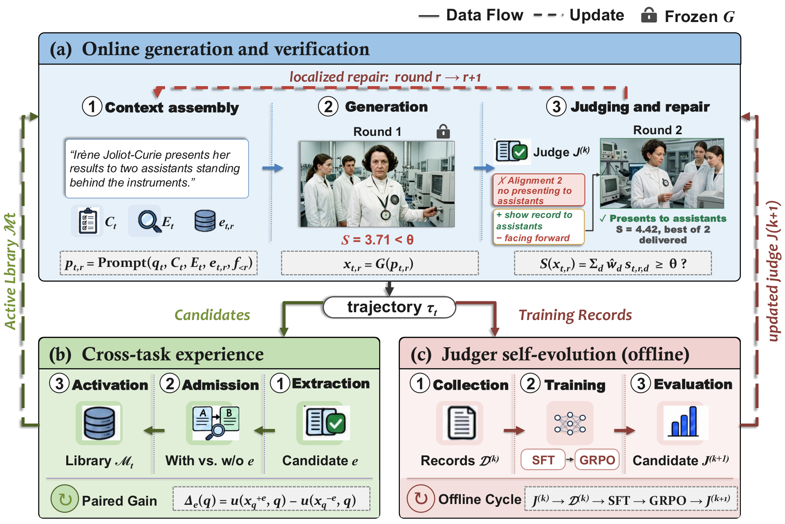

# ImageRSI：验证驱动的图像修复、经验复用与评审器升级

ImageRSI 保持原请求约束不变，用图像证据验证五个维度、指导针对性修复；跨任务经验必须经过同条件配对校准和 holdout，评审器再用轨迹记录离线训练升级。真实生成器和评审器是定义性组件，本页仅收录方法与成本，不以手工打分函数替代。

> **仅文献与成本收录**。完整实验：**成本过高，不复现（审查 DONE）**；不自动重试，不阻塞审查水位。无可执行 adapter、operator、训练命令、metrics 或 GPU receipt。

## 论文信息

| 字段 | 内容 |
|---|---|
| 论文 | [ImageRSI: Verification-Driven Recursive Self-Improvement for Agentic Image Generation](https://arxiv.org/abs/2610.32120v1) |
| 固定方法版本 | [arXiv v1 全文](https://arxiv.org/html/2610.32120v1) |
| 公司 / 作者机构 | 一作 **Shuo Han 的第一机构为 University of Science and Technology of China**，第二机构为 Qwen Business Unit of Alibaba；合作包括 Xidian University。未列 Google/Meta 作者机构，不因使用 Gemini 评审而归入 Google |
| 原始发布日期 | **2026-10-23 03:42:21 UTC**，arXiv v1；2026-10-26 公告 |
| 原作者代码 | **未找到**：固定 v1 摘要与全文未提供可核验作者实现仓库 |
| 固定 SHA / 源码许可 | 无已核验方法仓库，不适用；论文/原图许可 CC BY-SA 4.0 |
| 本地 Adapter / key | `image-rsi`，`adapter=null`；不接入 evolve 能力比较 |
| 本地复现代码位置 | **无**：仅方法审查与文档，不创建伪实现 |
| 本地验证 | 不适用：不跑模型，不生成 metrics 或 GPU receipt；`requires_gpu_validation=false`、`gpu_validation_passed=false` |

## 原始论文总结

### 背景与主要改动

图像生成器即使输出好看，也可能遗漏数量、空间关系、特定文字或身份约束。ImageRSI 固定原始 requirements，以真实生成器产图、五维评审器提供缺陷证据并指导修复，再经独立配对与 holdout 接纳跨任务经验、离线升级 judge，不能靠删掉要求提高分数。

经验抽取和经验复用分开：轨迹提议一个包含 Trigger、Negative Trigger、Action、Effect、Side Effects 的策略，不能直接激活。它先在相同请求、上游输入、生成配置和 seed 下有/无经验配对，由盲评器校准，再经过独立 holdout。评审器的 SFT/GRPO 离线更新发生在采集轮之间，不在同一评测请求中自改参数，也不能把外部 test verdict 反馈给生成器。

<!-- paper-figure:start -->
### 原论文关键图

图片来自[原论文](https://arxiv.org/html/2610.32120v1#S3.F2)，版权归原作者所有。固定 v1 原始 PNG 未重绘、未裁剪；许可 CC BY-SA 4.0，来源、SHA-256 与目视核验见 `assets/provenance.json`。
<!-- paper-figure:end -->

### 核心公式

对 active dimensions 做置信度加权，$\hat w_d=w_da_d/\sum_j w_ja_j$，$S(x)=\sum_d\hat w_ds_d$。接纳还须满足硬 veto，不能仅取平均高分。原文阈值为 4.5；训练后的 judge 不输出置信度时，由显式 inference adapter 给常数，不能声称其置信度经过校准。

经验的配对证据是 $\Delta_e(q)=u(x_q^{+e},q)-u(x_q^{-e},q)$。这里 $u$ 是独立 paired evaluator，不是同一个 in-loop $S$；改善与退化都须纳入，校准和 holdout 不能合并。最多初始生成加两次修复；未接纳时返回最高分图作为 fallback，**fallback 不等于 accepted**。

judge 先使用 response-token SFT，再用与 SFT 请求不相交的数据做 GRPO；严重 false accept、幻觉或遗漏处于不能靠其他维度抵消的低奖励带。连续收集-训练-再部署多个完整循环在原文中仍是拟议扩展，不能把单次训练阶段结果称为完整递归效果已证实。

### 论文离线与线上效果

原文 MindBench 的 Qwen-Image-2.0 直接生成 CSA 为 22.4%，ImageRSI 为 48.2%；ImageReq-Bench 431 条 test 请求的 CSA 为 65.66%。CSA 要求一题全部 checklist 通过，生成失败或评审错误算失败；不是五维分数的平均。外部评审为 Gemini 3.1 Pro，与内部 judge 分开。原文未报告生产线上 A/B，本地没有复现上述数字。

## 本地复现

只保存规范资料条目和原图，不提供可运行模型、打分代理、训练命令或伪单测。真实 generator、语义 judge、repair、paired admission 与 judge post-training 均未实现；`promotion_eligible=false`、`evolve_integrated=false`。

### 高成本完整实验

固定 v1 Sec.3/4.1 与 Appendix A/D 使用 Qwen-Image-2.0、Wan2.7-Image、Nano Banana Pro 等生成配置；MindBench 500 请求、ImageReq 530 experience + 431 test 请求；约 2,000 个 judge 训练请求；每题最多 3 次生成及检索/验证/修复，另有 Gemini 3.1 Pro 外部评测和 SFT/GRPO judge 训练。原文未给足以承诺单卡总时长的完整硬件成本，不编造 GPU 数或耗时。

相对单张 A100/A30 或 Mac 的可用预算，完整生成/API/训练矩阵为 **成本过高，不复现（审查 DONE）**；不下载权重或数据、不试跑昂贵配置、不自动进入待交付队列。这是审查终态，不是已实现能力。
