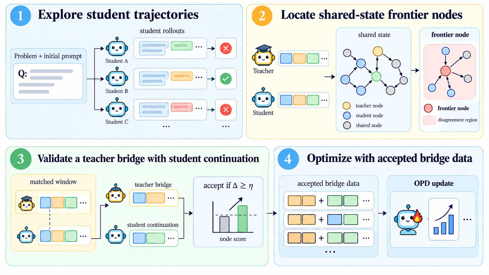

# Frontier-OPD: Trajectory-balanced frontier ranking and teacher bridge acceptance

<!-- source-sha256: 6f2ace5a3dd6594cb138b071583ec0d369a684936496168478a0850dc7b61f4b -->

[简体中文](README.md)

> **L1 numerical ranking and acceptance protocol; diagnostic only.** No full agent OPD run.

## Paper information

| Field | Details |
| --- | --- |
| Paper | [Frontier-OPD: Discovering the Edge of Agent Capability and Teaching Agents to Go Beyond](https://arxiv.org/abs/2610.32802v1); [reviewed full text](https://arxiv.org/html/2610.32802v1) |
| Affiliations | First author Zheng Jiang: Tsinghua University |
| First public release | 2026-10-23 15:40:44 UTC (announced 2026-10-26) |
| Author code | The paper links [jiangz20/FrontierOPD](https://github.com/jiangz20/FrontierOPD), but the repository and raw LICENSE were inaccessible on 2026-10-26. No public source, revision or license verified; paper CC BY-NC-ND 4.0. |
| Local key | `frontier-opd`; no adapter |
| Local code | `src/auto_research/agent_research/frontier_opd.py` |
| Local evidence | [Local mechanism metrics](metrics/component-cuda-seeds42-44.json); [A100 validation receipt](../../gpu-validations/frontier-opd-a100-20261026.json) |

## What the paper changes

Multiple histories can reach a shared observation. To prevent loops from dominating, average student–teacher disagreement first within each trajectory and then across trajectories. Select distinct states and a replayable original history for each. The teacher takes up to $K$ turns and the student continues for $H$. Compare bridge plus continuation against the same-length original window at that position; require valid replay, non-terminal handoff and complete continuation.

### Original paper figure



Original figure from the reviewed paper, reused without redrawing. See [figure provenance](assets/provenance.json).

### Core equations

$$
s(v)=\frac1{|I(v)|}\sum_{i\in I(v)}\frac1{|Q_i(v)|}\sum_{c\in Q_i(v)}d(c),\qquad
c^*(v)=\arg\max_{c\in\cup_iQ_i(v)}d(c).
$$

$$
\Delta=\operatorname{mean}_{c\in W^{new}}a(c)-\operatorname{mean}_{c\in W^{old}}a(c),\qquad
accept=V\land[\Delta\ge\eta].
$$

For each response, $g_j=\ell_j^S-\ell_j^T$; ranking uses the signed mean $d(c)$, whereas acceptance uses $a(c)=-\operatorname{mean}_j|g_j|$. Three visits scoring 10 from one trajectory and one scoring 0 from another yield 5, not 7.5. Threshold after aggregation; the budget is for states, and the representative is the maximum signed gap with chronological ties. Tied nodes use earliest eligible visit. Average tokens within responses and responses equally across windows. Use realized bridge length, not $K$, and accept ties at default margin zero. This does not show the continuation alone improved or the task succeeded.

### Results reported by the authors

Table 1, Qwen3-32B to Qwen3-4B: ALFWorld success goes from OPD $42.8\pm4.5$ to $49.5\pm1.9$; ScienceWorld from $8.2\pm0.9$ to $16.2\pm0.6$ (percent, three-seed sample SD). This is not a significance test or production A/B.

## Local reproduction and limits

`response_scores`, `select_frontier` and `accept_bridge` take external state/history keys, replay flags, valid actions, remaining turns and frozen sampled probabilities. Failed replay/handoff/continuation is rejected; padded NaN is ignored. CPU and A100 seeds 42/43/44 check trajectory weighting, signed versus absolute gaps, lengths, ties, thresholds and invalid windows. A separate trainer would preserve duplicates in $D^{stu}\uplus D^{bridge}$ and exclude the validating continuation; bridge responses get no extra reward-weighted loss, and `multi_turn_opd` ignores stored rewards. No actual environment, teacher, trainer, experience pool or Evolve integration.

```bash
PYTHONPATH=src python -c 'from auto_research.agent_research.frontier_opd import diagnostic; print(diagnostic(42))'
OMP_NUM_THREADS=1 MKL_NUM_THREADS=1 PYTHONPATH=src python -m pytest tests/post_training/test_oct26_post_agent_components.py -q
```

### Full experiment: not reproduced

The full matrix uses Qwen3-32B/8B-RL teachers, 1.7B/4B students, ALFWorld/WebShop/ScienceWorld, four rollouts per task, default $B=4,K=1,H=3$, 200 training steps, prompt/response limits 10,240/512, three seeds and held-out tests. Efficiency runs use four B300s; validation can add $B(K+H)$ generated turns per task even for rejected bridges. No model download, large trial or retry.

### Additional references

[Paper Figure 2](https://arxiv.org/html/2610.32802v1#S3.F2)
